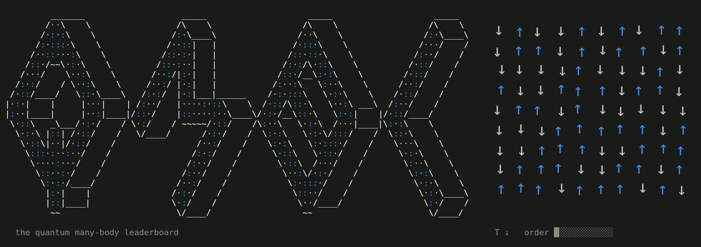

<!-- Header and footer animations are text-mode GIFs from scripts/ascii.mjs. -->

<!-- All badges via shields.io: Zenodo's own DOI badge returns 403. -->

**A live record of SOTA published ground-state energies for lattice Hamiltonians.**

Organised literature for fellow researchers and AI systems. So that we can see the works of the wider research community at one glance, build on each other's work more efficiently and advance frontier science together.

## Leaderboard

<!-- BEGIN LEADERBOARD (generated by scripts/readme_table.mjs - do not edit) -->

### All 665 Hamiltonian instances (click a model to expand)

<b>Heisenberg</b>: 104 instances, energies as <code>E/N (S.S)</code>

| instance | record | method | closest challenger |
|---|---|---|---|
| chain, 20 sites, open | **-0.4341237** | ED [run script](https://github.com/varbench/methods/blob/main/scripts/Heisenberg/chain_20_O/ed_netket.sh), [Wu et al. (2024)](https://doi.org/10.1126/science.adg9774) | -0.4341237 (+<1e-7) DMRG (truncation error ~1e-12) [run script](https://github.com/varbench/methods/blob/main/programs/dmrg_itensors_heisenberg/chain_20_O.jl), [Wu et al. (2024)](https://doi.org/10.1126/science.adg9774) |
| chain, 20 sites | **-0.4452193** | ED [run script](https://github.com/varbench/methods/blob/main/scripts/Heisenberg/chain_20_P/ed_netket.sh), [Wu et al. (2024)](https://doi.org/10.1126/science.adg9774) | -0.4452193 (+<1e-7) DMRG (truncation error ~1e-13) [run script](https://github.com/varbench/methods/blob/main/programs/dmrg_itensors_heisenberg/chain_20_P.jl), [Wu et al. (2024)](https://doi.org/10.1126/science.adg9774) |
| chain, 200 sites, open | **-0.4422078** | DMRG (truncation error ~1e-14) [run script](https://github.com/varbench/methods/blob/main/programs/dmrg_itensors_heisenberg/chain_200_O.jl), [Wu et al. (2024)](https://doi.org/10.1126/science.adg9774) | -0.4378396 (+4.4e-3) RBM (α = 1) [run script](https://github.com/varbench/methods/blob/main/scripts/Heisenberg/chain_200_O/vmc_rbm.sh), [Wu et al. (2024)](https://doi.org/10.1126/science.adg9774) |
| chain, 200 sites | **-0.4431678** | DMRG (truncation error ~2.8e-12) [run script](https://github.com/varbench/methods/blob/main/programs/dmrg_itensors_heisenberg/chain_200_P.jl), [Wu et al. (2024)](https://doi.org/10.1126/science.adg9774) | -0.4430967 (+7.1e-5) VMC (projected fermions + Jastrow) [run script](https://github.com/varbench/methods/blob/main/scripts/Heisenberg/chain_200_P/vmc_gutzwiller.sh), [Wu et al. (2024)](https://doi.org/10.1126/science.adg9774) |
| kagome-24, 24 sites | **-0.4412486** | ED [Läuchli et al. (2011)](https://doi.org/10.48550/arxiv.1103.1159) | none |
| kagome 2x2 (12 sites) | **-0.4537396** | ED [Läuchli et al. (2011)](https://doi.org/10.48550/arxiv.1103.1159) | none |
| kagome 2x3 (18 sites) | **-0.4471262** | ED [run script](https://github.com/varbench/methods/blob/main/scripts/Heisenberg/kagome-2x3_18_P/ed_netket.sh), [Wu et al. (2024)](https://doi.org/10.1126/science.adg9774) | -0.4471262 (+<1e-7) DMRG (bond dimension 368) [run script](https://github.com/varbench/methods/blob/main/scripts/Heisenberg/kagome-2x3_18_P/dmrg.sh), [Wu et al. (2024)](https://doi.org/10.1126/science.adg9774) |
| kagome-30, 30 sites | **-0.4384773** | ED [Läuchli et al. (2011)](https://doi.org/10.48550/arxiv.1103.1159) | none |
| kagome-36a, 36 sites | **-0.4385521** | ED [Läuchli et al. (2011)](https://doi.org/10.48550/arxiv.1103.1159) | none |
| kagome-36b, 36 sites | **-0.4390813** | ED [Läuchli et al. (2011)](https://doi.org/10.48550/arxiv.1103.1159) | none |
| kagome-36c, 36 sites | **-0.4392871** | ED [Läuchli et al. (2011)](https://doi.org/10.48550/arxiv.1103.1159) | none |
| kagome-36d, 36 sites | **-0.4383765** | ED [Läuchli et al. (2011)](https://doi.org/10.48550/arxiv.1103.1159) | none |
| kagome-42a, 42 sites | **-0.437999** | ED [Läuchli et al. (2011)](https://doi.org/10.48550/arxiv.1103.1159) | none |
| kagome-42b, 42 sites | **-0.4381426** | ED [Läuchli et al. (2011)](https://doi.org/10.48550/arxiv.1103.1159) | none |
| kagome 4x4 (48 sites) | **-0.4387039** | ED [Wietek & Läuchli (2018)](https://doi.org/10.1103/physreve.98.033309) | -0.4383000 (+4.0e-4) DMRG (extrapolated: truncation... [Depenbrock et al. (2012)](https://doi.org/10.48550/arxiv.1205.4858) |
| kagome 6x6 (108 sites) | **-0.4383(3)** | DMRG (extrapolated: truncation error → 0) [Depenbrock et al. (2012)](https://doi.org/10.48550/arxiv.1205.4858) | none |
| kagome 8x8 (192 sites) | **-0.42987(1)** | VMC (Dirac spin liquid + Jastrow) [run script](https://github.com/varbench/methods/blob/main/scripts/Heisenberg/kagome-8x8_192_P/vmc_gutzwiller.sh), [Wu et al. (2024)](https://doi.org/10.1126/science.adg9774) | -0.42868 (+1.2e-3) VMC (U(1) Dirac spin liquid, [0... [He et al. (2024)](https://doi.org/10.48550/arxiv.2407.20629) |
| pyrochlore 2x2x2 (32 sites) | **-0.5168588** | ED [QMBL check](https://github.com/quantum-many-body-leaderboard/quantum-many-body-leaderboard/tree/main/checks/pyrochlore-32-ed) | -0.5168000 &#9675; (+5.9e-5) DMRG (snake path; symmetric:... [Hagymási et al. (2020)](https://doi.org/10.48550/arxiv.2010.03563) |
| pyrochlore 2x2x2 (128 sites) | **-0.49434(5)** | mVMC (max.-flippable dimer initial state;... [Pohle et al. (2023)](https://doi.org/10.48550/arxiv.2311.11561) | -0.49280 (+1.5e-3) DMRG (snake path; symmetric:... [Hagymási et al. (2020)](https://doi.org/10.48550/arxiv.2010.03563) |
| pyrochlore 2x2x3 (48 sites) | **-0.5028(2)** | mVMC [Astrakhantsev et al. (2021)](https://doi.org/10.1103/physrevx.11.041021) | none |
| pyrochlore 2x2x4 (64 sites) | **-0.4924(2)** | mVMC [Astrakhantsev et al. (2021)](https://doi.org/10.1103/physrevx.11.041021) | -0.4908 (+1.6e-3) CNN [Astrakhantsev et al. (2021)](https://doi.org/10.1103/physrevx.11.041021) |
| pyrochlore 2x2x6 (96 sites) | **-0.4917(4)** | mVMC [Astrakhantsev et al. (2021)](https://doi.org/10.1103/physrevx.11.041021) | -0.4900 (+1.7e-3) CNN [Astrakhantsev et al. (2021)](https://doi.org/10.1103/physrevx.11.041021) |
| pyrochlore 2x4x6 (192 sites) | **-0.4915(2)** | mVMC [Astrakhantsev et al. (2021)](https://doi.org/10.1103/physrevx.11.041021) | none |
| pyrochlore 3x3x3 (108 sites) | **-0.4871(1)** | mVMC (projected: SU(2), unspecified) [Astrakhantsev et al. (2021)](https://doi.org/10.1103/physrevx.11.041021) | -0.4851 &#9675; (+2.0e-3) DMRG (bond dimension 16000) [Hagymási et al. (2020)](https://doi.org/10.48550/arxiv.2010.03563) |
| pyrochlore 3x3x3 (432 sites) | **-0.4924(2)** | mVMC (max.-flippable dimer initial state;... [Pohle et al. (2023)](https://doi.org/10.48550/arxiv.2311.11561) | -0.4923 (+1.0e-4) mVMC (random initial state;... [Pohle et al. (2023)](https://doi.org/10.48550/arxiv.2311.11561) |
| pyrochlore 4x4x4 (256 sites) | **-0.485584(3)** | VMC (generalized RVB) [Cheng & Li (2026)](https://doi.org/10.1103/dsr3-sjt6) | -0.483100 (+2.5e-3) mVMC (projected: SU(2)... [Astrakhantsev et al. (2021)](https://doi.org/10.1103/physrevx.11.041021) |
| pyrochlore 4x4x4 (1024 sites) | **-0.4921(2)** | mVMC (Lanczos steps; extrapolated: variance →... [Pohle et al. (2023)](https://doi.org/10.48550/arxiv.2311.11561) | -0.4880 (+4.1e-3) mVMC (1 Lanczos step; projected:... [Pohle et al. (2023)](https://doi.org/10.48550/arxiv.2311.11561) |
| rectangular 10x20, periodic/open | **-0.6599522(4)** exact (stochastic) | SSE QMC [Sandvik (2026)](https://doi.org/10.48550/arxiv.2601.20189) | none |
| rectangular 12x24, periodic/open | **-0.6612549(4)** exact (stochastic) | SSE QMC [Sandvik (2026)](https://doi.org/10.48550/arxiv.2601.20189) | none |
| rectangular 14x28, periodic/open | **-0.6622809(4)** exact (stochastic) | SSE QMC [Sandvik (2026)](https://doi.org/10.48550/arxiv.2601.20189) | none |
| rectangular 16x32, periodic/open | **-0.6630939(4)** exact (stochastic) | SSE QMC [Sandvik (2026)](https://doi.org/10.48550/arxiv.2601.20189) | none |
| rectangular 18x36, periodic/open | **-0.6637496(4)** exact (stochastic) | SSE QMC [Sandvik (2026)](https://doi.org/10.48550/arxiv.2601.20189) | none |
| rectangular 20x40, periodic/open | **-0.6642865(4)** exact (stochastic) | SSE QMC [Sandvik (2026)](https://doi.org/10.48550/arxiv.2601.20189) | none |
| rectangular 24x48, periodic/open | **-0.6651098(6)** exact (stochastic) | SSE QMC [Sandvik (2026)](https://doi.org/10.48550/arxiv.2601.20189) | none |
| rectangular 32x64, periodic/open | **-0.6661668(6)** exact (stochastic) | SSE QMC [Sandvik (2026)](https://doi.org/10.48550/arxiv.2601.20189) | none |
| rectangular 48x96, periodic/open | **-0.6672462(6)** exact (stochastic) | SSE QMC [Sandvik (2026)](https://doi.org/10.48550/arxiv.2601.20189) | none |
| rectangular 4x8, periodic/open | **-0.6623181(4)** exact (stochastic) | SSE QMC [Sandvik (2026)](https://doi.org/10.48550/arxiv.2601.20189) | none |
| rectangular 64x128, periodic/open | **-0.6677918(4)** exact (stochastic) | SSE QMC [Sandvik (2026)](https://doi.org/10.48550/arxiv.2601.20189) | none |
| rectangular 6x12, periodic/open | **-0.6570101(4)** exact (stochastic) | SSE QMC [Sandvik (2026)](https://doi.org/10.48550/arxiv.2601.20189) | none |
| rectangular 6x8 | **-0.6759867** | ED [Wietek & Läuchli (2018)](https://doi.org/10.1103/physreve.98.033309) | none |
| rectangular 8x16, periodic/open | **-0.6583592(4)** exact (stochastic) | SSE QMC [Sandvik (2026)](https://doi.org/10.48550/arxiv.2601.20189) | none |
| shuriken, 24 sites | **-0.4483291** | ED [Astrakhantsev et al. (2021)](https://doi.org/10.1103/physrevb.104.l220408) | none |
| shuriken, 96 sites | **-0.43826(1)** | mVMC (projected: SU(2), point group) [Wu et al. (2024)](https://doi.org/10.1126/science.adg9774) | none |
| shuriken, 216 sites | **-0.4376(1)** | mVMC (projected: SU(2), point group) [Wu et al. (2024)](https://doi.org/10.1126/science.adg9774) | none |
| shuriken, 384 sites | **-0.4371(1)** | mVMC (projected: SU(2), point group) [Wu et al. (2024)](https://doi.org/10.1126/science.adg9774) | none |
| square 4x4 | **-0.7017802** | ED [run script](https://github.com/varbench/methods/blob/main/scripts/Heisenberg/square_16_P/vqe.sh), [Wu et al. (2024)](https://doi.org/10.1126/science.adg9774) | -0.7017449 (+3.5e-5) VQE (exact gradients... [run script](https://github.com/varbench/methods/blob/main/scripts/Heisenberg/square_16_P/vqe.sh), [Wu et al. (2024)](https://doi.org/10.1126/science.adg9774) |
| square 6x6, open | **-0.6035218** | ED [run script](https://github.com/varbench/methods/blob/main/scripts/Heisenberg/square_36_O/ed_lattice_symmetries.sh), [Wu et al. (2024)](https://doi.org/10.1126/science.adg9774) | -0.6035218 &#9675; (+<1e-7) DMRG (bond dimension 4096) [Huang et al. (2016)](https://doi.org/10.48550/arxiv.1611.09574) |
| square 6x6 | **-0.6788721** | ED [run script](https://github.com/varbench/methods/blob/main/scripts/Heisenberg/square_36_P/ed_lattice_symmetries.sh), [Wu et al. (2024)](https://doi.org/10.1126/science.adg9774) | -0.6788710 (+1.1e-6) GVMC (ConvNeXt backflow + complex... [Hendry et al. (2025)](https://doi.org/10.48550/arxiv.2507.10287) |
| square, 40 sites | **-0.6773713** | ED [Richter & Schulenburg (2009)](https://doi.org/10.48550/arxiv.0909.3723) | none |
| square, 50 sites | **-0.675102** | ED [Wietek & Läuchli (2018)](https://doi.org/10.1103/physreve.98.033309) | none |
| square 8x8, open | **-0.6190371(2)** exact (stochastic) | SSE QMC [Sandvik (2026)](https://doi.org/10.48550/arxiv.2601.20189) | -0.6190345 (+2.7e-6) 2D RNN (tensorized GRU) [Moss et al. (2025)](https://doi.org/10.48550/arxiv.2502.17144) |
| square 8x8 | **-0.67349005(2)** exact (stochastic) | SSE QMC [Sandvik (2026)](https://doi.org/10.48550/arxiv.2601.20189) | -0.67348200 (+8.0e-6) RBM (symmetric: spin parity... [Chen et al. (2022)](https://doi.org/10.48550/arxiv.2206.14307) |
| square 10x10, open | **-0.6286561(2)** exact (stochastic) | SSE QMC [Sandvik (2026)](https://doi.org/10.48550/arxiv.2601.20189) | -0.6286560 (+1.2e-7) 2D RNN (tensorized GRU) [Moss et al. (2025)](https://doi.org/10.48550/arxiv.2502.17144) |
| square 10x10 | **-0.67155266(2)** exact (stochastic) | SSE QMC [Sandvik (2026)](https://doi.org/10.48550/arxiv.2601.20189) | -0.67155260 (+6.0e-8) ResNet (64 conv layers, 16... [Chen & Heyl (2023)](https://doi.org/10.48550/arxiv.2302.01941) |
| square 12x12, open | **-0.6352007(2)** exact (stochastic) | SSE QMC [Sandvik (2026)](https://doi.org/10.48550/arxiv.2601.20189) | -0.6352006 (+1.3e-7) 2D RNN (tensorized GRU) [Moss et al. (2025)](https://doi.org/10.48550/arxiv.2502.17144) |
| square 12x12 | **-0.67068192(2)** exact (stochastic) | SSE QMC [Sandvik (2026)](https://doi.org/10.48550/arxiv.2601.20189) | -0.67061864 (+6.3e-5) 2D RNN [Moss et al. (2025)](https://doi.org/10.48550/arxiv.2502.17144) |
| square 14x14, open | **-0.6399410(2)** exact (stochastic) | SSE QMC [Sandvik (2026)](https://doi.org/10.48550/arxiv.2601.20189) | -0.6399286 (+1.2e-5) 2D RNN (tensorized GRU) [Moss et al. (2025)](https://doi.org/10.48550/arxiv.2502.17144) |
| square 14x14 | **-0.67023225(2)** exact (stochastic) | SSE QMC [Sandvik (2026)](https://doi.org/10.48550/arxiv.2601.20189) | -0.67013830 (+9.4e-5) 2D RNN [Moss et al. (2025)](https://doi.org/10.48550/arxiv.2502.17144) |
| square 16x16, open | **-0.6435317(2)** exact (stochastic) | SSE QMC [Sandvik (2026)](https://doi.org/10.48550/arxiv.2601.20189) | -0.6435218 (+9.8e-6) 2D RNN (tensorized GRU) [Moss et al. (2025)](https://doi.org/10.48550/arxiv.2502.17144) |
| square 16x16 | **-0.66997660(2)** exact (stochastic) | SSE QMC [Sandvik (2026)](https://doi.org/10.48550/arxiv.2601.20189) | -0.66986638 (+1.1e-4) 2D RNN [Moss et al. (2025)](https://doi.org/10.48550/arxiv.2502.17144) |
| square 18x18, open | **-0.6463451(4)** exact (stochastic) | SSE QMC [Sandvik (2026)](https://doi.org/10.48550/arxiv.2601.20189) | -0.6463365 (+8.6e-6) 2D RNN (tensorized GRU) [Moss et al. (2025)](https://doi.org/10.48550/arxiv.2502.17144) |
| square 18x18 | **-0.66982043(2)** exact (stochastic) | SSE QMC [Sandvik (2026)](https://doi.org/10.48550/arxiv.2601.20189) | -0.66968155 (+1.4e-4) 2D RNN [Moss et al. (2025)](https://doi.org/10.48550/arxiv.2502.17144) |
| square 20x20, open | **-0.6486091(4)** exact (stochastic) | SSE QMC [Sandvik (2026)](https://doi.org/10.48550/arxiv.2601.20189) | -0.6485899 (+1.9e-5) 2D RNN (tensorized GRU) [Moss et al. (2025)](https://doi.org/10.48550/arxiv.2502.17144) |
| square 20x20 | **-0.66971967(2)** exact (stochastic) | SSE QMC [Sandvik (2026)](https://doi.org/10.48550/arxiv.2601.20189) | -0.66959053 (+1.3e-4) 2D RNN [Moss et al. (2025)](https://doi.org/10.48550/arxiv.2502.17144) |
| square 22x22, open | **-0.6504689(4)** exact (stochastic) | SSE QMC [Sandvik (2026)](https://doi.org/10.48550/arxiv.2601.20189) | none |
| square 22x22 | **-0.66965176(2)** exact (stochastic) | SSE QMC [Sandvik (2026)](https://doi.org/10.48550/arxiv.2601.20189) | none |
| square 24x24, open | **-0.6520251(4)** exact (stochastic) | SSE QMC [Sandvik (2026)](https://doi.org/10.48550/arxiv.2601.20189) | -0.6519824 (+4.3e-5) 2D RNN (tensorized GRU) [Moss et al. (2025)](https://doi.org/10.48550/arxiv.2502.17144) |
| square 24x24 | **-0.66960434(2)** exact (stochastic) | SSE QMC [Sandvik (2026)](https://doi.org/10.48550/arxiv.2601.20189) | -0.66943804 (+1.7e-4) 2D RNN [Moss et al. (2025)](https://doi.org/10.48550/arxiv.2502.17144) |
| square 26x26, open | **-0.6533456(4)** exact (stochastic) | SSE QMC [Sandvik (2026)](https://doi.org/10.48550/arxiv.2601.20189) | none |
| square 26x26 | **-0.66957017(3)** exact (stochastic) | SSE QMC [Sandvik (2026)](https://doi.org/10.48550/arxiv.2601.20189) | none |
| square 28x28, open | **-0.6544806(4)** exact (stochastic) | SSE QMC [Sandvik (2026)](https://doi.org/10.48550/arxiv.2601.20189) | none |
| square 28x28 | **-0.66954496(3)** exact (stochastic) | SSE QMC [Sandvik (2026)](https://doi.org/10.48550/arxiv.2601.20189) | -0.66937341 (+1.7e-4) 2D RNN [Moss et al. (2025)](https://doi.org/10.48550/arxiv.2502.17144) |
| square 30x30 | **-0.66952595(3)** exact (stochastic) | SSE QMC [Sandvik (2026)](https://doi.org/10.48550/arxiv.2601.20189) | none |
| square 32x32, open | **-0.6563289(4)** exact (stochastic) | SSE QMC [Sandvik (2026)](https://doi.org/10.48550/arxiv.2601.20189) | none |
| square 32x32 | **-0.66951133(3)** exact (stochastic) | SSE QMC [Sandvik (2026)](https://doi.org/10.48550/arxiv.2601.20189) | -0.66929567 (+2.2e-4) 2D RNN [Moss et al. (2025)](https://doi.org/10.48550/arxiv.2502.17144) |
| square 36x36 | **-0.66949091(3)** exact (stochastic) | SSE QMC [Sandvik (2026)](https://doi.org/10.48550/arxiv.2601.20189) | none |
| square 40x40 | **-0.66947776(3)** exact (stochastic) | SSE QMC [Sandvik (2026)](https://doi.org/10.48550/arxiv.2601.20189) | none |
| square 44x44 | **-0.66946889(3)** exact (stochastic) | SSE QMC [Sandvik (2026)](https://doi.org/10.48550/arxiv.2601.20189) | none |
| square 48x48, open | **-0.6606690(4)** exact (stochastic) | SSE QMC [Sandvik (2026)](https://doi.org/10.48550/arxiv.2601.20189) | none |
| square 48x48 | **-0.66946274(3)** exact (stochastic) | SSE QMC [Sandvik (2026)](https://doi.org/10.48550/arxiv.2601.20189) | none |
| square 52x52 | **-0.66945833(3)** exact (stochastic) | SSE QMC [Sandvik (2026)](https://doi.org/10.48550/arxiv.2601.20189) | none |
| square 56x56 | **-0.66945502(3)** exact (stochastic) | SSE QMC [Sandvik (2026)](https://doi.org/10.48550/arxiv.2601.20189) | none |
| square 60x60 | **-0.66945260(3)** exact (stochastic) | SSE QMC [Sandvik (2026)](https://doi.org/10.48550/arxiv.2601.20189) | none |
| square 64x64, open | **-0.6628515(4)** exact (stochastic) | SSE QMC [Sandvik (2026)](https://doi.org/10.48550/arxiv.2601.20189) | none |
| square 64x64 | **-0.66945072(3)** exact (stochastic) | SSE QMC [Sandvik (2026)](https://doi.org/10.48550/arxiv.2601.20189) | none |
| square 72x72 | **-0.66944815(3)** exact (stochastic) | SSE QMC [Sandvik (2026)](https://doi.org/10.48550/arxiv.2601.20189) | none |
| square 80x80 | **-0.66944645(3)** exact (stochastic) | SSE QMC [Sandvik (2026)](https://doi.org/10.48550/arxiv.2601.20189) | none |
| square 88x88 | **-0.66944530(3)** exact (stochastic) | SSE QMC [Sandvik (2026)](https://doi.org/10.48550/arxiv.2601.20189) | none |
| square 96x96, open | **-0.6650415(2)** exact (stochastic) | SSE QMC [Sandvik (2026)](https://doi.org/10.48550/arxiv.2601.20189) | none |
| square 96x96 | **-0.66944454(3)** exact (stochastic) | SSE QMC [Sandvik (2026)](https://doi.org/10.48550/arxiv.2601.20189) | none |
| square 128x128, open | **-0.6661389(2)** exact (stochastic) | SSE QMC [Sandvik (2026)](https://doi.org/10.48550/arxiv.2601.20189) | none |
| triangular 4x4 | **-0.5347197** | ED [run script](https://github.com/varbench/methods/blob/main/scripts/Heisenberg/triangular_16_P/ed_netket.sh), [Wu et al. (2024)](https://doi.org/10.1126/science.adg9774) | -0.5340324 (+6.9e-4) VQE (SR; symmetric: unspecified) [Wu et al. (2024)](https://doi.org/10.1126/science.adg9774) |
| triangular 6x6 | **-0.5603734** | ED [run script](https://github.com/varbench/methods/blob/main/scripts/Heisenberg/triangular_36_P/ed_lattice_symmetries.sh), [Wu et al. (2024)](https://doi.org/10.1126/science.adg9774) | -0.5603130 (+6.0e-5) GCNN (deep; projected:... [Roth et al. (2022)](https://doi.org/10.48550/arxiv.2211.07749) |
| triangular, 48 sites | **-0.558603** | ED [Wietek & Läuchli (2018)](https://doi.org/10.1103/physreve.98.033309) | none |
| triangular 10x10, open | **-0.5147668** | DMRG (bond dimension 4096) [run script](https://github.com/varbench/methods/blob/main/scripts/Heisenberg/triangular_100_O/dmrg.sh), [Wu et al. (2024)](https://doi.org/10.1126/science.adg9774) | -0.5138630 (+9.0e-4) Tensor-RNN (bond dimension 40) [Wu et al. (2023)](https://doi.org/10.1103/physrevresearch.5.l032001) |
| triangular, 108 sites | **-0.55315(3)** | GCNN [Roth et al. (2022)](https://doi.org/10.48550/arxiv.2211.07749) | -0.55190 (+1.2e-3) GNN (separate network per output... [Kochkov et al. (2021)](https://doi.org/10.48550/arxiv.2110.06390) |
| triangular 12x12, open | **-0.5150648** | DMRG (bond dimension 3000) [run script](https://github.com/varbench/methods/blob/main/programs/dmrg_itensor_cpp/dmrg_triangular_heisenberg_12x12.cc), [Wu et al. (2024)](https://doi.org/10.1126/science.adg9774) | -0.5119722 (+3.1e-3) 2D RNN (gated) [Wu et al. (2024)](https://doi.org/10.1126/science.adg9774) |
| triangular 12x12 | **-0.5493(1)** | 2D RNN (iterative retraining, s = 4.0, r =... [Moss et al. (2025)](https://doi.org/10.48550/arxiv.2505.20406) | -0.5470 (+2.3e-3) EPS (16-site plaquettes) [Mezzacapo & Cirac (2010)](https://doi.org/10.48550/arXiv.1006.4480) |
| triangular 14x14, open | **-0.5138(1)** | 2D RNN (gated) [Wu et al. (2024)](https://doi.org/10.1126/science.adg9774) | -0.5108 (+3.0e-3) DMRG (bond dimension 2000) [run script](https://github.com/varbench/methods/blob/main/programs/dmrg_itensor_cpp/dmrg_triangular_heisenberg_14x14.cc), [Wu et al. (2024)](https://doi.org/10.1126/science.adg9774) |
| triangular 16x16, open | **-0.51668(9)** | 2D RNN (gated) [Wu et al. (2024)](https://doi.org/10.1126/science.adg9774) | -0.50797 (+8.7e-3) DMRG (bond dimension 2000) [run script](https://github.com/varbench/methods/blob/main/programs/dmrg_itensor_cpp/dmrg_triangular_heisenberg_16x16.cc), [Wu et al. (2024)](https://doi.org/10.1126/science.adg9774) |
| triangular 18x18 | **-0.55200(1)** | ViT (spatial attention, b = 3; extrapolated:... [Viteritti et al. (2026)](https://doi.org/10.48550/arxiv.2602.02665) | -0.55170 (+3.0e-4) ViT (spatial attention, b = 3;... [Viteritti et al. (2026)](https://doi.org/10.48550/arxiv.2602.02665) |
| triangular 24x24 | **-0.55189(1)** | ViT (spatial attention, b = 3; extrapolated:... [Viteritti et al. (2026)](https://doi.org/10.48550/arxiv.2602.02665) | -0.55160 (+2.9e-4) ViT (spatial attention, b = 3;... [Viteritti et al. (2026)](https://doi.org/10.48550/arxiv.2602.02665) |
| triangular 30x30 | **-0.55180(1)** | ViT (spatial attention, b = 3; extrapolated:... [Viteritti et al. (2026)](https://doi.org/10.48550/arxiv.2602.02665) | -0.55153 (+2.7e-4) ViT (spatial attention, b = 3;... [Viteritti et al. (2026)](https://doi.org/10.48550/arxiv.2602.02665) |
| triangular 42x42 | **-0.55171(1)** | ViT (spatial attention, b = 3; extrapolated:... [Viteritti et al. (2026)](https://doi.org/10.48550/arxiv.2602.02665) | -0.55143 (+2.8e-4) ViT (spatial attention, b = 3;... [Viteritti et al. (2026)](https://doi.org/10.48550/arxiv.2602.02665) |

<b>J1-J2</b>: 112 instances, energies as <code>E/N (S.S)</code>

| instance | record | method | closest challenger |
|---|---|---|---|
| rectangular 4x6, J2 = 0.5 | **-0.5225249** | ED [run script](https://github.com/varbench/methods/blob/main/scripts/J1J2/rectangular-4x6_24_P_0.5/ed_lattice_symmetries.sh), [Wu et al. (2024)](https://doi.org/10.1126/science.adg9774) | -0.5225249 (+<1e-7) DMRG (bond dimension 4096) [run script](https://github.com/varbench/methods/blob/main/scripts/J1J2/rectangular-4x6_24_P_0.5/dmrg.sh), [Wu et al. (2024)](https://doi.org/10.1126/science.adg9774) |
| square 4x4, J2 = 0.05 | **-0.68059** | ED [run script](https://github.com/varbench/methods/blob/main/scripts/J1J2/square_16_P_0.05/ed_netket.sh), [Wu et al. (2024)](https://doi.org/10.1126/science.adg9774) | -0.68057 (+2.4e-5) VQE (exact gradients... [run script](https://github.com/varbench/methods/blob/main/scripts/J1J2/square_16_P_0.05/vqe.sh), [Wu et al. (2024)](https://doi.org/10.1126/science.adg9774) |
| square 4x4, J2 = 0.1 | **-0.6598172** | ED [run script](https://github.com/varbench/methods/blob/main/scripts/J1J2/square_16_P_0.1/ed_netket.sh), [Wu et al. (2024)](https://doi.org/10.1126/science.adg9774) | -0.6597832 (+3.4e-5) VQE (exact gradients... [run script](https://github.com/varbench/methods/blob/main/scripts/J1J2/square_16_P_0.1/vqe.sh), [Wu et al. (2024)](https://doi.org/10.1126/science.adg9774) |
| square 4x4, J2 = 0.15 | **-0.6395429** | ED [run script](https://github.com/varbench/methods/blob/main/scripts/J1J2/square_16_P_0.15/ed_netket.sh), [Wu et al. (2024)](https://doi.org/10.1126/science.adg9774) | -0.6395107 (+3.2e-5) VQE (2^14 samples per gradient;... [run script](https://github.com/varbench/methods/blob/main/scripts/J1J2/square_16_P_0.15/vqe_noisy.sh), [Wu et al. (2024)](https://doi.org/10.1126/science.adg9774) |
| square 4x4, J2 = 0.2 | **-0.6198739** | ED [run script](https://github.com/varbench/methods/blob/main/scripts/J1J2/square_16_P_0.2/ed_netket.sh), [Wu et al. (2024)](https://doi.org/10.1126/science.adg9774) | -0.6198639 (+1.0e-5) VQE (exact gradients... [run script](https://github.com/varbench/methods/blob/main/scripts/J1J2/square_16_P_0.2/vqe.sh), [Wu et al. (2024)](https://doi.org/10.1126/science.adg9774) |
| square 4x4, J2 = 0.25 | **-0.6009545** | ED [run script](https://github.com/varbench/methods/blob/main/scripts/J1J2/square_16_P_0.25/ed_netket.sh), [Wu et al. (2024)](https://doi.org/10.1126/science.adg9774) | -0.6009332 (+2.1e-5) VQE (exact gradients... [run script](https://github.com/varbench/methods/blob/main/scripts/J1J2/square_16_P_0.25/vqe.sh), [Wu et al. (2024)](https://doi.org/10.1126/science.adg9774) |
| square 4x4, J2 = 0.3 | **-0.5829838** | ED [run script](https://github.com/varbench/methods/blob/main/scripts/J1J2/square_16_P_0.3/ed_netket.sh), [Wu et al. (2024)](https://doi.org/10.1126/science.adg9774) | -0.5829522 (+3.2e-5) VQE (2^14 samples per gradient;... [run script](https://github.com/varbench/methods/blob/main/scripts/J1J2/square_16_P_0.3/vqe_noisy.sh), [Wu et al. (2024)](https://doi.org/10.1126/science.adg9774) |
| square 4x4, J2 = 0.35 | **-0.5662448** | ED [run script](https://github.com/varbench/methods/blob/main/scripts/J1J2/square_16_P_0.35/ed_netket.sh), [Wu et al. (2024)](https://doi.org/10.1126/science.adg9774) | -0.5662285 (+1.6e-5) VQE (exact gradients... [run script](https://github.com/varbench/methods/blob/main/scripts/J1J2/square_16_P_0.35/vqe.sh), [Wu et al. (2024)](https://doi.org/10.1126/science.adg9774) |
| square 4x4, J2 = 0.4 | **-0.5511478** | ED [run script](https://github.com/varbench/methods/blob/main/scripts/J1J2/square_16_P_0.4/ed_netket.sh), [Wu et al. (2024)](https://doi.org/10.1126/science.adg9774) | -0.5511135 (+3.4e-5) VQE (2^14 samples per gradient;... [run script](https://github.com/varbench/methods/blob/main/scripts/J1J2/square_16_P_0.4/vqe_noisy.sh), [Wu et al. (2024)](https://doi.org/10.1126/science.adg9774) |
| square 4x4, J2 = 0.45 | **-0.5382998** | ED [run script](https://github.com/varbench/methods/blob/main/scripts/J1J2/square_16_P_0.45/ed_netket.sh), [Wu et al. (2024)](https://doi.org/10.1126/science.adg9774) | -0.5382766 (+2.3e-5) VQE (exact gradients... [run script](https://github.com/varbench/methods/blob/main/scripts/J1J2/square_16_P_0.45/vqe.sh), [Wu et al. (2024)](https://doi.org/10.1126/science.adg9774) |
| square 4x4, J2 = 0.5 | **-0.5286202** | ED [run script](https://github.com/varbench/methods/blob/main/scripts/J1J2/square_16_P_0.5/ed_netket.sh), [Wu et al. (2024)](https://doi.org/10.1126/science.adg9774) | -0.5286173 (+2.9e-6) VQE (exact gradients... [run script](https://github.com/varbench/methods/blob/main/scripts/J1J2/square_16_P_0.5/vqe.sh), [Wu et al. (2024)](https://doi.org/10.1126/science.adg9774) |
| square 4x4, J2 = 0.6 | **-0.5258958** | ED [run script](https://github.com/varbench/methods/blob/main/scripts/J1J2/square_16_P_0.6/ed_netket.sh), [Wu et al. (2024)](https://doi.org/10.1126/science.adg9774) | -0.5258158 (+8.0e-5) VQE (exact gradients... [run script](https://github.com/varbench/methods/blob/main/scripts/J1J2/square_16_P_0.6/vqe.sh), [Wu et al. (2024)](https://doi.org/10.1126/science.adg9774) |
| square 4x4, J2 = 0.65 | **-0.5393825** | ED [run script](https://github.com/varbench/methods/blob/main/scripts/J1J2/square_16_P_0.65/ed_netket.sh), [Wu et al. (2024)](https://doi.org/10.1126/science.adg9774) | -0.5393444 (+3.8e-5) VQE (exact gradients... [run script](https://github.com/varbench/methods/blob/main/scripts/J1J2/square_16_P_0.65/vqe.sh), [Wu et al. (2024)](https://doi.org/10.1126/science.adg9774) |
| square 4x4, J2 = 0.7 | **-0.5638581** | ED [run script](https://github.com/varbench/methods/blob/main/scripts/J1J2/square_16_P_0.7/ed_netket.sh), [Wu et al. (2024)](https://doi.org/10.1126/science.adg9774) | -0.5637716 (+8.7e-5) VQE (2^14 samples per gradient;... [run script](https://github.com/varbench/methods/blob/main/scripts/J1J2/square_16_P_0.7/vqe_noisy.sh), [Wu et al. (2024)](https://doi.org/10.1126/science.adg9774) |
| square 4x4, J2 = 0.75 | **-0.5942731** | ED [run script](https://github.com/varbench/methods/blob/main/scripts/J1J2/square_16_P_0.75/ed_netket.sh), [Wu et al. (2024)](https://doi.org/10.1126/science.adg9774) | -0.5942152 (+5.8e-5) VQE (exact gradients... [run script](https://github.com/varbench/methods/blob/main/scripts/J1J2/square_16_P_0.75/vqe.sh), [Wu et al. (2024)](https://doi.org/10.1126/science.adg9774) |
| square 4x4, J2 = 0.8 | **-0.6273351** | ED [run script](https://github.com/varbench/methods/blob/main/scripts/J1J2/square_16_P_0.8/ed_netket.sh), [Wu et al. (2024)](https://doi.org/10.1126/science.adg9774) | -0.6273137 (+2.1e-5) VQE (exact gradients... [run script](https://github.com/varbench/methods/blob/main/scripts/J1J2/square_16_P_0.8/vqe.sh), [Wu et al. (2024)](https://doi.org/10.1126/science.adg9774) |
| square 4x4, J2 = 0.85 | **-0.6617197** | ED [run script](https://github.com/varbench/methods/blob/main/scripts/J1J2/square_16_P_0.85/ed_netket.sh), [Wu et al. (2024)](https://doi.org/10.1126/science.adg9774) | -0.6617069 (+1.3e-5) VQE (exact gradients... [run script](https://github.com/varbench/methods/blob/main/scripts/J1J2/square_16_P_0.85/vqe.sh), [Wu et al. (2024)](https://doi.org/10.1126/science.adg9774) |
| square 4x4, J2 = 0.9 | **-0.6968656** | ED [run script](https://github.com/varbench/methods/blob/main/scripts/J1J2/square_16_P_0.9/ed_netket.sh), [Wu et al. (2024)](https://doi.org/10.1126/science.adg9774) | -0.6967967 (+6.9e-5) VQE (exact gradients... [run script](https://github.com/varbench/methods/blob/main/scripts/J1J2/square_16_P_0.9/vqe.sh), [Wu et al. (2024)](https://doi.org/10.1126/science.adg9774) |
| square 4x4, J2 = 0.95 | **-0.7324989** | ED [run script](https://github.com/varbench/methods/blob/main/scripts/J1J2/square_16_P_0.95/ed_netket.sh), [Wu et al. (2024)](https://doi.org/10.1126/science.adg9774) | -0.7324804 (+1.8e-5) VQE (exact gradients... [run script](https://github.com/varbench/methods/blob/main/scripts/J1J2/square_16_P_0.95/vqe.sh), [Wu et al. (2024)](https://doi.org/10.1126/science.adg9774) |
| square 4x4, J2 = 1 | **-0.7684681** | ED [run script](https://github.com/varbench/methods/blob/main/scripts/J1J2/square_16_P_1.0/ed_netket.sh), [Wu et al. (2024)](https://doi.org/10.1126/science.adg9774) | -0.7684501 (+1.8e-5) VQE (exact gradients... [run script](https://github.com/varbench/methods/blob/main/scripts/J1J2/square_16_P_1.0/vqe.sh), [Wu et al. (2024)](https://doi.org/10.1126/science.adg9774) |
| square 6x6, J2 = 0.1 | **-0.638096** | ED [Schulz et al. (1996)](https://arxiv.org/abs/cond-mat/9402061) | -0.638078 &#9675; (+1.8e-5) ViT [Golubev et al. (2026)](https://doi.org/10.48550/arxiv.2606.04558) |
| square 6x6, J2 = 0.2 | **-0.5990463** | ED [Schulz et al. (1996)](https://arxiv.org/abs/cond-mat/9402061) | -0.5990440 &#9675; (+2.3e-6) ViT [Golubev et al. (2026)](https://doi.org/10.48550/arxiv.2606.04558) |
| square 6x6, J2 = 0.3 | **-0.5624595** | ED [run script](https://github.com/varbench/methods/blob/main/scripts/J1J2/square_36_P_0.3/ed_lattice_symmetries.sh), [Wu et al. (2024)](https://doi.org/10.1126/science.adg9774) | -0.5624530 &#9675; (+6.5e-6) ViT [Golubev et al. (2026)](https://doi.org/10.48550/arxiv.2606.04558) |
| square 6x6, J2 = 0.4 | **-0.529745** | ED [run script](https://github.com/varbench/methods/blob/main/scripts/J1J2/square_36_P_0.4/ed_lattice_symmetries.sh), [Wu et al. (2024)](https://doi.org/10.1126/science.adg9774) | -0.529744 &#9675; (+1.0e-6) DMRG (bond dimension 8192... [Gong et al. (2013)](https://doi.org/10.48550/arxiv.1311.5962) |
| square 6x6, J2 = 0.45 | **-0.5156574** | ED [QMBL check](https://github.com/quantum-many-body-leaderboard/quantum-many-body-leaderboard/tree/main/checks/exact-recompute-2026-09) | -0.5156550 &#9675; (+2.4e-6) DMRG (bond dimension 8192... [Gong et al. (2013)](https://doi.org/10.48550/arxiv.1311.5962) |
| square 6x6, J2 = 0.5 | **-0.5038097** | ED [run script](https://github.com/varbench/methods/blob/main/scripts/J1J2/square_36_P_0.5/ed_lattice_symmetries.sh), [Wu et al. (2024)](https://doi.org/10.1126/science.adg9774) | -0.5038080 (+1.7e-6) DMRG (symmetric: SU(2);... [Gong et al. (2013)](https://doi.org/10.48550/arxiv.1311.5962) |
| square 6x6, J2 = 0.55 | **-0.4951777** | ED [Schulz et al. (1996)](https://arxiv.org/abs/cond-mat/9402061) | -0.4951670 &#9675; (+1.1e-5) DMRG (bond dimension 8192... [Gong et al. (2013)](https://doi.org/10.48550/arxiv.1311.5962) |
| square 6x6, J2 = 0.6 | **-0.4932386** | ED [run script](https://github.com/varbench/methods/blob/main/scripts/J1J2/square_36_P_0.6/ed_lattice_symmetries.sh), [Wu et al. (2024)](https://doi.org/10.1126/science.adg9774) | -0.4931800 (+5.9e-5) RBM (2 Lanczos steps; symmetric:... [Chen et al. (2022)](https://doi.org/10.48550/arxiv.2206.14307) |
| square 6x6, J2 = 0.65 | **-0.5065879** | ED [Schulz et al. (1996)](https://arxiv.org/abs/cond-mat/9402061) | -0.5062990 &#9675; (+2.9e-4) ViT [Golubev et al. (2026)](https://doi.org/10.48550/arxiv.2606.04558) |
| square 6x6, J2 = 0.7 | **-0.5300012** | ED [Schulz et al. (1996)](https://doi.org/10.1051/jp1:1996236) | -0.5299243 (+7.7e-5) DMRG (bond dimension 2048) [run script](https://github.com/varbench/methods/blob/main/scripts/J1J2/square_36_P_0.7/dmrg.sh), [Wu et al. (2024)](https://doi.org/10.1126/science.adg9774) |
| square 6x6, J2 = 0.8 | **-0.5864866** | ED [Schulz et al. (1996)](https://doi.org/10.1051/jp1:1996236) | -0.5864110 (+7.6e-5) RBM (symmetric: spin parity... [Chen et al. (2022)](https://doi.org/10.48550/arxiv.2206.14307) |
| square 6x6, J2 = 0.9 | **-0.649052** | ED [Schulz et al. (1996)](https://doi.org/10.1051/jp1:1996236) | -0.647870 (+1.2e-3) DMRG (bond dimension 2048) [run script](https://github.com/varbench/methods/blob/main/scripts/J1J2/square_36_P_0.9/dmrg.sh), [Wu et al. (2024)](https://doi.org/10.1126/science.adg9774) |
| square 6x6, J2 = 1 | **-0.7143604** | ED [Schulz et al. (1996)](https://doi.org/10.1051/jp1:1996236) | -0.7142900 (+7.0e-5) RBM (symmetric: spin parity... [Chen et al. (2022)](https://doi.org/10.48550/arxiv.2206.14307) |
| square, 40 sites, J2 = 0.1 | **-0.6366151** | ED [Richter & Schulenburg (2009)](https://doi.org/10.48550/arxiv.0909.3723) | none |
| square, 40 sites, J2 = 0.2 | **-0.5975117** | ED [Richter & Schulenburg (2009)](https://doi.org/10.48550/arxiv.0909.3723) | none |
| square, 40 sites, J2 = 0.3 | **-0.5606822** | ED [Richter & Schulenburg (2009)](https://doi.org/10.48550/arxiv.0909.3723) | none |
| square, 40 sites, J2 = 0.4 | **-0.5272092** | ED [Richter & Schulenburg (2009)](https://doi.org/10.48550/arxiv.0909.3723) | none |
| square, 40 sites, J2 = 0.5 | **-0.4990762** | ED [Richter & Schulenburg (2009)](https://doi.org/10.48550/arxiv.0909.3723) | none |
| square, 40 sites, J2 = 0.55 | **-0.4879479** | ED [Richter & Schulenburg (2009)](https://doi.org/10.48550/arxiv.0909.3723) | none |
| square, 40 sites, J2 = 0.6 | **-0.4796232** | ED [QMBL check](https://github.com/quantum-many-body-leaderboard/quantum-many-body-leaderboard/tree/main/checks/j1j2-40-sector-ed) | none |
| square, 40 sites, J2 = 0.65 | **-0.5011508** | ED [Richter & Schulenburg (2009)](https://doi.org/10.48550/arxiv.0909.3723) | none |
| square, 40 sites, J2 = 0.7 | **-0.5263826** | ED [Richter & Schulenburg (2009)](https://doi.org/10.48550/arxiv.0909.3723) | none |
| square, 40 sites, J2 = 0.8 | **-0.5835051** | ED [Richter & Schulenburg (2009)](https://doi.org/10.48550/arxiv.0909.3723) | none |
| square, 40 sites, J2 = 0.9 | **-0.6459228** | ED [Richter & Schulenburg (2009)](https://doi.org/10.48550/arxiv.0909.3723) | none |
| square, 40 sites, J2 = 1 | **-0.7109702** | ED [Richter & Schulenburg (2009)](https://doi.org/10.48550/arxiv.0909.3723) | none |
| square 8x8, J2 = 0.1 | **-0.633093** &#9675; | ViT [Golubev et al. (2026)](https://doi.org/10.48550/arxiv.2606.04558) | none |
| square 8x8, J2 = 0.2 | **-0.594508** &#9675; | ViT [Golubev et al. (2026)](https://doi.org/10.48550/arxiv.2606.04558) | none |
| square 8x8, J2 = 0.3 | **-0.558295** &#9675; | ViT [Golubev et al. (2026)](https://doi.org/10.48550/arxiv.2606.04558) | none |
| square 8x8, J2 = 0.4 | **-0.5262(1)** | DMRG (symmetric: SU(2); extrapolated:... [Gong et al. (2013)](https://doi.org/10.48550/arxiv.1311.5962) | -0.5257 (+5.5e-4) RBM + PP (16 hidden units, no... [Nomura & Imada (2021)](https://doi.org/10.1103/physrevx.11.031034) |
| square 8x8, J2 = 0.45 | **-0.5116(1)** | DMRG (symmetric: SU(2); extrapolated:... [Gong et al. (2013)](https://doi.org/10.48550/arxiv.1311.5962) | -0.5114 (+2.0e-4) VMC (Lanczos steps; extrapolated:... [Hu et al. (2013)](https://doi.org/10.48550/arxiv.1304.2630) |
| square 8x8, J2 = 0.48 | **-0.5034(4)** | TPS (extrapolated: χ → ∞ (contraction... [Wang et al. (2011)](https://doi.org/10.48550/arxiv.1112.3331) | none |
| square 8x8, J2 = 0.5 | **-0.4992(1)** | DMRG (symmetric: SU(2); extrapolated:... [Gong et al. (2013)](https://doi.org/10.48550/arxiv.1311.5962) | -0.4991 (+1.4e-4) VMC (Lanczos steps; extrapolated:... [Hu et al. (2013)](https://doi.org/10.48550/arxiv.1304.2630) |
| square 8x8, J2 = 0.52 | **-0.4941(1)** | TPS (extrapolated: χ → ∞ (contraction... [Wang et al. (2011)](https://doi.org/10.48550/arxiv.1112.3331) | none |
| square 8x8, J2 = 0.55 | **-0.4891(1)** | DMRG (symmetric: SU(2); extrapolated:... [Gong et al. (2013)](https://doi.org/10.48550/arxiv.1311.5962) | -0.4889 (+1.6e-4) VMC (Lanczos steps; extrapolated:... [Hu et al. (2013)](https://doi.org/10.48550/arxiv.1304.2630) |
| square 8x8, J2 = 0.6 | **-0.481606** &#9675; | ViT [Golubev et al. (2026)](https://doi.org/10.48550/arxiv.2606.04558) | -0.480800 (+8.1e-4) TPS (extrapolated: χ → ∞... [Wang et al. (2011)](https://doi.org/10.48550/arxiv.1112.3331) |
| square 8x8, J2 = 0.65 | **-0.498312** &#9675; | ViT [Golubev et al. (2026)](https://doi.org/10.48550/arxiv.2606.04558) | none |
| square 8x8, J2 = 0.7 | **-0.522091** &#9675; | ViT [Golubev et al. (2026)](https://doi.org/10.48550/arxiv.2606.04558) | none |
| square 8x8, J2 = 0.8 | **-0.57731** &#9675; | ViT [Golubev et al. (2026)](https://doi.org/10.48550/arxiv.2606.04558) | none |
| square 8x8, J2 = 0.9 | **-0.637518** &#9675; | ViT [Golubev et al. (2026)](https://doi.org/10.48550/arxiv.2606.04558) | none |
| square 8x8, J2 = 1 | **-0.700508** &#9675; | ViT [Golubev et al. (2026)](https://doi.org/10.48550/arxiv.2606.04558) | none |
| square 10x10, J2 = 0.1 | **-0.631365** &dagger; | ViT [Golubev et al. (2026)](https://doi.org/10.48550/arxiv.2606.04558) | none |
| square 10x10, J2 = 0.2 | **-0.592982** &dagger; | ViT [Golubev et al. (2026)](https://doi.org/10.48550/arxiv.2606.04558) | -0.592847 (+1.4e-4) RBM (symmetric: spin parity... [Chen et al. (2022)](https://doi.org/10.48550/arxiv.2206.14307) |
| square 10x10, J2 = 0.3 | **-0.556912** &dagger; | ViT [Golubev et al. (2026)](https://doi.org/10.48550/arxiv.2606.04558) | -0.554852 (+2.1e-3) VMC (fermions, flux + Néel +... [run script](https://github.com/varbench/methods/blob/main/scripts/J1J2/square_100_P_0.3/vmc_gutzwiller.sh), [Wu et al. (2024)](https://doi.org/10.1126/science.adg9774) |
| square 10x10, J2 = 0.4 | **-0.5253** &#9675; | DMRG (symmetric: SU(2); extrapolated:... [Gong et al. (2013)](https://doi.org/10.48550/arxiv.1311.5962) | -0.5244 &dagger; (+9.4e-4) ViT [Golubev et al. (2026)](https://doi.org/10.48550/arxiv.2606.04558) |
| square 10x10, J2 = 0.44 | **-0.51273** &#9675; | CNN [10.1109/TPDS.2022.3145163,](https://doi.org/10.1109/TPDS.2022.3145163,) | none |
| square 10x10, J2 = 0.45 | **-0.511** &#9675; | DMRG (symmetric: SU(2); extrapolated:... [Gong et al. (2013)](https://doi.org/10.48550/arxiv.1311.5962) | -0.510 (+<1e-3) VMC (Lanczos steps; extrapolated:... [Hu et al. (2013)](https://doi.org/10.48550/arxiv.1304.2630) |
| square 10x10, J2 = 0.46 | **-0.50744** &#9675; | CNN (CNN1, 1 Lanczos step) [Liang et al. (2023)](https://doi.org/10.1088/2632-2153/acc56a) | -0.50728 &#9675; (+1.6e-4) CNN [10.1109/TPDS.2022.3145163,](https://doi.org/10.1109/TPDS.2022.3145163,) |
| square 10x10, J2 = 0.48 | **-0.50231** &#9675; | CNN (CNN1, 1 Lanczos step) [Liang et al. (2023)](https://doi.org/10.1088/2632-2153/acc56a) | -0.50209 &#9675; (+2.2e-4) CNN [10.1109/TPDS.2022.3145163,](https://doi.org/10.1109/TPDS.2022.3145163,) |
| square 10x10, J2 = 0.5 | **-0.4988** &#9675; | DMRG (symmetric: SU(2); extrapolated:... [Gong et al. (2013)](https://doi.org/10.48550/arxiv.1311.5962) | -0.4978 (+9.9e-4) VMC (Lanczos steps; extrapolated:... [Hu et al. (2013)](https://doi.org/10.48550/arxiv.1304.2630) |
| square 10x10, J2 = 0.55 | **-0.488** &#9675; | DMRG (symmetric: SU(2); extrapolated:... [Gong et al. (2013)](https://doi.org/10.48550/arxiv.1311.5962) | -0.488 (+<1e-3) VMC (Lanczos steps; extrapolated:... [Hu et al. (2013)](https://doi.org/10.48550/arxiv.1304.2630) |
| square 10x10, J2 = 0.6 | **-0.47839** &#9675; | CNN (CNN1, 1 Lanczos step) [Liang et al. (2023)](https://doi.org/10.1088/2632-2153/acc56a) | -0.47762 &dagger; (+7.7e-4) ViT [Golubev et al. (2026)](https://doi.org/10.48550/arxiv.2606.04558) |
| square 10x10, J2 = 0.65 | **-0.494672** &dagger; | ViT [Golubev et al. (2026)](https://doi.org/10.48550/arxiv.2606.04558) | none |
| square 10x10, J2 = 0.7 | **-0.519035** &dagger; | ViT [Golubev et al. (2026)](https://doi.org/10.48550/arxiv.2606.04558) | -0.518890 (+1.4e-4) RBM (symmetric: spin parity... [Chen et al. (2022)](https://doi.org/10.48550/arxiv.2206.14307) |
| square 10x10, J2 = 0.8 | **-0.57413** &dagger; | ViT [Golubev et al. (2026)](https://doi.org/10.48550/arxiv.2606.04558) | -0.57404 (+9.0e-5) RBM (symmetric: spin parity... [Chen et al. (2022)](https://doi.org/10.48550/arxiv.2206.14307) |
| square 10x10, J2 = 0.9 | **-0.63417** &dagger; | ViT [Golubev et al. (2026)](https://doi.org/10.48550/arxiv.2606.04558) | -0.62697 (+7.2e-3) DMRG (bond dimension 1024) [run script](https://github.com/varbench/methods/blob/main/scripts/J1J2/square_100_P_0.9/dmrg.sh), [Wu et al. (2024)](https://doi.org/10.1126/science.adg9774) |
| square 10x10, J2 = 1 | **-0.69670(2)** | RBM (symmetric: spin parity (even);... [Chen et al. (2022)](https://doi.org/10.48550/arxiv.2206.14307) | -0.69664 &dagger; (+5.9e-5) ViT [Golubev et al. (2026)](https://doi.org/10.48550/arxiv.2606.04558) |
| square 12x12, J2 = 0.44 | **-0.51225** &#9675; | CNN [10.1109/TPDS.2022.3145163,](https://doi.org/10.1109/TPDS.2022.3145163,) | none |
| square 12x12, J2 = 0.45 | **-0.5088(1)** | TPS (extrapolated: χ → ∞ (contraction... [Wang et al. (2011)](https://doi.org/10.48550/arxiv.1112.3331) | none |
| square 12x12, J2 = 0.46 | **-0.50697** &#9675; | CNN (CNN1, 1 Lanczos step) [Liang et al. (2023)](https://doi.org/10.1088/2632-2153/acc56a) | -0.50679 &#9675; (+1.8e-4) CNN [10.1109/TPDS.2022.3145163,](https://doi.org/10.1109/TPDS.2022.3145163,) |
| square 12x12, J2 = 0.48 | **-0.50183** &#9675; | CNN (CNN1, 1 Lanczos step) [Liang et al. (2023)](https://doi.org/10.1088/2632-2153/acc56a) | -0.50159 &#9675; (+2.4e-4) CNN [10.1109/TPDS.2022.3145163,](https://doi.org/10.1109/TPDS.2022.3145163,) |
| square 12x12, J2 = 0.5 | **-0.496989** &#9675; | CNN (CNN1, 1 Lanczos step) [Liang et al. (2023)](https://doi.org/10.1088/2632-2153/acc56a) | -0.496791 (+2.0e-4) mVMC + RBM Nomura (2023), quoted in Roth et al. (2022) |
| square 12x12, J2 = 0.52 | **-0.4920(1)** | TPS (extrapolated: χ → ∞ (contraction... [Wang et al. (2011)](https://doi.org/10.48550/arxiv.1112.3331) | none |
| square 12x12, J2 = 0.55 | **-0.4862(2)** | TPS (extrapolated: χ → ∞ (contraction... [Wang et al. (2011)](https://doi.org/10.48550/arxiv.1112.3331) | -0.4861 (+1.3e-4) GCNN [Roth et al. (2022)](https://doi.org/10.48550/arxiv.2211.07749) |
| square 12x12, J2 = 0.6 | **-0.4784(3)** | TPS (extrapolated: χ → ∞ (contraction... [Wang et al. (2011)](https://doi.org/10.48550/arxiv.1112.3331) | -0.4771 &#9675; (+1.3e-3) CNN (CNN1, 1 Lanczos step) [Liang et al. (2023)](https://doi.org/10.1088/2632-2153/acc56a) |
| square 14x14, J2 = 0.4 | **-0.52351(2)** | VMC (Lanczos steps; extrapolated: variance →... [Hu et al. (2013)](https://doi.org/10.48550/arxiv.1304.2630) | -0.52287 (+6.4e-4) VMC (1 Lanczos step) [Hu et al. (2013)](https://doi.org/10.48550/arxiv.1304.2630) |
| square 14x14, J2 = 0.44 | **-0.512** &#9675; | CNN [10.1109/TPDS.2022.3145163,](https://doi.org/10.1109/TPDS.2022.3145163,) | none |
| square 14x14, J2 = 0.45 | **-0.50953(1)** | VMC (Lanczos steps; extrapolated: variance →... [Hu et al. (2013)](https://doi.org/10.48550/arxiv.1304.2630) | -0.50899 (+5.4e-4) VMC (1 Lanczos step) [Hu et al. (2013)](https://doi.org/10.48550/arxiv.1304.2630) |
| square 14x14, J2 = 0.46 | **-0.50675** &#9675; | CNN (CNN1, 1 Lanczos step) [Liang et al. (2023)](https://doi.org/10.1088/2632-2153/acc56a) | -0.50655 &#9675; (+2.0e-4) CNN [10.1109/TPDS.2022.3145163,](https://doi.org/10.1109/TPDS.2022.3145163,) |
| square 14x14, J2 = 0.48 | **-0.50159** &#9675; | CNN (CNN1, 1 Lanczos step) [Liang et al. (2023)](https://doi.org/10.1088/2632-2153/acc56a) | -0.50135 &#9675; (+2.4e-4) CNN [10.1109/TPDS.2022.3145163,](https://doi.org/10.1109/TPDS.2022.3145163,) |
| square 14x14, J2 = 0.5 | **-0.49722(2)** | VMC (Lanczos steps; extrapolated: variance →... [Hu et al. (2013)](https://doi.org/10.48550/arxiv.1304.2630) | -0.49674 &#9675; (+4.8e-4) CNN (CNN1, 1 Lanczos step) [Liang et al. (2023)](https://doi.org/10.1088/2632-2153/acc56a) |
| square 14x14, J2 = 0.55 | **-0.48696(5)** | VMC (Lanczos steps; extrapolated: variance →... [Hu et al. (2013)](https://doi.org/10.48550/arxiv.1304.2630) | -0.48581 &#9675; (+1.1e-3) CNN (CNN1, 1 Lanczos step) [Liang et al. (2023)](https://doi.org/10.1088/2632-2153/acc56a) |
| square 14x14, J2 = 0.6 | **-0.47678** &#9675; | CNN (CNN1, 1 Lanczos step) [Liang et al. (2023)](https://doi.org/10.1088/2632-2153/acc56a) | -0.47558 &#9675; (+1.2e-3) CNN [10.1109/TPDS.2022.3145163,](https://doi.org/10.1109/TPDS.2022.3145163,) |
| square 16x16, J2 = 0.44 | **-0.51188** &#9675; | CNN [10.1109/TPDS.2022.3145163,](https://doi.org/10.1109/TPDS.2022.3145163,) | none |
| square 16x16, J2 = 0.45 | **-0.5087(1)** | TPS (extrapolated: χ → ∞ (contraction... [Wang et al. (2011)](https://doi.org/10.48550/arxiv.1112.3331) | none |
| square 16x16, J2 = 0.46 | **-0.50662** &#9675; | CNN (CNN1, 1 Lanczos step) [Liang et al. (2023)](https://doi.org/10.1088/2632-2153/acc56a) | -0.50642 &#9675; (+2.0e-4) CNN [10.1109/TPDS.2022.3145163,](https://doi.org/10.1109/TPDS.2022.3145163,) |
| square 16x16, J2 = 0.48 | **-0.50147** &#9675; | CNN (CNN1, 1 Lanczos step) [Liang et al. (2023)](https://doi.org/10.1088/2632-2153/acc56a) | -0.50122 &#9675; (+2.5e-4) CNN [10.1109/TPDS.2022.3145163,](https://doi.org/10.1109/TPDS.2022.3145163,) |
| square 16x16, J2 = 0.5 | **-0.4969140(5)** | CNN-MPS (bond dimension 15) [Fan et al. (2026)](https://doi.org/10.48550/arxiv.2603.14425) | -0.4967860 (+1.3e-4) T-MPS [Fan et al. (2026)](https://doi.org/10.48550/arxiv.2603.14425) |
| square 16x16, J2 = 0.52 | **-0.4920(1)** | TPS (extrapolated: χ → ∞ (contraction... [Wang et al. (2011)](https://doi.org/10.48550/arxiv.1112.3331) | none |
| square 16x16, J2 = 0.55 | **-0.4859(4)** | TPS (extrapolated: χ → ∞ (contraction... [Wang et al. (2011)](https://doi.org/10.48550/arxiv.1112.3331) | -0.4857 &#9675; (+2.5e-4) CNN (CNN1, 1 Lanczos step) [Liang et al. (2023)](https://doi.org/10.1088/2632-2153/acc56a) |
| square 16x16, J2 = 0.6 | **-0.4777(3)** | TPS (extrapolated: χ → ∞ (contraction... [Wang et al. (2011)](https://doi.org/10.48550/arxiv.1112.3331) | -0.4766 &#9675; (+1.1e-3) CNN (CNN1, 1 Lanczos step) [Liang et al. (2023)](https://doi.org/10.1088/2632-2153/acc56a) |
| square 18x18, J2 = 0.4 | **-0.52333(1)** | VMC (Lanczos steps; extrapolated: variance →... [Hu et al. (2013)](https://doi.org/10.48550/arxiv.1304.2630) | -0.52259 (+7.4e-4) VMC (1 Lanczos step) [Hu et al. (2013)](https://doi.org/10.48550/arxiv.1304.2630) |
| square 18x18, J2 = 0.44 | **-0.51179** &#9675; | CNN [10.1109/TPDS.2022.3145163,](https://doi.org/10.1109/TPDS.2022.3145163,) | none |
| square 18x18, J2 = 0.45 | **-0.50940(1)** | VMC (Lanczos steps; extrapolated: variance →... [Hu et al. (2013)](https://doi.org/10.48550/arxiv.1304.2630) | -0.50874 (+6.6e-4) VMC (1 Lanczos step) [Hu et al. (2013)](https://doi.org/10.48550/arxiv.1304.2630) |
| square 18x18, J2 = 0.46 | **-0.50651** &#9675; | CNN (CNN1, 1 Lanczos step) [Liang et al. (2023)](https://doi.org/10.1088/2632-2153/acc56a) | -0.50635 &#9675; (+1.6e-4) CNN [10.1109/TPDS.2022.3145163,](https://doi.org/10.1109/TPDS.2022.3145163,) |
| square 18x18, J2 = 0.48 | **-0.50139** &#9675; | CNN (CNN1, 1 Lanczos step) [Liang et al. (2023)](https://doi.org/10.1088/2632-2153/acc56a) | -0.50114 &#9675; (+2.5e-4) CNN [10.1109/TPDS.2022.3145163,](https://doi.org/10.1109/TPDS.2022.3145163,) |
| square 18x18, J2 = 0.5 | **-0.49717(2)** | VMC (Lanczos steps; extrapolated: variance →... [Hu et al. (2013)](https://doi.org/10.48550/arxiv.1304.2630) | -0.49651 &#9675; (+6.6e-4) CNN (CNN1, 1 Lanczos step) [Liang et al. (2023)](https://doi.org/10.1088/2632-2153/acc56a) |
| square 18x18, J2 = 0.55 | **-0.48698(5)** | VMC (Lanczos steps; extrapolated: variance →... [Hu et al. (2013)](https://doi.org/10.48550/arxiv.1304.2630) | -0.48557 &#9675; (+1.4e-3) CNN (CNN1, 1 Lanczos step) [Liang et al. (2023)](https://doi.org/10.1088/2632-2153/acc56a) |
| square 18x18, J2 = 0.6 | **-0.47652** &#9675; | CNN (CNN1, 1 Lanczos step) [Liang et al. (2023)](https://doi.org/10.1088/2632-2153/acc56a) | -0.47520 &#9675; (+1.3e-3) CNN [10.1109/TPDS.2022.3145163,](https://doi.org/10.1109/TPDS.2022.3145163,) |
| square 20x20, J2 = 0.5 | **-0.49684(1)** | ViT (spatial attention, b = 4; extrapolated:... [Viteritti et al. (2026)](https://doi.org/10.48550/arxiv.2602.02665) | -0.49680 (+4.1e-5) CNN-MPS (bond dimension 15, h =... [Fan et al. (2026)](https://doi.org/10.48550/arxiv.2603.14425) |
| triangular, 48 sites, J2 = 0.125 | **-0.5173144** | ED (sector Gamma.D6.A1, spin flip +1) [Wu et al. (2024)](https://doi.org/10.1126/science.adg9774) | none |
| triangular, 108 sites, J2 = 0.125 | **-0.51268(9)** | GCNN (1 Lanczos step) [Roth et al. (2022)](https://doi.org/10.48550/arxiv.2211.07749) | -0.51175 (+9.3e-4) GCNN [Roth et al. (2022)](https://doi.org/10.48550/arxiv.2211.07749) |
| triangular 12x12, J2 = 0.125 | **-0.51218(9)** | GCNN (1 Lanczos step) [Roth et al. (2022)](https://doi.org/10.48550/arxiv.2211.07749) | -0.51101 (+1.2e-3) GCNN [Roth et al. (2022)](https://doi.org/10.48550/arxiv.2211.07749) |

<b>Hubbard</b>: 209 instances, energies as <code>E/site</code>

| instance | record | method | closest challenger |
|---|---|---|---|
| chain, 14 sites, U = 1, n &asymp; 0.5714 | **-0.9116302** | ED [run script](https://github.com/varbench/methods/blob/main/scripts/Hubbard/chain_14_P_4_1/ed_netket.sh), [Wu et al. (2024)](https://doi.org/10.1126/science.adg9774) | -0.9116293 (+9.1e-7) DMRG (bond dimension 1550) [run script](https://github.com/varbench/methods/blob/main/programs/dmrg_itensors_hubbard/chain_14_P_4_1.jl), [Wu et al. (2024)](https://doi.org/10.1126/science.adg9774) |
| chain, 14 sites, U = 1.66810054, n &asymp; 0.5714 | **-0.8761535** | ED [run script](https://github.com/varbench/methods/blob/main/scripts/Hubbard/chain_14_P_4_1.66810054/ed_netket.sh), [Wu et al. (2024)](https://doi.org/10.1126/science.adg9774) | -0.8761535 (+<1e-7) DMRG (bond dimension 1550) [run script](https://github.com/varbench/methods/blob/main/programs/dmrg_itensors_hubbard/chain_14_P_4_1.66810054.jl), [Wu et al. (2024)](https://doi.org/10.1126/science.adg9774) |
| chain, 14 sites, U = 2.15443469, n &asymp; 0.5714 | **-0.8542284** | ED [run script](https://github.com/varbench/methods/blob/main/scripts/Hubbard/chain_14_P_4_2.15443469/ed_netket.sh), [Wu et al. (2024)](https://doi.org/10.1126/science.adg9774) | -0.8542284 (+<1e-7) DMRG (bond dimension ~1500) [run script](https://github.com/varbench/methods/blob/main/programs/dmrg_itensors_hubbard/chain_14_P_4_2.15443469.jl), [Wu et al. (2024)](https://doi.org/10.1126/science.adg9774) |
| chain, 14 sites, U = 2.7825594, n &asymp; 0.5714 | **-0.8300032** | ED [run script](https://github.com/varbench/methods/blob/main/scripts/Hubbard/chain_14_P_4_2.7825594/ed_netket.sh), [Wu et al. (2024)](https://doi.org/10.1126/science.adg9774) | -0.8300032 (+<1e-7) DMRG (bond dimension ~1500) [run script](https://github.com/varbench/methods/blob/main/programs/dmrg_itensors_hubbard/chain_14_P_4_2.7825594.jl), [Wu et al. (2024)](https://doi.org/10.1126/science.adg9774) |
| chain, 14 sites, U = 3.59381366, n &asymp; 0.5714 | **-0.804323** | ED [run script](https://github.com/varbench/methods/blob/main/scripts/Hubbard/chain_14_P_4_3.59381366/ed_netket.sh), [Wu et al. (2024)](https://doi.org/10.1126/science.adg9774) | -0.804323 (+<1e-6) DMRG (bond dimension ~1500) [run script](https://github.com/varbench/methods/blob/main/programs/dmrg_itensors_hubbard/chain_14_P_4_3.59381366.jl), [Wu et al. (2024)](https://doi.org/10.1126/science.adg9774) |
| chain, 14 sites, U = 4.64158882, n &asymp; 0.5714 | **-0.7783541** | ED [QMBL check](https://github.com/quantum-many-body-leaderboard/quantum-many-body-leaderboard/tree/main/checks/hubbard-u-labels) | -0.7783541 (+<1e-7) DMRG (bond dimension ~1500) [run script](https://github.com/varbench/methods/blob/main/programs/dmrg_itensors_hubbard/chain_14_P_4_4.64158882.jl), [Wu et al. (2024)](https://doi.org/10.1126/science.adg9774) |
| chain, 14 sites, U = 4.64158883, n &asymp; 0.5714 | **-0.7783541** | ED [run script](https://github.com/varbench/methods/blob/main/scripts/Hubbard/chain_14_P_4_4.64158882/ed_netket.sh), [Wu et al. (2024)](https://doi.org/10.1126/science.adg9774) | none |
| chain, 14 sites, U = 7.74263683, n &asymp; 0.5714 | **-0.7304717** | ED [run script](https://github.com/varbench/methods/blob/main/scripts/Hubbard/chain_14_P_4_7.74263683/ed_netket.sh), [Wu et al. (2024)](https://doi.org/10.1126/science.adg9774) | -0.7304717 (+<1e-7) DMRG (bond dimension ~1500) [run script](https://github.com/varbench/methods/blob/main/programs/dmrg_itensors_hubbard/chain_14_P_4_7.74263683.jl), [Wu et al. (2024)](https://doi.org/10.1126/science.adg9774) |
| chain, 14 sites, U = 10, n &asymp; 0.5714 | **-0.7103639** | ED [run script](https://github.com/varbench/methods/blob/main/scripts/Hubbard/chain_14_P_4_10/ed_netket.sh), [Wu et al. (2024)](https://doi.org/10.1126/science.adg9774) | -0.7103637 (+1.4e-7) DMRG (bond dimension ~1500) [run script](https://github.com/varbench/methods/blob/main/programs/dmrg_itensors_hubbard/chain_14_P_4_10.jl), [Wu et al. (2024)](https://doi.org/10.1126/science.adg9774) |
| rectangular 10x16, U = 8, n = 0.875, t12 (t2 = -0.2) | **-0.7434** &#9675; | Transformer backflow (MARCH) [Gu et al. (2026)](https://doi.org/10.1038/s41467-026-74028-6) | none |
| rectangular 12x16, U = 8, n = 0.875 | **-0.7562** &#9675; | Transformer backflow (MARCH) [Gu et al. (2026)](https://doi.org/10.1038/s41467-026-74028-6) | none |
| rectangular 12x16, U = 8, n = 0.875, t12 (t2 = -0.2) | **-0.744** &#9675; | Transformer backflow (MARCH) [Gu et al. (2026)](https://doi.org/10.1038/s41467-026-74028-6) | none |
| rectangular 14x16, U = 8, n = 0.875 | **-0.75830(4)** | VAFQMC (stripe λ = 7) [Wu et al. (2024)](https://doi.org/10.1126/science.adg9774) | none |
| rectangular 16x32, U = 8, n = 0.875 | **-0.7547** &#9675; | Fixed-node GFMC (trial state: SCALE, 1 conv... [Gu et al. (2026)](https://doi.org/10.1103/2kq2-5g5q) | -0.7546 &#9675; (+<1e-4) Fixed-node GFMC (trial state:... [Gu et al. (2026)](https://doi.org/10.1103/2kq2-5g5q) |
| rectangular 16x32, U = 8, n = 0.875, t12 (t2 = -0.2) | **-0.7406** &#9675; | Fixed-node GFMC (trial state: SCALE, 1 conv... [Gu et al. (2026)](https://doi.org/10.1103/2kq2-5g5q) | -0.7397 &#9675; (+9.0e-4) Fixed-node GFMC (trial state:... [Gu et al. (2026)](https://doi.org/10.1103/2kq2-5g5q) |
| rectangular 4x12, U = 8, n = 0.875 | **-0.76608(1)** | HFPS (GCNN) [Chen et al. (2026)](https://doi.org/10.1073/pnas.2535288123) | none |
| rectangular 4x16, U = 8, n = 0.875 | **-0.76748** &#9675; | NNBF (symmetric: unspecified (symmetrized... [Loehr & Clark (2025)](https://doi.org/10.48550/arxiv.2510.26906) | -0.76730 &#9675; (+1.8e-4) Transformer backflow (MARCH;... [Gu et al. (2026)](https://doi.org/10.1038/s41467-026-74028-6) |
| rectangular 4x16, periodic/open, U = 2, n = 0.8125 | **-1.2852656** | DMRG (bond dimension 6000, truncation error... [run script](https://github.com/varbench/methods/blob/main/programs/dmrg_itensors_hubbard/rectangular-4x16_64_PO_26_2.jl), [Wu et al. (2024)](https://doi.org/10.1126/science.adg9774) | none |
| rectangular 4x16, periodic/open, U = 8, n = 0.8125 | **-0.853** | DMRG (bond dimension 4000, truncation error... [run script](https://github.com/varbench/methods/blob/main/programs/dmrg_itensors_hubbard/rectangular-4x16_64_PO_26_8.jl), [Wu et al. (2024)](https://doi.org/10.1126/science.adg9774) | none |
| rectangular 4x16, periodic/open, U = 2, n = 0.875 | **-1.2611875** | DMRG (bond dimension 4000, truncation error... [run script](https://github.com/varbench/methods/blob/main/programs/dmrg_itensors_hubbard/rectangular-4x16_64_PO_28_2.jl), [Wu et al. (2024)](https://doi.org/10.1126/science.adg9774) | none |
| rectangular 4x16, periodic/open, U = 8, n = 0.875 | **-0.75114(6)** | DMRG (extrapolated: truncation error → 0) [run script](https://github.com/varbench/methods/blob/main/programs/dmrg_itensors_hubbard/rectangular-4x16_64_PO_28_8.jl), [Wu et al. (2024)](https://doi.org/10.1126/science.adg9774) | -0.75083 (+3.1e-4) DMRG (bond dimension 10000... [run script](https://github.com/varbench/methods/blob/main/programs/dmrg_itensors_hubbard/rectangular-4x16_64_PO_28_8.jl), [Wu et al. (2024)](https://doi.org/10.1126/science.adg9774) |
| rectangular 4x16, periodic/open, U = 2, n = 0.9375 | **-1.2199062** | DMRG (bond dimension 4000, truncation error... [run script](https://github.com/varbench/methods/blob/main/programs/dmrg_itensors_hubbard/rectangular-4x16_64_PO_30_2.jl), [Wu et al. (2024)](https://doi.org/10.1126/science.adg9774) | none |
| rectangular 4x16, periodic/open, U = 8, n = 0.9375 | **-0.637875** | DMRG (bond dimension 4000, truncation error... [run script](https://github.com/varbench/methods/blob/main/programs/dmrg_itensors_hubbard/rectangular-4x16_64_PO_30_8.jl), [Wu et al. (2024)](https://doi.org/10.1126/science.adg9774) | none |
| rectangular 4x16, periodic/open, U = 2, n = 1 | **-1.1710781** | DMRG (bond dimension 4000, truncation error... [run script](https://github.com/varbench/methods/blob/main/programs/dmrg_itensors_hubbard/rectangular-4x16_64_PO_32_2.jl), [Wu et al. (2024)](https://doi.org/10.1126/science.adg9774) | none |
| rectangular 4x16, periodic/open, U = 8, n = 1 | **-0.5144219** | DMRG (bond dimension 4000, truncation error... [run script](https://github.com/varbench/methods/blob/main/programs/dmrg_itensors_hubbard/rectangular-4x16_64_PO_32_8.jl), [Wu et al. (2024)](https://doi.org/10.1126/science.adg9774) | none |
| rectangular 4x24, U = 4, n &asymp; 0.8333 | **-1.07872(3)** | HFPS (GCNN; filled stripe) [Roth et al. (2025)](https://doi.org/10.48550/arxiv.2511.07566) | -1.07779 (+9.3e-4) HFPS (GCNN; d-wave superconductor) [Roth et al. (2025)](https://doi.org/10.48550/arxiv.2511.07566) |
| rectangular 4x8, U = 8, n = 0.875 | **-0.768416** &#9675; | NNBF (symmetric: unspecified (symmetrized... [Loehr & Clark (2025)](https://doi.org/10.48550/arxiv.2510.26906) | -0.768337 (+7.9e-5) NNBF (MLP, 128 determinants;... [Loehr & Clark (2025)](https://doi.org/10.48550/arxiv.2510.26906) |
| rectangular 4x8, periodic/open, U = 8, n = 0.875 | **-0.736431(9)** | DMRG (extrapolated: truncation error → 0) [run script](https://github.com/varbench/methods/blob/main/programs/dmrg_itensors_hubbard/rectangular-4x8_32_PO_14_8.jl), [Wu et al. (2024)](https://doi.org/10.1126/science.adg9774) | -0.736391 (+4.1e-5) DMRG (bond dimension 12000... [run script](https://github.com/varbench/methods/blob/main/programs/dmrg_itensors_hubbard/rectangular-4x8_32_PO_14_8.jl), [Wu et al. (2024)](https://doi.org/10.1126/science.adg9774) |
| rectangular 6x16, U = 8, n = 0.875 | **-0.7486** &#9675; | VMC (stripe λ = 8 + Jastrow + backflow) [Marino et al. (2022)](https://doi.org/10.21468/scipostphys.12.6.180) | -0.7439 &#9675; (+4.7e-3) VMC (uniform + Jastrow + backflow) [Marino et al. (2022)](https://doi.org/10.21468/scipostphys.12.6.180) |
| rectangular 6x32, U = 8, n = 0.875 | **-0.7483** &#9675; | VMC (stripe λ = 8 + Jastrow + backflow) [Marino et al. (2022)](https://doi.org/10.21468/scipostphys.12.6.180) | -0.7437 &#9675; (+4.6e-3) VMC (uniform + Jastrow + backflow) [Marino et al. (2022)](https://doi.org/10.21468/scipostphys.12.6.180) |
| rectangular 6x40, U = 12, n = 0.875, t12 (t2 = -0.1) | **-0.6206** &#9675; | VMC (stripe λ = 5 + Jastrow + backflow) [Marino et al. (2022)](https://doi.org/10.21468/scipostphys.12.6.180) | none |
| rectangular 6x40, U = 12, n = 0.875, t12 (t2 = -0.2) | **-0.6187** &#9675; | VMC (stripe λ = 5 + Jastrow + backflow) [Marino et al. (2022)](https://doi.org/10.21468/scipostphys.12.6.180) | none |
| rectangular 6x40, U = 12, n = 0.875, t12 (t2 = -0.3) | **-0.619** &#9675; | VMC (stripe λ = 5 + Jastrow + backflow) [Marino et al. (2022)](https://doi.org/10.21468/scipostphys.12.6.180) | none |
| rectangular 6x40, U = 12, n = 0.875, t12 (t2 = -0.35) | **-0.6202** &#9675; | VMC (stripe λ = 5 + Jastrow + backflow) [Marino et al. (2022)](https://doi.org/10.21468/scipostphys.12.6.180) | none |
| rectangular 6x40, U = 12, n = 0.875, t12 (t2 = -0.4) | **-0.622** &#9675; | VMC (stripe λ = 5 + Jastrow + backflow) [Marino et al. (2022)](https://doi.org/10.21468/scipostphys.12.6.180) | none |
| rectangular 6x40, U = 12, n = 0.875, t12 (t2 = -0.45) | **-0.624** &#9675; | VMC (stripe λ = 5 + Jastrow + backflow) [Marino et al. (2022)](https://doi.org/10.21468/scipostphys.12.6.180) | none |
| rectangular 6x40, U = 12, n = 0.875, t12 (t2 = -0.5) | **-0.626** &#9675; | VMC (stripe λ = 5 + Jastrow + backflow) [Marino et al. (2022)](https://doi.org/10.21468/scipostphys.12.6.180) | none |
| rectangular 6x48, U = 8, n &asymp; 0.8333 | **-0.82575(2)** | Fixed-node GFMC (trial state: VMC, stripe λ =... [run script](https://github.com/varbench/methods/blob/main/scripts/Hubbard/rectangular-6x48_288_P_120_8/FN-stripes/fn_hubbard.sh), [Wu et al. (2024)](https://doi.org/10.1126/science.adg9774) | -0.82339 (+2.4e-3) Fixed-node GFMC (trial state: VMC... [Wu et al. (2024)](https://doi.org/10.1126/science.adg9774) |
| rectangular 6x48, U = 8, n = 0.875 | **-0.75398(2)** | Fixed-node GFMC (trial state: VMC, stripe λ =... [run script](https://github.com/varbench/methods/blob/main/scripts/Hubbard/rectangular-6x48_288_P_126_8/FN-stripes/fn_hubbard.sh), [Wu et al. (2024)](https://doi.org/10.1126/science.adg9774) | -0.74997 (+4.0e-3) Fixed-node GFMC (trial state: VMC... [Wu et al. (2024)](https://doi.org/10.1126/science.adg9774) |
| rectangular 6x48, U = 12, n = 0.875 | **-0.63217(2)** | Fixed-node GFMC (trial state: VMC, stripe λ =... [run script](https://github.com/varbench/methods/blob/main/scripts/Hubbard/rectangular-6x48_288_P_126_12/FN-stripes/fn_hubbard.sh), [Wu et al. (2024)](https://doi.org/10.1126/science.adg9774) | -0.62965 (+2.5e-3) Fixed-node GFMC (trial state: VMC... [Wu et al. (2024)](https://doi.org/10.1126/science.adg9774) |
| rectangular 6x48, U = 12, n = 0.875, t12 (t2 = -0.1) | **-0.6147** &#9675; | VMC (uniform + Jastrow + backflow) [Marino et al. (2022)](https://doi.org/10.21468/scipostphys.12.6.180) | none |
| rectangular 6x48, U = 12, n = 0.875, t12 (t2 = -0.2) | **-0.6113** &#9675; | VMC (uniform + Jastrow + backflow) [Marino et al. (2022)](https://doi.org/10.21468/scipostphys.12.6.180) | none |
| rectangular 6x48, U = 12, n = 0.875, t12 (t2 = -0.3) | **-0.6118** &#9675; | VMC (uniform + Jastrow + backflow) [Marino et al. (2022)](https://doi.org/10.21468/scipostphys.12.6.180) | none |
| rectangular 6x48, U = 12, n = 0.875, t12 (t2 = -0.35) | **-0.6135** &#9675; | VMC (uniform + Jastrow + backflow) [Marino et al. (2022)](https://doi.org/10.21468/scipostphys.12.6.180) | none |
| rectangular 6x48, U = 12, n = 0.875, t12 (t2 = -0.4) | **-0.6162** &#9675; | VMC (uniform + Jastrow + backflow) [Marino et al. (2022)](https://doi.org/10.21468/scipostphys.12.6.180) | none |
| rectangular 6x48, U = 12, n = 0.875, t12 (t2 = -0.45) | **-0.6202** &#9675; | VMC (uniform + Jastrow + backflow) [Marino et al. (2022)](https://doi.org/10.21468/scipostphys.12.6.180) | none |
| rectangular 6x48, U = 12, n = 0.875, t12 (t2 = -0.5) | **-0.6261** &#9675; | VMC (uniform + Jastrow + backflow) [Marino et al. (2022)](https://doi.org/10.21468/scipostphys.12.6.180) | none |
| rectangular 6x48, U = 12, n = 0.875, t12 (t2 = 0.1) | **-0.6375** &#9675; | VMC (stripe λ = 8 + Jastrow + backflow) [Marino et al. (2022)](https://doi.org/10.21468/scipostphys.12.6.180) | -0.6355 &#9675; (+2.0e-3) VMC (uniform + Jastrow + backflow) [Marino et al. (2022)](https://doi.org/10.21468/scipostphys.12.6.180) |
| rectangular 6x48, U = 12, n = 0.875, t12 (t2 = 0.15) | **-0.6464** &#9675; | VMC (stripe λ = 12 + Jastrow + backflow) [Marino et al. (2022)](https://doi.org/10.21468/scipostphys.12.6.180) | -0.6447 &#9675; (+1.7e-3) VMC (uniform + Jastrow + backflow) [Marino et al. (2022)](https://doi.org/10.21468/scipostphys.12.6.180) |
| rectangular 6x48, U = 12, n = 0.875, t12 (t2 = 0.2) | **-0.6562** &#9675; | VMC (stripe λ = 12 + Jastrow + backflow) [Marino et al. (2022)](https://doi.org/10.21468/scipostphys.12.6.180) | -0.6553 &#9675; (+9.0e-4) VMC (uniform + Jastrow + backflow) [Marino et al. (2022)](https://doi.org/10.21468/scipostphys.12.6.180) |
| rectangular 6x48, U = 12, n = 0.875, t12 (t2 = 0.25) | **-0.6669** &#9675; | VMC (stripe λ = 12 + Jastrow + backflow) [Marino et al. (2022)](https://doi.org/10.21468/scipostphys.12.6.180) | -0.6669 &#9675; (+<1e-4) VMC (uniform + Jastrow + backflow) [Marino et al. (2022)](https://doi.org/10.21468/scipostphys.12.6.180) |
| rectangular 6x48, U = 8, n &asymp; 0.9167 | **-0.6862(2)** | CP-AFQMC (trial state: 2/3-filled stripe, λ =... [Xu et al. (2022)](https://doi.org/10.1103/physrevresearch.4.013239) | -0.6855 (+7.0e-4) CP-AFQMC (trial state: filled... [Xu et al. (2022)](https://doi.org/10.1103/physrevresearch.4.013239) |
| rectangular 6x64, U = 8, n = 0.875 | **-0.7482** &#9675; | VMC (stripe λ = 8 + Jastrow + backflow) [Marino et al. (2022)](https://doi.org/10.21468/scipostphys.12.6.180) | -0.7435 &#9675; (+4.7e-3) VMC (uniform + Jastrow + backflow) [Marino et al. (2022)](https://doi.org/10.21468/scipostphys.12.6.180) |
| rectangular 8x10, U = 8, n = 0.875, t12 (t2 = -0.2) | **-0.7427** &#9675; | Transformer backflow (MARCH) [Gu et al. (2026)](https://doi.org/10.1038/s41467-026-74028-6) | none |
| rectangular 8x12, U = 8, n = 0.875, t12 (t2 = -0.2) | **-0.7456** &#9675; | Transformer backflow (MARCH) [Gu et al. (2026)](https://doi.org/10.1038/s41467-026-74028-6) | none |
| rectangular 8x16, U = 8, n = 0.875 | **-0.7568** &#9675; | Tensor backflow (NN backflow, direct... [Liang (2025)](https://doi.org/10.48550/arXiv.2507.01856) | -0.7568 &#9675; (+<1e-4) Transformer backflow (MARCH) [Gu et al. (2026)](https://doi.org/10.1038/s41467-026-74028-6) |
| rectangular 8x16, U = 8, n = 0.875, t12 (t2 = -0.2) | **-0.7419** &#9675; | Transformer backflow (MARCH) [Gu et al. (2026)](https://doi.org/10.1038/s41467-026-74028-6) | -0.7410 &#9675; (+9.0e-4) Tensor backflow (NNN backflow... [Liang (2025)](https://doi.org/10.48550/arXiv.2507.01856) |
| rectangular 8x18, U = 8, n = 0.875, t12 (t2 = -0.2) | **-0.7421** &#9675; | Transformer backflow (MARCH) [Gu et al. (2026)](https://doi.org/10.1038/s41467-026-74028-6) | none |
| rectangular 8x20, U = 8, n = 0.875, t12 (t2 = -0.2) | **-0.7433** &#9675; | Transformer backflow (MARCH) [Gu et al. (2026)](https://doi.org/10.1038/s41467-026-74028-6) | none |
| rectangular 8x24, U = 8, n = 0.875 | **-0.7546** &#9675; | Tensor backflow (NN backflow, direct... [Liang (2025)](https://doi.org/10.48550/arXiv.2507.01856) | -0.7500 &#9675; (+4.6e-3) Tensor backflow (NN backflow... [Liang (2025)](https://doi.org/10.48550/arXiv.2507.01856) |
| rectangular 8x24, U = 8, n = 0.875, t12 (t2 = -0.2) | **-0.7423** &#9675; | Transformer backflow (MARCH) [Gu et al. (2026)](https://doi.org/10.1038/s41467-026-74028-6) | none |
| rectangular 8x32, U = 8, n = 0.875 | **-0.7547** &#9675; | Tensor backflow (NN backflow, direct... [Liang (2025)](https://doi.org/10.48550/arXiv.2507.01856) | -0.7505 &#9675; (+4.2e-3) Tensor backflow (NN backflow... [Liang (2025)](https://doi.org/10.48550/arXiv.2507.01856) |
| rectangular 8x32, U = 8, n = 0.875, t12 (t2 = -0.2) | **-0.7491** &#9675; | Transformer backflow (MARCH; extrapolated:... [Gu et al. (2026)](https://doi.org/10.1038/s41467-026-74028-6) | -0.7420 &#9675; (+7.1e-3) Transformer backflow (MARCH) [Gu et al. (2026)](https://doi.org/10.1038/s41467-026-74028-6) |
| rectangular 8x48, U = 8, n &asymp; 0.9167 | **-0.6854(2)** | CP-AFQMC (trial state: 2/3-filled stripe, λ =... [Xu et al. (2022)](https://doi.org/10.1103/physrevresearch.4.013239) | -0.6852 (+2.0e-4) CP-AFQMC (trial state: filled... [Xu et al. (2022)](https://doi.org/10.1103/physrevresearch.4.013239) |
| square 4x4, U = 0.1, n = 0.5 | **-1.2442068** | ED [Moreno et al. (2022)](https://doi.org/10.1073/pnas.2122059119) | -1.2441738 (+3.3e-5) HFDS (unrestricted hidden-spin... [Moreno et al. (2022)](https://doi.org/10.1073/pnas.2122059119) |
| square 4x4, U = 0.59948425, n = 0.5 | **-1.2171727** | ED [Moreno et al. (2022)](https://doi.org/10.1073/pnas.2122059119) | -1.2171594 (+1.3e-5) HFDS (unrestricted hidden-spin... [Moreno et al. (2022)](https://doi.org/10.1073/pnas.2122059119) |
| square 4x4, U = 1, n = 0.5 | **-1.1976241** | ED [Moreno et al. (2022)](https://doi.org/10.1073/pnas.2122059119) | -1.1975113 (+1.1e-4) HFDS (unrestricted hidden-spin... [Moreno et al. (2022)](https://doi.org/10.1073/pnas.2122059119) |
| square 4x4, U = 2, n = 0.5 | **-1.1559648** | ED [run script](https://github.com/varbench/methods/blob/main/scripts/Hubbard/square_16_P_4_2/ed_lattice_symmetries.sh), [Wu et al. (2024)](https://doi.org/10.1126/science.adg9774) | -1.1559648 (+<1e-7) DMRG (bond dimension ~3200) [run script](https://github.com/varbench/methods/blob/main/programs/dmrg_itensors_hubbard/square_16_P_4_2.jl), [Wu et al. (2024)](https://doi.org/10.1126/science.adg9774) |
| square 4x4, U = 2.15443469, n = 0.5 | **-1.1503325** | ED [Moreno et al. (2022)](https://doi.org/10.1073/pnas.2122059119) | -1.1486269 (+1.7e-3) HFDS (unrestricted hidden-spin... [Moreno et al. (2022)](https://doi.org/10.1073/pnas.2122059119) |
| square 4x4, U = 3.59381366, n = 0.5 | **-1.1061269** | ED [Moreno et al. (2022)](https://doi.org/10.1073/pnas.2122059119) | -1.1058481 (+2.8e-4) HFDS (8 hidden fermions, 1-layer... [Moreno et al. (2022)](https://doi.org/10.1073/pnas.2122059119) |
| square 4x4, U = 3.5981, n = 0.5 | **-1.1060147** | ED [QMBL check](https://github.com/quantum-many-body-leaderboard/quantum-many-body-leaderboard/tree/main/checks/hubbard-u-labels) | -1.1060144 (+3.2e-7) DMRG (bond dimension ~3200) [run script](https://github.com/varbench/methods/blob/main/programs/dmrg_itensors_hubbard/square_16_P_4_3.5981.jl), [Wu et al. (2024)](https://doi.org/10.1126/science.adg9774) |
| square 4x4, U = 4, n = 0.5 | **-1.0959311** | ED [run script](https://github.com/varbench/methods/blob/main/scripts/Hubbard/square_16_P_4_4/ed_lattice_symmetries.sh), [Wu et al. (2024)](https://doi.org/10.1126/science.adg9774) | -1.0959310 (+<1e-7) DMRG (bond dimension ~3200) [run script](https://github.com/varbench/methods/blob/main/programs/dmrg_itensors_hubbard/square_16_P_4_4.jl), [Wu et al. (2024)](https://doi.org/10.1126/science.adg9774) |
| square 4x4, U = 6, n = 0.5 | **-1.0562454** | ED [run script](https://github.com/varbench/methods/blob/main/scripts/Hubbard/square_16_P_4_6/ed_lattice_symmetries.sh), [Wu et al. (2024)](https://doi.org/10.1126/science.adg9774) | -1.0562454 (+<1e-7) DMRG (bond dimension ~3200) [run script](https://github.com/varbench/methods/blob/main/programs/dmrg_itensors_hubbard/square_16_P_4_6.jl), [Wu et al. (2024)](https://doi.org/10.1126/science.adg9774) |
| square 4x4, U = 7.74263683, n = 0.5 | **-1.0318222** | ED [Moreno et al. (2022)](https://doi.org/10.1073/pnas.2122059119) | -1.0315625 (+2.6e-4) HFDS (8 hidden fermions, 1-layer... [Moreno et al. (2022)](https://doi.org/10.1073/pnas.2122059119) |
| square 4x4, U = 7.74264, n = 0.5 | **-1.0318221** | ED [QMBL check](https://github.com/quantum-many-body-leaderboard/quantum-many-body-leaderboard/tree/main/checks/hubbard-u-labels) | -1.0318221 (+<1e-7) DMRG (bond dimension ~3200) [run script](https://github.com/varbench/methods/blob/main/programs/dmrg_itensors_hubbard/square_16_P_4_7.74264.jl), [Wu et al. (2024)](https://doi.org/10.1126/science.adg9774) |
| square 4x4, U = 8, n = 0.5 | **-1.0287892** | ED [run script](https://github.com/varbench/methods/blob/main/scripts/Hubbard/square_16_P_4_8/ed_lattice_symmetries.sh), [Wu et al. (2024)](https://doi.org/10.1126/science.adg9774) | -1.0287892 (+<1e-7) DMRG (bond dimension ~3200) [run script](https://github.com/varbench/methods/blob/main/programs/dmrg_itensors_hubbard/square_16_P_4_8.jl), [Wu et al. (2024)](https://doi.org/10.1126/science.adg9774) |
| square 4x4, U = 10, n = 0.5 | **-1.0089505** | ED [run script](https://github.com/varbench/methods/blob/main/scripts/Hubbard/square_16_P_4_10/ed_lattice_symmetries.sh), [Wu et al. (2024)](https://doi.org/10.1126/science.adg9774) | -1.0089505 (+<1e-7) DMRG (bond dimension 3200) [run script](https://github.com/varbench/methods/blob/main/programs/dmrg_itensors_hubbard/square_16_P_4_10.jl), [Wu et al. (2024)](https://doi.org/10.1126/science.adg9774) |
| square 4x4, U = 2, n = 0.625 | **-1.3360594** | ED [run script](https://github.com/varbench/methods/blob/main/scripts/Hubbard/square_16_P_5_2/ed_lattice_symmetries.sh), [Wu et al. (2024)](https://doi.org/10.1126/science.adg9774) | -1.3360594 (+<1e-7) DMRG (bond dimension 7000) [run script](https://github.com/varbench/methods/blob/main/programs/dmrg_itensors_hubbard/square_16_P_5_2.jl), [Wu et al. (2024)](https://doi.org/10.1126/science.adg9774) |
| square 4x4, U = 2.1544, n = 0.625 | **-1.325767** | ED [QMBL check](https://github.com/quantum-many-body-leaderboard/quantum-many-body-leaderboard/tree/main/checks/hubbard-u-labels) | -1.325767 (+<1e-6) DMRG (bond dimension 7000) [run script](https://github.com/varbench/methods/blob/main/programs/dmrg_itensors_hubbard/square_16_P_5_2.1544.jl), [Wu et al. (2024)](https://doi.org/10.1126/science.adg9774) |
| square 4x4, U = 2.15443469, n = 0.625 | **-1.3257647** | ED [Moreno et al. (2022)](https://doi.org/10.1073/pnas.2122059119) | -1.3257435 (+2.1e-5) HFDS (10 hidden fermions, 1-layer... [Moreno et al. (2022)](https://doi.org/10.1073/pnas.2122059119) |
| square 4x4, U = 3.59381366, n = 0.625 | **-1.2432273** | ED [Moreno et al. (2022)](https://doi.org/10.1073/pnas.2122059119) | -1.2431527 (+7.5e-5) HFDS (10 hidden fermions, 1-layer... [Moreno et al. (2022)](https://doi.org/10.1073/pnas.2122059119) |
| square 4x4, U = 3.5981, n = 0.625 | **-1.2430143** | ED [QMBL check](https://github.com/quantum-many-body-leaderboard/quantum-many-body-leaderboard/tree/main/checks/hubbard-u-labels) | -1.2430143 (+<1e-7) DMRG (bond dimension 7000) [run script](https://github.com/varbench/methods/blob/main/programs/dmrg_itensors_hubbard/square_16_P_5_3.5981.jl), [Wu et al. (2024)](https://doi.org/10.1126/science.adg9774) |
| square 4x4, U = 4, n = 0.625 | **-1.2238086** | ED [run script](https://github.com/varbench/methods/blob/main/scripts/Hubbard/square_16_P_5_4/ed_lattice_symmetries.sh), [Wu et al. (2024)](https://doi.org/10.1126/science.adg9774) | -1.2238086 (+<1e-7) DMRG (bond dimension 7000) [run script](https://github.com/varbench/methods/blob/main/programs/dmrg_itensors_hubbard/square_16_P_5_4.jl), [Wu et al. (2024)](https://doi.org/10.1126/science.adg9774) |
| square 4x4, U = 6, n = 0.625 | **-1.1473978** | ED [run script](https://github.com/varbench/methods/blob/main/scripts/Hubbard/square_16_P_5_6/ed_lattice_symmetries.sh), [Wu et al. (2024)](https://doi.org/10.1126/science.adg9774) | -1.1473978 &#9675; (+<1e-7) DMRG (bond dimension 7000) [run script](https://github.com/varbench/methods/blob/main/programs/dmrg_itensors_hubbard/square_16_P_5_6.jl), [Wu et al. (2024)](https://doi.org/10.1126/science.adg9774) |
| square 4x4, U = 7.74263683, n = 0.625 | **-1.1002332** | ED [Moreno et al. (2022)](https://doi.org/10.1073/pnas.2122059119) | -1.1001250 (+1.1e-4) HFDS (10 hidden fermions, 1-layer... [Moreno et al. (2022)](https://doi.org/10.1073/pnas.2122059119) |
| square 4x4, U = 7.74264, n = 0.625 | **-1.1002331** | ED [QMBL check](https://github.com/quantum-many-body-leaderboard/quantum-many-body-leaderboard/tree/main/checks/hubbard-u-labels) | -1.1002331 (+<1e-7) DMRG (bond dimension 7000) [run script](https://github.com/varbench/methods/blob/main/programs/dmrg_itensors_hubbard/square_16_P_5_7.74264.jl), [Wu et al. (2024)](https://doi.org/10.1126/science.adg9774) |
| square 4x4, U = 8, n = 0.625 | **-1.0943979** | ED [run script](https://github.com/varbench/methods/blob/main/scripts/Hubbard/square_16_P_5_8/ed_lattice_symmetries.sh), [Wu et al. (2024)](https://doi.org/10.1126/science.adg9774) | -1.0943979 (+<1e-7) DMRG (bond dimension 7000) [run script](https://github.com/varbench/methods/blob/main/programs/dmrg_itensors_hubbard/square_16_P_5_8.jl), [Wu et al. (2024)](https://doi.org/10.1126/science.adg9774) |
| square 4x4, U = 10, n = 0.625 | **-1.0564725** | ED [run script](https://github.com/varbench/methods/blob/main/scripts/Hubbard/square_16_P_5_10/ed_lattice_symmetries.sh), [Wu et al. (2024)](https://doi.org/10.1126/science.adg9774) | -1.0564725 (+<1e-7) DMRG (bond dimension 7000) [run script](https://github.com/varbench/methods/blob/main/programs/dmrg_itensors_hubbard/square_16_P_5_10.jl), [Wu et al. (2024)](https://doi.org/10.1126/science.adg9774) |
| square 4x4, U = 8, n = 0.875 | **-0.74177(5)** | HFPS (GCNN) [Chen et al. (2026)](https://doi.org/10.1073/pnas.2535288123) | -0.74090 (+8.7e-4) HFDS (full hidden sub-matrix) [Moreno et al. (2022)](https://doi.org/10.1073/pnas.2122059119) |
| square 4x4, U = 2, n = 1 | **-1.1265(4)** exact (stochastic) | AFQMC (Δτ = 0.01) [Qin et al. (2016)](https://doi.org/10.48550/arxiv.1605.09421) | -1.1248 &#9675; (+1.7e-3) Hierarchical backflow (K = 1) [Zhou et al. (2026)](https://doi.org/10.48550/arxiv.2606.00924) |
| square 4x4, U = 4, n = 1 | **-0.8513659** | ED [QMBL check](https://github.com/quantum-many-body-leaderboard/quantum-many-body-leaderboard/tree/main/checks/hubbard-4x4-half-filling-ed) | -0.8511400 (+2.3e-4) TQS [Yamazaki et al. (2026)](https://doi.org/10.1103/bjxb-8tsk) |
| square 4x4, U = 6, n = 1 | **-0.6588(3)** exact (stochastic) | AFQMC (Δτ = 0.01) [Qin et al. (2016)](https://doi.org/10.48550/arxiv.1605.09421) | -0.6577 &#9675; (+1.1e-3) Hierarchical backflow (K = 1) [Zhou et al. (2026)](https://doi.org/10.48550/arxiv.2606.00924) |
| square 4x4, U = 8, n = 1 | **-0.5293047** | ED [QMBL check](https://github.com/quantum-many-body-leaderboard/quantum-many-body-leaderboard/tree/main/checks/hubbard-4x4-half-filling-ed) | -0.5291900 (+1.1e-4) PITQS [Yamazaki et al. (2026)](https://doi.org/10.1103/bjxb-8tsk) |
| square 4x4, periodic/antiperiodic, U = 2, n = 1 | **-1.2571(1)** exact (stochastic) | AFQMC (Δτ = 0.01) [Qin et al. (2016)](https://doi.org/10.48550/arxiv.1605.09421) | -1.2569 (+1.9e-4) HFDS (full hidden sub-matrix) [Moreno et al. (2022)](https://doi.org/10.1073/pnas.2122059119) |
| square 4x4, periodic/antiperiodic, U = 4, n = 1 | **-0.9121(2)** exact (stochastic) | AFQMC (Δτ = 0.01) [Qin et al. (2016)](https://doi.org/10.48550/arxiv.1605.09421) | -0.9120 (+1.2e-4) HFDS (full hidden sub-matrix) [Moreno et al. (2022)](https://doi.org/10.1073/pnas.2122059119) |
| square 4x4, periodic/antiperiodic, U = 6, n = 1 | **-0.6814(4)** exact (stochastic) | AFQMC (Δτ = 0.01) [Qin et al. (2016)](https://doi.org/10.48550/arxiv.1605.09421) | -0.6814 (+<1e-4) HFDS (full hidden sub-matrix) [Moreno et al. (2022)](https://doi.org/10.1073/pnas.2122059119) |
| square 4x4, periodic/antiperiodic, U = 8, n = 1 | **-0.5404(5)** exact (stochastic) | AFQMC (Δτ = 0.01) [Qin et al. (2016)](https://doi.org/10.48550/arxiv.1605.09421) | -0.5401 (+2.8e-4) HFDS (full hidden sub-matrix) [Moreno et al. (2022)](https://doi.org/10.1073/pnas.2122059119) |
| square 6x6, U = 4, n &asymp; 0.6667 | **-1.18525(4)** | CP-AFQMC (constraint release) [Shi & Zhang (2013)](https://doi.org/10.1103/physrevb.88.125132) | -1.18340 (+1.8e-3) VAFQMC (N_l = 4) [Levy et al. (2023)](https://doi.org/10.48550/arxiv.2308.08594) |
| square 6x6, U = 2, n = 1 | **-1.1516(1)** exact (stochastic) | AFQMC (Δτ = 0.01) [Qin et al. (2016)](https://doi.org/10.48550/arxiv.1605.09421) | -1.1506 &#9675; (+9.8e-4) Hierarchical backflow (K = 1) [Zhou et al. (2026)](https://doi.org/10.48550/arxiv.2606.00924) |
| square 6x6, U = 4, n = 1 | **-0.8574(3)** exact (stochastic) | AFQMC (Δτ = 0.01) [Qin et al. (2016)](https://doi.org/10.48550/arxiv.1605.09421) | -0.8554 &#9675; (+2.0e-3) Hierarchical backflow (K = 1) [Zhou et al. (2026)](https://doi.org/10.48550/arxiv.2606.00924) |
| square 6x6, U = 6, n = 1 | **-0.6594(3)** exact (stochastic) | AFQMC (Δτ = 0.01) [Qin et al. (2016)](https://doi.org/10.48550/arxiv.1605.09421) | none |
| square 6x6, U = 8, n = 1 | **-0.5278(6)** exact (stochastic) | AFQMC (Δτ = 0.01) [Qin et al. (2016)](https://doi.org/10.48550/arxiv.1605.09421) | -0.5266 &#9675; (+1.2e-3) Hierarchical backflow (K = 2) [Zhou et al. (2026)](https://doi.org/10.48550/arxiv.2606.00924) |
| square 6x6, U = 4, n &asymp; 1.3333 | **0.14809(4)** | CP-AFQMC (constraint release) [Shi & Zhang (2013)](https://doi.org/10.1103/physrevb.88.125132) | none |
| square 6x6, periodic/antiperiodic, U = 2, n = 1 | **-1.20831(6)** exact (stochastic) | AFQMC (Δτ = 0.01) [Qin et al. (2016)](https://doi.org/10.48550/arxiv.1605.09421) | -1.20790 (+4.1e-4) HFDS (8 hidden fermions, full... [Moreno et al. (2022)](https://doi.org/10.1073/pnas.2122059119) |
| square 6x6, periodic/antiperiodic, U = 4, n = 1 | **-0.8731(6)** exact (stochastic) | AFQMC (Δτ = 0.01) [Qin et al. (2016)](https://doi.org/10.48550/arxiv.1605.09421) | -0.8717 (+1.3e-3) HFDS (8 hidden fermions, full... [Moreno et al. (2022)](https://doi.org/10.1073/pnas.2122059119) |
| square 6x6, periodic/antiperiodic, U = 6, n = 1 | **-0.6622(3)** exact (stochastic) | AFQMC (Δτ = 0.01) [Qin et al. (2016)](https://doi.org/10.48550/arxiv.1605.09421) | -0.6609 (+1.3e-3) HFDS (8 hidden fermions, full... [Moreno et al. (2022)](https://doi.org/10.1073/pnas.2122059119) |
| square 6x6, periodic/antiperiodic, U = 8, n = 1 | **-0.5281(3)** exact (stochastic) | AFQMC (Δτ = 0.01) [Qin et al. (2016)](https://doi.org/10.48550/arxiv.1605.09421) | -0.5271 (+1.0e-3) HFDS (8 hidden fermions, full... [Moreno et al. (2022)](https://doi.org/10.1073/pnas.2122059119) |
| square, 50 sites, U = 8, n = 0.84 | **-0.82328(3)** | VAFQMC [Wu et al. (2024)](https://doi.org/10.1126/science.adg9774) | none |
| square 8x8, U = 4, n = 0.4375 | **-1.07180(2)** | CP-AFQMC (constraint release) [Shi & Zhang (2013)](https://doi.org/10.1103/physrevb.88.125132) | none |
| square 8x8, U = 4, n = 0.6875 | **-1.1858(2)** | CP-AFQMC (constraint release) [Shi & Zhang (2013)](https://doi.org/10.1103/physrevb.88.125132) | -1.1846 &#9675; (+1.2e-3) Tensor backflow (direct... [Liang (2025)](https://doi.org/10.48550/arXiv.2507.01856) |
| square 8x8, U = -8, n &asymp; 0.7813 | **-3.6258(1)** exact (stochastic) | AFQMC (extrapolated: Δτ → 0) [Wu et al. (2024)](https://doi.org/10.1126/science.adg9774) | none |
| square 8x8, U = -4, n &asymp; 0.7813 | **-2.39630(9)** exact (stochastic) | AFQMC (extrapolated: Δτ → 0) [Wu et al. (2024)](https://doi.org/10.1126/science.adg9774) | none |
| square 8x8, U = 4, n &asymp; 0.7813 | **-1.13253(3)** | CP-AFQMC [Levy et al. (2023)](https://doi.org/10.48550/arxiv.2308.08594) | -1.13048 (+2.1e-3) VAFQMC (N_l = 4) [Levy et al. (2023)](https://doi.org/10.48550/arxiv.2308.08594) |
| square 8x8, U = 8, n &asymp; 0.7813 | **-0.9252(1)** | CP-AFQMC [Levy et al. (2023)](https://doi.org/10.48550/arxiv.2308.08594) | -0.9148 (+1.0e-2) mVMC + RBM (Lanczos steps, α = 8... [run script](https://github.com/varbench/methods/blob/main/scripts/Hubbard/square_64_P_25_8/mVMC/mVMC.sh), [Wu et al. (2024)](https://doi.org/10.1126/science.adg9774) |
| square 8x8, U = -8, n = 0.875 | **-4.01700(9)** exact (stochastic) | AFQMC (extrapolated: Δτ → 0) [Wu et al. (2024)](https://doi.org/10.1126/science.adg9774) | -4.01690 (+1.0e-4) Transformer backflow (Pfaffian) [Viteritti et al. (2026)](https://doi.org/10.48550/arxiv.2604.21978) |
| square 8x8, U = -4, n = 0.875 | **-2.60123(8)** exact (stochastic) | AFQMC (extrapolated: Δτ → 0) [Wu et al. (2024)](https://doi.org/10.1126/science.adg9774) | none |
| square 8x8, U = -2, n = 0.875 | **-2.0339** &#9675; | Fixed-node GFMC (trial state: ACE) [Gu et al. (2026)](https://doi.org/10.1103/2kq2-5g5q) | -2.0338 &#9675; (+1.0e-4) Fixed-node GFMC (trial state:... [Gu et al. (2026)](https://doi.org/10.1103/2kq2-5g5q) |
| square 8x8, U = 4, n = 0.875 | **-1.01923(6)** | CP-AFQMC [Levy et al. (2023)](https://doi.org/10.48550/arxiv.2308.08594) | -1.01391 (+5.3e-3) VAFQMC (N_l = 4) [Levy et al. (2023)](https://doi.org/10.48550/arxiv.2308.08594) |
| square 8x8, U = 8, n = 0.875 | **-0.7616(1)** | CP-AFQMC [Levy et al. (2023)](https://doi.org/10.48550/arxiv.2308.08594) | -0.7532 &#9675; (+8.4e-3) Transformer backflow (MARCH) [Gu et al. (2026)](https://doi.org/10.1038/s41467-026-74028-6) |
| square 8x8, U = 8, n = 0.875, t12 (t2 = -0.2) | **-0.7540(4)** | Transformer backflow (Pfaffian; extrapolated:... [Viteritti et al. (2026)](https://doi.org/10.48550/arxiv.2604.21978) | -0.7506 (+3.4e-3) Transformer backflow (Pfaffian;... [Viteritti et al. (2026)](https://doi.org/10.48550/arxiv.2604.21978) |
| square 8x8, U = -8, n = 1 | **-4.52589(9)** exact (stochastic) | AFQMC (extrapolated: Δτ → 0) [Wu et al. (2024)](https://doi.org/10.1126/science.adg9774) | -4.52583 &dagger; (+5.7e-5) HFPS (CNN Jastrow; symmetric:... [Chen et al. (2026)](https://doi.org/10.1073/pnas.2535288123) |
| square 8x8, U = -4, n = 1 | **-2.86037(6)** exact (stochastic) | AFQMC (extrapolated: Δτ → 0) [Wu et al. (2024)](https://doi.org/10.1126/science.adg9774) | -2.85958 &dagger; (+8.0e-4) HFPS (CNN Jastrow; symmetric:... [Chen et al. (2026)](https://doi.org/10.1073/pnas.2535288123) |
| square 8x8, U = 2, n = 1 | **-1.16359(8)** exact (stochastic) | AFQMC (Δτ = 0.01) [Qin et al. (2016)](https://doi.org/10.48550/arxiv.1605.09421) | -1.16260 &#9675; (+9.9e-4) Hierarchical backflow (K = 1) [Zhou et al. (2026)](https://doi.org/10.48550/arxiv.2606.00924) |
| square 8x8, U = 4, n = 1 | **-0.86036(6)** exact (stochastic) | AFQMC (extrapolated: Δτ → 0) [Wu et al. (2024)](https://doi.org/10.1126/science.adg9774) | -0.85916 (+1.2e-3) mVMC + RBM (Lanczos steps, α = 4;... [run script](https://github.com/varbench/methods/blob/main/scripts/Hubbard/square_64_P_32_4/mVMC/mVMC.sh), [Wu et al. (2024)](https://doi.org/10.1126/science.adg9774) |
| square 8x8, U = 6, n = 1 | **-0.6587(3)** exact (stochastic) | AFQMC (Δτ = 0.01) [Qin et al. (2016)](https://doi.org/10.48550/arxiv.1605.09421) | -0.6554 &#9675; (+3.3e-3) Hierarchical backflow (K = 1) [Zhou et al. (2026)](https://doi.org/10.48550/arxiv.2606.00924) |
| square 8x8, U = 8, n = 1 | **-0.52566(8)** exact (stochastic) | AFQMC (extrapolated: Δτ → 0) [Wu et al. (2024)](https://doi.org/10.1126/science.adg9774) | -0.52459 (+1.1e-3) mVMC + RBM (Lanczos steps, α = 4;... [run script](https://github.com/varbench/methods/blob/main/scripts/Hubbard/square_64_P_32_8/mVMC/mVMC.sh), [Wu et al. (2024)](https://doi.org/10.1126/science.adg9774) |
| square 8x8, periodic/antiperiodic, U = 2, n = 1 | **-1.19231(5)** exact (stochastic) | AFQMC (Δτ = 0.01) [Qin et al. (2016)](https://doi.org/10.48550/arxiv.1605.09421) | -1.19003 (+2.3e-3) HFDS (16 hidden fermions, 1-layer... [Moreno et al. (2022)](https://doi.org/10.1073/pnas.2122059119) |
| square 8x8, periodic/antiperiodic, U = 4, n = 1 | **-0.8642(2)** exact (stochastic) | AFQMC (Δτ = 0.01) [Qin et al. (2016)](https://doi.org/10.48550/arxiv.1605.09421) | -0.8622 (+2.0e-3) HFDS (16 hidden fermions, 1-layer... [Moreno et al. (2022)](https://doi.org/10.1073/pnas.2122059119) |
| square 8x8, periodic/antiperiodic, U = 6, n = 1 | **-0.6589(3)** exact (stochastic) | AFQMC (Δτ = 0.01) [Qin et al. (2016)](https://doi.org/10.48550/arxiv.1605.09421) | -0.6574 (+1.5e-3) HFDS (16 hidden fermions, full... [Moreno et al. (2022)](https://doi.org/10.1073/pnas.2122059119) |
| square 8x8, periodic/antiperiodic, U = 8, n = 1 | **-0.5259(3)** exact (stochastic) | AFQMC (Δτ = 0.01) [Qin et al. (2016)](https://doi.org/10.48550/arxiv.1605.09421) | -0.5244 (+1.5e-3) HFDS (16 hidden fermions, 1-layer... [Moreno et al. (2022)](https://doi.org/10.1073/pnas.2122059119) |
| square 8x8, periodic/open, U = 8, n = 1 | **-0.5005(2)** exact (stochastic) | AFQMC (extrapolated: Δτ → 0) [Wu et al. (2024)](https://doi.org/10.1126/science.adg9774) | -0.5000 (+4.1e-4) DMRG (extrapolated: truncation... [run script](https://github.com/varbench/methods/blob/main/programs/dmrg_itensors_hubbard/square_64_PO_32_8.jl), [Wu et al. (2024)](https://doi.org/10.1126/science.adg9774) |
| square 10x10, U = 4, n = 0.8 | **-1.1135(2)** | CP-AFQMC (constraint release) [Shi & Zhang (2013)](https://doi.org/10.1103/physrevb.88.125132) | -1.1110 (+2.5e-3) VAFQMC (N_l = 4) [Levy et al. (2023)](https://doi.org/10.48550/arxiv.2308.08594) |
| square 10x10, U = 2, n = 1 | **-1.16908(4)** exact (stochastic) | AFQMC (Δτ = 0.01) [Qin et al. (2016)](https://doi.org/10.48550/arxiv.1605.09421) | -1.16770 &#9675; (+1.4e-3) Hierarchical backflow (K = 1) [Zhou et al. (2026)](https://doi.org/10.48550/arxiv.2606.00924) |
| square 10x10, U = 4, n = 1 | **-0.8612(4)** exact (stochastic) | AFQMC (Δτ = 0.01) [Qin et al. (2016)](https://doi.org/10.48550/arxiv.1605.09421) | -0.8585 &#9675; (+2.7e-3) Hierarchical backflow (K = 1) [Zhou et al. (2026)](https://doi.org/10.48550/arxiv.2606.00924) |
| square 10x10, U = 6, n = 1 | **-0.6580(2)** exact (stochastic) | AFQMC (Δτ = 0.01) [Qin et al. (2016)](https://doi.org/10.48550/arxiv.1605.09421) | -0.6550 &#9675; (+3.0e-3) Hierarchical backflow (K = 1) [Zhou et al. (2026)](https://doi.org/10.48550/arxiv.2606.00924) |
| square 10x10, U = 8, n = 1 | **-0.5254(3)** exact (stochastic) | AFQMC (Δτ = 0.01) [Qin et al. (2016)](https://doi.org/10.48550/arxiv.1605.09421) | -0.5249 &#9675; (+4.8e-4) Transformer backflow [Gu et al. (2026)](https://doi.org/10.1038/s41467-026-74028-6) |
| square 10x10, periodic/antiperiodic, U = 2, n = 1 | **-1.18505(4)** exact (stochastic) | AFQMC (Δτ = 0.01) [Qin et al. (2016)](https://doi.org/10.48550/arxiv.1605.09421) | none |
| square 10x10, periodic/antiperiodic, U = 4, n = 1 | **-0.8620(2)** exact (stochastic) | AFQMC (Δτ = 0.01) [Qin et al. (2016)](https://doi.org/10.48550/arxiv.1605.09421) | none |
| square 10x10, periodic/antiperiodic, U = 6, n = 1 | **-0.6576(2)** exact (stochastic) | AFQMC (Δτ = 0.01) [Qin et al. (2016)](https://doi.org/10.48550/arxiv.1605.09421) | none |
| square 10x10, periodic/antiperiodic, U = 8, n = 1 | **-0.5249(2)** exact (stochastic) | AFQMC (Δτ = 0.01) [Qin et al. (2016)](https://doi.org/10.48550/arxiv.1605.09421) | none |
| square 12x12, U = 4, n &asymp; 0.8056 | **-1.1089(2)** | CP-AFQMC (constraint release) [Shi & Zhang (2013)](https://doi.org/10.1103/physrevb.88.125132) | -1.1061 &#9675; (+2.8e-3) Tensor backflow (direct... [Liang (2025)](https://doi.org/10.48550/arXiv.2507.01856) |
| square 12x12, U = 2, n &asymp; 0.8333 | **-1.29500(3)** | HFPS (GCNN; lowest energy over the... [Roth et al. (2025)](https://doi.org/10.48550/arxiv.2511.07566) | none |
| square 12x12, U = 4, n &asymp; 0.8333 | **-1.0751(1)** | HFPS (GCNN; initialised at Δ0 = 0.5, U0 = 3;... [Roth et al. (2025)](https://doi.org/10.48550/arxiv.2511.07566) | -1.0751 (+<1e-4) HFPS (GCNN; lowest energy over... [Roth et al. (2025)](https://doi.org/10.48550/arxiv.2511.07566) |
| square 12x12, U = 6, n &asymp; 0.8333 | **-0.92516(5)** | HFPS (GCNN; lowest energy over the... [Roth et al. (2025)](https://doi.org/10.48550/arxiv.2511.07566) | none |
| square 12x12, U = 10, n &asymp; 0.8333 | **-0.76179(5)** | HFPS (GCNN; lowest energy over the... [Roth et al. (2025)](https://doi.org/10.48550/arxiv.2511.07566) | none |
| square 12x12, U = 15, n &asymp; 0.8333 | **-0.66690(5)** | HFPS (GCNN; lowest energy over the... [Roth et al. (2025)](https://doi.org/10.48550/arxiv.2511.07566) | none |
| square 12x12, U = -8, n = 0.875 | **-4.0161** &#9675; | Fixed-node GFMC (trial state: ACE) [Gu et al. (2026)](https://doi.org/10.1103/2kq2-5g5q) | -4.0159 &#9675; (+2.0e-4) ACE (16 conv layers) [Gu et al. (2026)](https://doi.org/10.1103/2kq2-5g5q) |
| square 12x12, U = -2, n = 0.875 | **-2.0407** &#9675; | Fixed-node GFMC (trial state: ACE) [Gu et al. (2026)](https://doi.org/10.1103/2kq2-5g5q) | -2.0406 &#9675; (+<1e-4) Fixed-node GFMC (trial state:... [Gu et al. (2026)](https://doi.org/10.1103/2kq2-5g5q) |
| square 12x12, U = 8, n = 0.875 | **-0.7567** &#9675; | Transformer backflow (MARCH) [Gu et al. (2026)](https://doi.org/10.1038/s41467-026-74028-6) | none |
| square 12x12, U = 8, n = 0.875, t12 (t2 = -0.2) | **-0.74425(1)** | SBP (symmetric: unspecified) [Rende et al. (2026)](https://doi.org/10.48550/arxiv.2608.12465) | -0.74200 &#9675; (+2.2e-3) Tensor backflow (NNN backflow... [Liang (2025)](https://doi.org/10.48550/arXiv.2507.01856) |
| square 12x12, U = 2, n = 1 | **-1.17187(5)** exact (stochastic) | AFQMC (Δτ = 0.01) [Qin et al. (2016)](https://doi.org/10.48550/arxiv.1605.09421) | none |
| square 12x12, U = 4, n = 1 | **-0.8608(1)** exact (stochastic) | AFQMC (Δτ = 0.01) [Qin et al. (2016)](https://doi.org/10.48550/arxiv.1605.09421) | none |
| square 12x12, U = 6, n = 1 | **-0.6574(1)** exact (stochastic) | AFQMC (Δτ = 0.01) [Qin et al. (2016)](https://doi.org/10.48550/arxiv.1605.09421) | none |
| square 12x12, U = 8, n = 1 | **-0.5246(1)** exact (stochastic) | AFQMC (Δτ = 0.01) [Qin et al. (2016)](https://doi.org/10.48550/arxiv.1605.09421) | -0.5244 &#9675; (+1.8e-4) Transformer backflow [Gu et al. (2026)](https://doi.org/10.1038/s41467-026-74028-6) |
| square 12x12, periodic/antiperiodic, U = 2, n = 1 | **-1.18133(2)** exact (stochastic) | AFQMC (Δτ = 0.01) [Qin et al. (2016)](https://doi.org/10.48550/arxiv.1605.09421) | none |
| square 12x12, periodic/antiperiodic, U = 4, n = 1 | **-0.8610(2)** exact (stochastic) | AFQMC (Δτ = 0.01) [Qin et al. (2016)](https://doi.org/10.48550/arxiv.1605.09421) | none |
| square 12x12, periodic/antiperiodic, U = 6, n = 1 | **-0.6574(1)** exact (stochastic) | AFQMC (Δτ = 0.01) [Qin et al. (2016)](https://doi.org/10.48550/arxiv.1605.09421) | none |
| square 12x12, periodic/antiperiodic, U = 8, n = 1 | **-0.5249(2)** exact (stochastic) | AFQMC (Δτ = 0.01) [Qin et al. (2016)](https://doi.org/10.48550/arxiv.1605.09421) | -0.5224 &#9675; (+2.5e-3) Tensor backflow (1 Lanczos step) [Liang (2025)](https://doi.org/10.48550/arXiv.2507.01856) |
| square 14x14, U = 2, n = 1 | **-1.17337(3)** exact (stochastic) | AFQMC (Δτ = 0.01) [Qin et al. (2016)](https://doi.org/10.48550/arxiv.1605.09421) | none |
| square 14x14, U = 4, n = 1 | **-0.8606(1)** exact (stochastic) | AFQMC (Δτ = 0.01) [Qin et al. (2016)](https://doi.org/10.48550/arxiv.1605.09421) | none |
| square 14x14, U = 6, n = 1 | **-0.6569(1)** exact (stochastic) | AFQMC (Δτ = 0.01) [Qin et al. (2016)](https://doi.org/10.48550/arxiv.1605.09421) | none |
| square 14x14, U = 8, n = 1 | **-0.5247(2)** exact (stochastic) | AFQMC (Δτ = 0.01) [Qin et al. (2016)](https://doi.org/10.48550/arxiv.1605.09421) | none |
| square 14x14, periodic/antiperiodic, U = 2, n = 1 | **-1.17926(2)** exact (stochastic) | AFQMC (Δτ = 0.01) [Qin et al. (2016)](https://doi.org/10.48550/arxiv.1605.09421) | none |
| square 14x14, periodic/antiperiodic, U = 4, n = 1 | **-0.8607(2)** exact (stochastic) | AFQMC (Δτ = 0.01) [Qin et al. (2016)](https://doi.org/10.48550/arxiv.1605.09421) | none |
| square 14x14, periodic/antiperiodic, U = 6, n = 1 | **-0.6570(2)** exact (stochastic) | AFQMC (Δτ = 0.01) [Qin et al. (2016)](https://doi.org/10.48550/arxiv.1605.09421) | none |
| square 14x14, periodic/antiperiodic, U = 8, n = 1 | **-0.5246(2)** exact (stochastic) | AFQMC (Δτ = 0.01) [Qin et al. (2016)](https://doi.org/10.48550/arxiv.1605.09421) | none |
| square 16x16, open, U = 8, n = 0.875 | **-0.7288** &#9675; | Fixed-node GFMC (trial state: ACE) [Gu et al. (2026)](https://doi.org/10.1103/2kq2-5g5q) | -0.7280 &#9675; (+8.0e-4) ACE (16 conv layers) [Gu et al. (2026)](https://doi.org/10.1103/2kq2-5g5q) |
| square 16x16, open, U = 8, n = 0.875, t12 (t2 = -0.2) | **-0.7097(1)** | Tensor backflow (wave function of the PBC run... [Liang (2026)](https://doi.org/10.48550/arxiv.2609.22618) | -0.7048 (+4.9e-3) Tensor backflow (wave function of... [Liang (2026)](https://doi.org/10.48550/arxiv.2609.22618) |
| square 16x16, U = 8, n &asymp; 0.8281 | **-0.83788(6)** | VAFQMC (stripe λ = 8) [Wu et al. (2024)](https://doi.org/10.1126/science.adg9774) | none |
| square 16x16, U = 8, n &asymp; 0.8438 | **-0.81198(6)** | VAFQMC (stripe λ = 8) [Wu et al. (2024)](https://doi.org/10.1126/science.adg9774) | none |
| square 16x16, U = 8, n &asymp; 0.8516 | **-0.79896(5)** | VAFQMC (stripe λ = 8) [Wu et al. (2024)](https://doi.org/10.1126/science.adg9774) | none |
| square 16x16, U = 8, n &asymp; 0.8594 | **-0.78530(6)** | VAFQMC (stripe λ = 8) [Wu et al. (2024)](https://doi.org/10.1126/science.adg9774) | -0.77524 (+1.0e-2) VMC (stripe λ = 8 + Jastrow +... [Wu et al. (2024)](https://doi.org/10.1126/science.adg9774) |
| square 16x16, U = 8, n &asymp; 0.8672 | **-0.77196(6)** | VAFQMC (stripe λ = 8) [Wu et al. (2024)](https://doi.org/10.1126/science.adg9774) | none |
| square 16x16, U = -8, n = 0.875 | **-4.01629(5)** exact (stochastic) | AFQMC [Wu et al. (2024)](https://doi.org/10.1126/science.adg9774) | none |
| square 16x16, U = -4, n = 0.875 | **-2.60067(6)** exact (stochastic) | AFQMC [Wu et al. (2024)](https://doi.org/10.1126/science.adg9774) | none |
| square 16x16, U = 4, n = 0.875 | **-1.02916(2)** | VAFQMC (stripe λ = 8) [Wu et al. (2024)](https://doi.org/10.1126/science.adg9774) | -1.02139 (+7.8e-3) VMC (uniform + Jastrow + backflow) [Wu et al. (2024)](https://doi.org/10.1126/science.adg9774) |
| square 16x16, U = 6, n = 0.875 | **-0.86592(2)** | VAFQMC (stripe λ = 8) [Wu et al. (2024)](https://doi.org/10.1126/science.adg9774) | -0.85627 (+9.7e-3) VMC (stripe λ = 8 + Jastrow +... [Wu et al. (2024)](https://doi.org/10.1126/science.adg9774) |
| square 16x16, U = 8, n = 0.875 | **-0.75865(3)** | VAFQMC (stripe λ = 8) [Wu et al. (2024)](https://doi.org/10.1126/science.adg9774) | -0.75830 &#9675; (+3.5e-4) Fixed-node GFMC (trial state: ACE... [Gu et al. (2026)](https://doi.org/10.1103/2kq2-5g5q) |
| square 16x16, U = 8, n = 0.875, t12 (t2 = -0.1) | **-0.7370(1)** | HFPS (half-filled stripe + d-wave... [Roth et al. (2025)](https://doi.org/10.48550/arxiv.2511.07566) | -0.7367 (+3.0e-4) HFPS (filled stripe) [Roth et al. (2025)](https://doi.org/10.48550/arxiv.2511.07566) |
| square 16x16, U = 8, n = 0.875, t12 (t2 = -0.2) | **-0.74411(1)** | SBP (symmetric: unspecified) [Rende et al. (2026)](https://doi.org/10.48550/arxiv.2608.12465) | -0.74400 &#9675; (+1.1e-4) Fixed-node GFMC (trial state: ACE) [Gu et al. (2026)](https://doi.org/10.1103/2kq2-5g5q) |
| square 16x16, U = 8, n = 0.875, t12 (t2 = -0.3) | **-0.7375(1)** | HFPS (half-filled stripe + d-wave... [Roth et al. (2025)](https://doi.org/10.48550/arxiv.2511.07566) | -0.7245 (+1.3e-2) HFPS (half-filled stripe, no... [Roth et al. (2025)](https://doi.org/10.48550/arxiv.2511.07566) |
| square 16x16, U = 8, n &asymp; 0.8828 | **-0.74455(3)** | VAFQMC (stripe λ = 8) [Wu et al. (2024)](https://doi.org/10.1126/science.adg9774) | none |
| square 16x16, U = 4, n &asymp; 0.8906 | **-1.00849(2)** | VAFQMC (stripe λ = 8) [Wu et al. (2024)](https://doi.org/10.1126/science.adg9774) | -0.99898 (+9.5e-3) VMC (uniform + Jastrow + backflow) [Wu et al. (2024)](https://doi.org/10.1126/science.adg9774) |
| square 16x16, U = 6, n &asymp; 0.8906 | **-0.84058(2)** | VAFQMC (stripe λ = 8) [Wu et al. (2024)](https://doi.org/10.1126/science.adg9774) | -0.83072 (+9.9e-3) VMC (stripe λ = 8 + Jastrow +... [Wu et al. (2024)](https://doi.org/10.1126/science.adg9774) |
| square 16x16, U = 8, n &asymp; 0.8906 | **-0.73038(5)** | VAFQMC (stripe λ = 8) [Wu et al. (2024)](https://doi.org/10.1126/science.adg9774) | -0.72030 (+1.0e-2) VMC (stripe λ = 8 + Jastrow +... [Wu et al. (2024)](https://doi.org/10.1126/science.adg9774) |
| square 16x16, U = 8, n &asymp; 0.8984 | **-0.71584(5)** | VAFQMC (stripe λ = 8) [Wu et al. (2024)](https://doi.org/10.1126/science.adg9774) | none |
| square 16x16, U = 8, n &asymp; 0.9063 | **-0.70135(3)** | VAFQMC (stripe λ = 8) [Wu et al. (2024)](https://doi.org/10.1126/science.adg9774) | -0.69132 (+1.0e-2) VMC (stripe λ = 8 + Jastrow +... [Wu et al. (2024)](https://doi.org/10.1126/science.adg9774) |
| square 16x16, U = 8, n &asymp; 0.9141 | **-0.68678(5)** | VAFQMC (stripe λ = 8) [Wu et al. (2024)](https://doi.org/10.1126/science.adg9774) | none |
| square 16x16, U = 8, n &asymp; 0.9219 | **-0.67215(5)** | VAFQMC (stripe λ = 8) [Wu et al. (2024)](https://doi.org/10.1126/science.adg9774) | none |
| square 16x16, U = 8, n = 0.9375 | **-0.64053(5)** | VAFQMC (stripe λ = 8) [Wu et al. (2024)](https://doi.org/10.1126/science.adg9774) | none |
| square 16x16, U = -8, n = 1 | **-4.52446(6)** exact (stochastic) | AFQMC [Wu et al. (2024)](https://doi.org/10.1126/science.adg9774) | none |
| square 16x16, U = -4, n = 1 | **-2.8605(1)** exact (stochastic) | AFQMC [Wu et al. (2024)](https://doi.org/10.1126/science.adg9774) | none |
| square 16x16, U = 2, n = 1 | **-1.17420(2)** exact (stochastic) | AFQMC (Δτ = 0.01) [Qin et al. (2016)](https://doi.org/10.48550/arxiv.1605.09421) | none |
| square 16x16, U = 4, n = 1 | **-0.8605(2)** exact (stochastic) | AFQMC (Δτ = 0.01) [Qin et al. (2016)](https://doi.org/10.48550/arxiv.1605.09421) | none |
| square 16x16, U = 6, n = 1 | **-0.6570(1)** exact (stochastic) | AFQMC (Δτ = 0.01) [Qin et al. (2016)](https://doi.org/10.48550/arxiv.1605.09421) | none |
| square 16x16, U = 8, n = 1 | **-0.5243(1)** exact (stochastic) | AFQMC (Δτ = 0.01) [Qin et al. (2016)](https://doi.org/10.48550/arxiv.1605.09421) | none |
| square 16x16, periodic/antiperiodic, U = 8, n &asymp; 0.8359 | **-0.82333(3)** | VAFQMC (stripe λ = 8) [Wu et al. (2024)](https://doi.org/10.1126/science.adg9774) | -0.79875 (+2.5e-2) mVMC + RBM (Lanczos steps, α = 1;... [Wu et al. (2024)](https://doi.org/10.1126/science.adg9774) |
| square 16x16, periodic/antiperiodic, U = 8, n &asymp; 0.8359, t12 (t2 = -0.25) | **-0.79937(4)** | mVMC + RBM (Lanczos steps, α = 1, 4x4 RBM... [Wu et al. (2024)](https://doi.org/10.1126/science.adg9774) | none |
| square 16x16, periodic/antiperiodic, U = 8, n &asymp; 0.8359, t12 (t2 = -0.25), UV1V2 | **1.25918(3)** | mVMC + RBM (Lanczos steps, α = 2, 1x1 RBM... [Wu et al. (2024)](https://doi.org/10.1126/science.adg9774) | none |
| square 16x16, periodic/antiperiodic, U = 2, n = 1 | **-1.17798(2)** exact (stochastic) | AFQMC (Δτ = 0.01) [Qin et al. (2016)](https://doi.org/10.48550/arxiv.1605.09421) | none |
| square 16x16, periodic/antiperiodic, U = 4, n = 1 | **-0.8605(2)** exact (stochastic) | AFQMC (Δτ = 0.01) [Qin et al. (2016)](https://doi.org/10.48550/arxiv.1605.09421) | none |
| square 16x16, periodic/antiperiodic, U = 6, n = 1 | **-0.6571(2)** exact (stochastic) | AFQMC (Δτ = 0.01) [Qin et al. (2016)](https://doi.org/10.48550/arxiv.1605.09421) | none |
| square 16x16, periodic/antiperiodic, U = 8, n = 1 | **-0.5244(1)** exact (stochastic) | AFQMC (Δτ = 0.01) [Qin et al. (2016)](https://doi.org/10.48550/arxiv.1605.09421) | -0.5243 (+1.5e-4) VAFQMC [Wu et al. (2024)](https://doi.org/10.1126/science.adg9774) |
| square, 288 sites, U = 2, n &asymp; 0.8333 | **-1.29563(3)** | HFPS (GCNN; lowest energy over the... [Roth et al. (2025)](https://doi.org/10.48550/arxiv.2511.07566) | none |
| square, 288 sites, U = 4, n &asymp; 0.8333 | **-1.07256(5)** | HFPS (GCNN; lowest energy over the... [Roth et al. (2025)](https://doi.org/10.48550/arxiv.2511.07566) | none |
| square, 288 sites, U = 6, n &asymp; 0.8333 | **-0.91859(6)** | HFPS (GCNN; lowest energy over the... [Roth et al. (2025)](https://doi.org/10.48550/arxiv.2511.07566) | none |
| square 20x20, U = 8, n = 0.875, t12 (t2 = -0.2) | **-0.74382(1)** | SBP (symmetric: unspecified) [Rende et al. (2026)](https://doi.org/10.48550/arxiv.2608.12465) | none |
| square 24x24, U = 8, n = 0.875, t12 (t2 = -0.2) | **-0.74397(1)** | SBP (transfer-learned from 20x20; symmetric:... [Rende et al. (2026)](https://doi.org/10.48550/arxiv.2608.12465) | none |
| square 32x32, U = 8, n = 0.875 | **-0.7548** &#9675; | Fixed-node GFMC (trial state: SCALE, 1 conv... [Gu et al. (2026)](https://doi.org/10.1103/2kq2-5g5q) | -0.7501 &#9675; (+4.7e-3) SCALE (1 conv layer) [Gu et al. (2026)](https://doi.org/10.1103/2kq2-5g5q) |

<b>Spinless t-V</b>: 14 instances, energies as <code>E/site</code>

| instance | record | method | closest challenger |
|---|---|---|---|
| chain, 32 sites, V = 1, n = 0.5 | **-0.498339** | ED [run script](https://github.com/varbench/methods/blob/main/scripts/tV/chain_32_P_16_1/ed_lattice_symmetries.sh), [Wu et al. (2024)](https://doi.org/10.1126/science.adg9774) | -0.498339 (+<1e-6) DMRG (bond dimension 573) [run script](https://github.com/varbench/methods/blob/main/scripts/tV/chain_32_P_16_1/dmrg_B1024.sh), [Wu et al. (2024)](https://doi.org/10.1126/science.adg9774) |
| chain, 32 sites, V = 2, n = 0.5 | **-0.3852719** | ED [run script](https://github.com/varbench/methods/blob/main/scripts/tV/chain_32_P_16_2/ed_lattice_symmetries.sh), [Wu et al. (2024)](https://doi.org/10.1126/science.adg9774) | -0.3852719 &#9675; (+<1e-7) DMRG (bond dimension 200) [run script](https://github.com/varbench/methods/blob/main/scripts/tV/chain_32_P_16_2/dmrg.sh), [Wu et al. (2024)](https://doi.org/10.1126/science.adg9774) |
| chain, 32 sites, V = 4, n = 0.5 | **-0.2344426** | ED [run script](https://github.com/varbench/methods/blob/main/scripts/tV/chain_32_P_16_4/ed_lattice_symmetries.sh), [Wu et al. (2024)](https://doi.org/10.1126/science.adg9774) | -0.2344426 &#9675; (+<1e-7) DMRG (bond dimension 200) [run script](https://github.com/varbench/methods/blob/main/scripts/tV/chain_32_P_16_4/dmrg.sh), [Wu et al. (2024)](https://doi.org/10.1126/science.adg9774) |
| square 4x4, V = 0.01, n = 0.3125 | **-0.7487516** | ED [run script](https://github.com/varbench/methods/blob/main/scripts/tV/square_16_P_5_0.01/ed_netket.sh), [Wu et al. (2024)](https://doi.org/10.1126/science.adg9774) | -0.7487516 (+<1e-7) Slater-backflow-Jastrow (RBM... [Wu et al. (2024)](https://doi.org/10.1126/science.adg9774) |
| square 4x4, V = 0.1, n = 0.3125 | **-0.7376632** | ED [run script](https://github.com/varbench/methods/blob/main/scripts/tV/square_16_P_5_0.1/ed_netket.sh), [Wu et al. (2024)](https://doi.org/10.1126/science.adg9774) | -0.7376632 (+<1e-7) DMRG (bond dimension 72) [run script](https://github.com/varbench/methods/blob/main/scripts/tV/square_16_P_5_0.1/dmrg.sh), [Wu et al. (2024)](https://doi.org/10.1126/science.adg9774) |
| square 4x4, V = 1, n = 0.3125 | **-0.6400407** | ED [run script](https://github.com/varbench/methods/blob/main/scripts/tV/square_16_P_5_1/ed_netket.sh), [Wu et al. (2024)](https://doi.org/10.1126/science.adg9774) | -0.6400407 (+<1e-7) DMRG (bond dimension 74) [run script](https://github.com/varbench/methods/blob/main/scripts/tV/square_16_P_5_1/dmrg.sh), [Wu et al. (2024)](https://doi.org/10.1126/science.adg9774) |
| square 4x4, V = 10, n = 0.3125 | **-0.2532535** | ED [run script](https://github.com/varbench/methods/blob/main/scripts/tV/square_16_P_5_10/ed_netket.sh), [Wu et al. (2024)](https://doi.org/10.1126/science.adg9774) | -0.2511097 (+2.1e-3) Slater-backflow-Jastrow (RBM... [Wu et al. (2024)](https://doi.org/10.1126/science.adg9774) |
| square 6x6, V = 0.01, n &asymp; 0.3611 | **-0.7759279** | ED [Humeniuk et al. (2022)](https://doi.org/10.48550/arxiv.2210.05871) | -0.7759259 &#9675; (+2.0e-6) Hartree-Fock [Humeniuk et al. (2022)](https://doi.org/10.48550/arxiv.2210.05871) |
| square 6x6, V = 0.1, n &asymp; 0.3611 | **-0.7594596** | ED [Humeniuk et al. (2022)](https://doi.org/10.48550/arxiv.2210.05871) | -0.7594593 (+2.3e-7) DMRG (bond dimension 4096) [run script](https://github.com/varbench/methods/blob/main/scripts/tV/square_36_P_13_0.1/dmrg.sh), [Wu et al. (2024)](https://doi.org/10.1126/science.adg9774) |
| square 6x6, V = 1, n &asymp; 0.3611 | **-0.6132603** | ED [Humeniuk et al. (2022)](https://doi.org/10.48550/arxiv.2210.05871) | -0.6132263 (+3.4e-5) DMRG (bond dimension 4096) [run script](https://github.com/varbench/methods/blob/main/scripts/tV/square_36_P_13_1/dmrg.sh), [Wu et al. (2024)](https://doi.org/10.1126/science.adg9774) |
| square 6x6, V = 10, n &asymp; 0.3611 | **-0.220223** | ED [Humeniuk et al. (2022)](https://doi.org/10.48550/arxiv.2210.05871) | -0.220124 (+9.9e-5) DMRG (bond dimension 4096) [run script](https://github.com/varbench/methods/blob/main/scripts/tV/square_36_P_13_10/dmrg.sh), [Wu et al. (2024)](https://doi.org/10.1126/science.adg9774) |
| square 8x8, V = 1, n = 0.5 | **-0.4607(4)** exact (stochastic) | CT-QMC (ground-state projector, Θ = 40... [run script](https://github.com/varbench/methods/blob/main/scripts/tV/square_64_P_32_1/lct_int.sh), [Wu et al. (2024)](https://doi.org/10.1126/science.adg9774) | -0.4591 (+1.6e-3) DMRG (bond dimension 4096) [run script](https://github.com/varbench/methods/blob/main/scripts/tV/square_64_P_32_1/dmrg.sh), [Wu et al. (2024)](https://doi.org/10.1126/science.adg9774) |
| square 8x8, V = 2, n = 0.5 | **-0.292(1)** exact (stochastic) | CT-QMC (ground-state projector, Θ = 40... [run script](https://github.com/varbench/methods/blob/main/scripts/tV/square_64_P_32_2/lct_int.sh), [Wu et al. (2024)](https://doi.org/10.1126/science.adg9774) | -0.291 (+1.2e-3) DMRG (bond dimension 4096) [run script](https://github.com/varbench/methods/blob/main/scripts/tV/square_64_P_32_2/dmrg.sh), [Wu et al. (2024)](https://doi.org/10.1126/science.adg9774) |
| square 8x8, V = 4, n = 0.5 | **-0.1601344** | DMRG (bond dimension 4096) [run script](https://github.com/varbench/methods/blob/main/scripts/tV/square_64_P_32_4/dmrg.sh), [Wu et al. (2024)](https://doi.org/10.1126/science.adg9774) | -0.1597047 &#9675; (+4.3e-4) Hartree-Fock [Humeniuk et al. (2022)](https://doi.org/10.48550/arxiv.2210.05871) |

<b>Transverse-field Ising</b>: 11 instances, energies as <code>E/N (Pauli)</code>

| instance | record | method | closest challenger |
|---|---|---|---|
| chain, 10 sites, open, h = 1 | **-1.238149** | ED [run script](https://github.com/varbench/methods/blob/main/scripts/TFIsing/chain_10_O_1/ed_netket.sh), [Wu et al. (2024)](https://doi.org/10.1126/science.adg9774) | -1.238134 (+1.5e-5) VQE (Hamiltonian variational... [run script](https://github.com/varbench/methods/blob/main/programs/pqc_ising_1d/pqc_HamVar.py), [Wu et al. (2024)](https://doi.org/10.1126/science.adg9774) |
| chain, 10 sites, h = 1 | **-1.2784906** | Exact solution [run script](https://github.com/varbench/methods/blob/main/programs/exact_ising_1d/exact_ising_1d.py), [Wu et al. (2024)](https://doi.org/10.1126/science.adg9774) | -1.2772460 (+1.2e-3) Jastrow [run script](https://github.com/varbench/methods/blob/main/scripts/TFIsing/chain_10_P_1/vmc_jastrow.sh), [Wu et al. (2024)](https://doi.org/10.1126/science.adg9774) |
| chain, 32 sites, h = 0.5 | **-1.0635444** | Exact solution [run script](https://github.com/varbench/methods/blob/main/programs/exact_ising_1d/exact_ising_1d.py), [Wu et al. (2024)](https://doi.org/10.1126/science.adg9774) | -1.0635444 (+<1e-7) DMRG (bond dimension 24) [run script](https://github.com/varbench/methods/blob/main/scripts/TFIsing/chain_32_P_0.5/dmrg.sh), [Wu et al. (2024)](https://doi.org/10.1126/science.adg9774) |
| chain, 32 sites, h = 1 | **-1.273751** | Exact solution [run script](https://github.com/varbench/methods/blob/main/programs/exact_ising_1d/exact_ising_1d.py), [Wu et al. (2024)](https://doi.org/10.1126/science.adg9774) | -1.273751 (+<1e-6) DMRG (bond dimension 71) [run script](https://github.com/varbench/methods/blob/main/scripts/TFIsing/chain_32_P_1/dmrg.sh), [Wu et al. (2024)](https://doi.org/10.1126/science.adg9774) |
| square 6x6, h = 3 | **-3.2009085** | ED [run script](https://github.com/varbench/methods/blob/main/scripts/TFIsing/square_36_P_3/ed_lattice_symmetries.sh), [Wu et al. (2024)](https://doi.org/10.1126/science.adg9774) | -3.2009084 (+1.6e-7) DMRG (bond dimension 1024) [run script](https://github.com/varbench/methods/blob/main/scripts/TFIsing/square_36_P_3/dmrg.sh), [Wu et al. (2024)](https://doi.org/10.1126/science.adg9774) |
| square 8x8, open, h = 3 | **-3.1641828** &#9675; | DMRG [Dao (2026)](https://doi.org/10.48550/arxiv.2606.25600) | -3.1634328 (+7.5e-4) 2D RNN (Lorentz (hyperbolic)... [Dao (2026)](https://doi.org/10.48550/arxiv.2606.25600) |
| square 10x10, open, h = 3 | **-3.16977** &#9675; | DMRG [Dao (2026)](https://doi.org/10.48550/arxiv.2606.25600) | -3.16935 (+4.2e-4) 2D RNN (Lorentz (hyperbolic)... [Dao (2026)](https://doi.org/10.48550/arxiv.2606.25600) |
| square 12x12, open, h = 2 | **-2.4096026** &#9675; | DMRG [Hibat-Allah et al. (2020)](https://doi.org/10.1103/physrevresearch.2.023358) | -2.4086806 (+9.2e-4) 2D RNN (Euclidean cells) [Dao (2026)](https://doi.org/10.48550/arxiv.2606.25600) |
| square 12x12, open, h = 3 | **-3.1739018(2)** | 2D RNN [Hibat-Allah et al. (2020)](https://doi.org/10.1103/physrevresearch.2.023358) | -3.1739009 (+9.4e-7) DMRG (bond dimension 1024) [run script](https://github.com/varbench/methods/blob/main/scripts/TFIsing/square_144_O_3/dmrg.sh), [Wu et al. (2024)](https://doi.org/10.1126/science.adg9774) |
| square 12x12, open, h = 4 | **-4.1217979** &#9675; | DMRG [Hibat-Allah et al. (2020)](https://doi.org/10.1103/physrevresearch.2.023358) | -4.1215319 (+2.7e-4) 2D RNN (Euclidean cells) [Dao (2026)](https://doi.org/10.48550/arxiv.2606.25600) |
| square 20x20, open, h = 3 | **-3.18197** &#9675; | DMRG (bond dimension 32768, on TPUs; printed... [Ganahl et al. (2023)](https://doi.org/10.1103/prxquantum.4.010317) | -3.18190 (+6.6e-5) Tensor-RNN (bond dimension 64) [Wu et al. (2024)](https://doi.org/10.1126/science.adg9774) |

<b>Impurity</b>: 12 instances, energies as <code>E (total)</code>

| instance | record | method | closest challenger |
|---|---|---|---|
| SB-DMFT-MI-HF, size 10 | **-34.5805205** | ED [run script](https://github.com/varbench/methods/blob/main/scripts/Impurity/SB-DMFT-MI-HF_9.py), [Wu et al. (2024)](https://doi.org/10.1126/science.adg9774) | -34.5805205 (+<1e-7) DMRG (bond dimension 100, fork... [run script](https://github.com/varbench/methods/blob/main/scripts/Impurity/SB-DMFT-MI-HF_9.py), [Wu et al. (2024)](https://doi.org/10.1126/science.adg9774) |
| SB-DMFT-MT-AHF, size 9 | **-13.8893249** | ED [run script](https://github.com/varbench/methods/blob/main/scripts/Impurity/SB-DMFT-MT-AHF_9.py), [Wu et al. (2024)](https://doi.org/10.1126/science.adg9774) | -13.8893249 (+<1e-7) DMRG (bond dimension 100, fork... [run script](https://github.com/varbench/methods/blob/main/scripts/Impurity/SB-DMFT-MT-AHF_9.py), [Wu et al. (2024)](https://doi.org/10.1126/science.adg9774) |
| SB-DMFT-MT-HF, size 9 | **-23.3009472** | ED [run script](https://github.com/varbench/methods/blob/main/scripts/Impurity/SB-DMFT-MT-HF_9.py), [Wu et al. (2024)](https://doi.org/10.1126/science.adg9774) | -23.3009472 (+<1e-7) DMRG (bond dimension 100, fork... [run script](https://github.com/varbench/methods/blob/main/scripts/Impurity/SB-DMFT-MT-HF_9.py), [Wu et al. (2024)](https://doi.org/10.1126/science.adg9774) |
| SB-IMP, size 9 | **-10.4871285** | ED [run script](https://github.com/varbench/methods/blob/main/scripts/Impurity/SB-IMP_9.py), [Wu et al. (2024)](https://doi.org/10.1126/science.adg9774) | -10.4871285 (+<1e-7) DMRG (bond dimension 100, fork... [run script](https://github.com/varbench/methods/blob/main/scripts/Impurity/SB-IMP_9.py), [Wu et al. (2024)](https://doi.org/10.1126/science.adg9774) |
| TB-DMFT, size 9 | **-112.9042852** | DMRG (bond dimension 350, fork tensor product... [run script](https://github.com/varbench/methods/blob/main/scripts/Impurity/TB-DMFT_9.py), [Wu et al. (2024)](https://doi.org/10.1126/science.adg9774) | -112.9042852 (+<1e-7) DMRG (bond dimension 330, fork... [run script](https://github.com/varbench/methods/blob/main/scripts/Impurity/TB-DMFT_9.py), [Wu et al. (2024)](https://doi.org/10.1126/science.adg9774) |
| TB-DMFT, size 19 | **-224.3360713** | DMRG (bond dimension 350, fork tensor product... [run script](https://github.com/varbench/methods/blob/main/scripts/Impurity/TB-DMFT_19.py), [Wu et al. (2024)](https://doi.org/10.1126/science.adg9774) | -224.3360713 (+<1e-7) DMRG (bond dimension 330, fork... [run script](https://github.com/varbench/methods/blob/main/scripts/Impurity/TB-DMFT_19.py), [Wu et al. (2024)](https://doi.org/10.1126/science.adg9774) |
| TB-DMFT, size 119 | **-1307.5645417** | DMRG (bond dimension 350, fork tensor product... [run script](https://github.com/varbench/methods/blob/main/scripts/Impurity/TB-DMFT_119.py), [Wu et al. (2024)](https://doi.org/10.1126/science.adg9774) | -1307.5645415 (+1.6e-7) DMRG (bond dimension 330, fork... [run script](https://github.com/varbench/methods/blob/main/scripts/Impurity/TB-DMFT_119.py), [Wu et al. (2024)](https://doi.org/10.1126/science.adg9774) |
| TB-DMFT, size 309 | **-3378.6762368** | DMRG (bond dimension 350, fork tensor product... [run script](https://github.com/varbench/methods/blob/main/scripts/Impurity/TB-DMFT_309.py), [Wu et al. (2024)](https://doi.org/10.1126/science.adg9774) | -3378.6762363 (+5.4e-7) DMRG (bond dimension 330, fork... [run script](https://github.com/varbench/methods/blob/main/scripts/Impurity/TB-DMFT_309.py), [Wu et al. (2024)](https://doi.org/10.1126/science.adg9774) |
| TB-DMFT-SOC, size 9 | **-112.8717703** | DMRG (bond dimension 350, fork tensor product... [run script](https://github.com/varbench/methods/blob/main/scripts/Impurity/TB-DMFT-SOC_9.py), [Wu et al. (2024)](https://doi.org/10.1126/science.adg9774) | -112.8717703 (+<1e-7) DMRG (bond dimension 330, fork... [run script](https://github.com/varbench/methods/blob/main/scripts/Impurity/TB-DMFT-SOC_9.py), [Wu et al. (2024)](https://doi.org/10.1126/science.adg9774) |
| TB-DMFT-SOC, size 19 | **-219.766911** | DMRG (bond dimension 350, fork tensor product... [run script](https://github.com/varbench/methods/blob/main/scripts/Impurity/TB-DMFT-SOC_19.py), [Wu et al. (2024)](https://doi.org/10.1126/science.adg9774) | -219.766911 (+<1e-6) DMRG (bond dimension 330, fork... [run script](https://github.com/varbench/methods/blob/main/scripts/Impurity/TB-DMFT-SOC_19.py), [Wu et al. (2024)](https://doi.org/10.1126/science.adg9774) |
| TB-DMFT-SOC, size 119 | **-1305.3902308** | DMRG (bond dimension 350, fork tensor product... [run script](https://github.com/varbench/methods/blob/main/scripts/Impurity/TB-DMFT-SOC_119.py), [Wu et al. (2024)](https://doi.org/10.1126/science.adg9774) | -1305.3902296 (+1.3e-6) DMRG (bond dimension 330, fork... [run script](https://github.com/varbench/methods/blob/main/scripts/Impurity/TB-DMFT-SOC_119.py), [Wu et al. (2024)](https://doi.org/10.1126/science.adg9774) |
| TB-DMFT-SOC, size 309 | **-3351.7573592** | DMRG (bond dimension 350, fork tensor product... [run script](https://github.com/varbench/methods/blob/main/scripts/Impurity/TB-DMFT-SOC_309.py), [Wu et al. (2024)](https://doi.org/10.1126/science.adg9774) | -3351.7573530 (+6.2e-6) DMRG (bond dimension 330, fork... [run script](https://github.com/varbench/methods/blob/main/scripts/Impurity/TB-DMFT-SOC_309.py), [Wu et al. (2024)](https://doi.org/10.1126/science.adg9774) |

<b>Electron gas, 3D</b>: 138 instances, energies as <code>E/N (Ha)</code>

| instance | record | method | closest challenger |
|---|---|---|---|
| bcc cell, N = 27, rs = 0.2, polarized | **44.18067(2)** | FermiNet (16 dense determinants, 4 layers... [10.1103/PhysRevLett.130.036401](https://doi.org/10.1103/PhysRevLett.130.036401) | 44.18224 (+1.6e-3) Fixed-node DMC (trial state:... [10.1103/PhysRevLett.130.036401](https://doi.org/10.1103/PhysRevLett.130.036401) |
| bcc cell, N = 27, rs = 0.5, polarized | **6.318704(2)** | FermiNet (16 dense determinants, 4 layers... [10.1103/PhysRevLett.130.036401](https://doi.org/10.1103/PhysRevLett.130.036401) | 6.319754 (+1.0e-3) Fixed-node DMC (trial state:... [10.1103/PhysRevLett.130.036401](https://doi.org/10.1103/PhysRevLett.130.036401) |
| bcc cell, N = 27, rs = 1, polarized | **1.261547(1)** | FermiNet (16 dense determinants, 4 layers... [10.1103/PhysRevLett.130.036401](https://doi.org/10.1103/PhysRevLett.130.036401) | 1.261975 (+4.3e-4) Fixed-node DMC (trial state:... [10.1103/PhysRevLett.130.036401](https://doi.org/10.1103/PhysRevLett.130.036401) |
| bcc cell, N = 27, rs = 10, polarized | **-0.0503349(8)** | Fixed-node DMC (trial state:... [10.1103/PhysRevLett.130.036401](https://doi.org/10.1103/PhysRevLett.130.036401) | -0.0503200 (+1.5e-5) FermiNet (16 dense determinants... [10.1103/PhysRevLett.130.036401](https://doi.org/10.1103/PhysRevLett.130.036401) |
| bcc cell, N = 27, rs = 2, polarized | **0.152077(4)** | Fixed-node DMC (trial state:... [10.1103/PhysRevLett.130.036401](https://doi.org/10.1103/PhysRevLett.130.036401) | 0.152086 (+9.0e-6) FermiNet (16 dense determinants... [10.1103/PhysRevLett.130.036401](https://doi.org/10.1103/PhysRevLett.130.036401) |
| bcc cell, N = 27, rs = 3, polarized | **-0.006966(2)** | Fixed-node DMC (trial state:... [10.1103/PhysRevLett.130.036401](https://doi.org/10.1103/PhysRevLett.130.036401) | -0.006961 (+5.0e-6) FermiNet (16 dense determinants... [10.1103/PhysRevLett.130.036401](https://doi.org/10.1103/PhysRevLett.130.036401) |
| bcc cell, N = 27, rs = 30, polarized | **-0.0225620(2)** | Fixed-node DMC (trial state:... [10.1103/PhysRevLett.130.036401](https://doi.org/10.1103/PhysRevLett.130.036401) | -0.0225410 (+2.1e-5) FermiNet (16 dense determinants... [10.1103/PhysRevLett.130.036401](https://doi.org/10.1103/PhysRevLett.130.036401) |
| bcc cell, N = 27, rs = 5, polarized | **-0.057702(1)** | Fixed-node DMC (trial state:... [10.1103/PhysRevLett.130.036401](https://doi.org/10.1103/PhysRevLett.130.036401) | -0.057691 (+1.1e-5) FermiNet (16 dense determinants... [10.1103/PhysRevLett.130.036401](https://doi.org/10.1103/PhysRevLett.130.036401) |
| bcc cell, N = 27, rs = 50, polarized | **-0.0144918(1)** | Fixed-node DMC (trial state:... [10.1103/PhysRevLett.130.036401](https://doi.org/10.1103/PhysRevLett.130.036401) | -0.0144780 (+1.4e-5) FermiNet (16 dense determinants... [10.1103/PhysRevLett.130.036401](https://doi.org/10.1103/PhysRevLett.130.036401) |
| bcc cell, N = 27, rs = 70, polarized | **-0.0107118(1)** | Fixed-node DMC (trial state:... [10.1103/PhysRevLett.130.036401](https://doi.org/10.1103/PhysRevLett.130.036401) | -0.0106930 (+1.9e-5) FermiNet (16 dense determinants... [10.1103/PhysRevLett.130.036401](https://doi.org/10.1103/PhysRevLett.130.036401) |
| bcc cell, N = 27, rs = 90, polarized | **-0.0085137(2)** | Fixed-node DMC (trial state:... [10.1103/PhysRevLett.130.036401](https://doi.org/10.1103/PhysRevLett.130.036401) | -0.0084960 (+1.8e-5) FermiNet (16 dense determinants... [10.1103/PhysRevLett.130.036401](https://doi.org/10.1103/PhysRevLett.130.036401) |
| bcc cell, N = 64, rs = 100, unpolarized | **-0.0076974(1)** | Fixed-node DMC (trial state: Slater-Jastrow... [10.1103/PhysRevB.105.245135](https://doi.org/10.1103/PhysRevB.105.245135) | -0.0076713 (+2.6e-5) Slater-Jastrow (antiferromagnetic... [10.1103/PhysRevB.105.245135](https://doi.org/10.1103/PhysRevB.105.245135) |
| bcc cell, N = 64, rs = 125, unpolarized | **-0.0062597(1)** | Fixed-node DMC (trial state: Slater-Jastrow... [10.1103/PhysRevB.105.245135](https://doi.org/10.1103/PhysRevB.105.245135) | -0.0062378 (+2.2e-5) Slater-Jastrow (antiferromagnetic... [10.1103/PhysRevB.105.245135](https://doi.org/10.1103/PhysRevB.105.245135) |
| bcc cell, N = 64, rs = 80, unpolarized | **-0.0094484(2)** | Fixed-node DMC (trial state: Slater-Jastrow... [10.1103/PhysRevB.105.245135](https://doi.org/10.1103/PhysRevB.105.245135) | -0.0093993 (+4.9e-5) Slater-Jastrow (antiferromagnetic... [10.1103/PhysRevB.105.245135](https://doi.org/10.1103/PhysRevB.105.245135) |
| bcc cell, N = 64, rs = 90, unpolarized | **-0.0084813(1)** | Fixed-node DMC (trial state: Slater-Jastrow... [10.1103/PhysRevB.105.245135](https://doi.org/10.1103/PhysRevB.105.245135) | -0.0084487 (+3.3e-5) Slater-Jastrow (antiferromagnetic... [10.1103/PhysRevB.105.245135](https://doi.org/10.1103/PhysRevB.105.245135) |
| bcc cell, N = 64, rs = 100, polarized | **-0.00769619(9)** | Fixed-node DMC (Gaussian exponent C = 0.00011... [10.1103/PhysRevB.105.245135](https://doi.org/10.1103/PhysRevB.105.245135) | -0.00769616 (+3.0e-8) Fixed-node DMC (Gaussian exponent... [10.1103/PhysRevB.105.245135](https://doi.org/10.1103/PhysRevB.105.245135) |
| bcc cell, N = 64, rs = 125, polarized | **-0.0062592(1)** | Fixed-node DMC (trial state: Slater-Jastrow... [10.1103/PhysRevB.105.245135](https://doi.org/10.1103/PhysRevB.105.245135) | -0.0062431 (+1.6e-5) Slater-Jastrow (ferromagnetic bcc... [10.1103/PhysRevB.105.245135](https://doi.org/10.1103/PhysRevB.105.245135) |
| bcc cell, N = 64, rs = 80, polarized | **-0.00944340(6)** | Fixed-node DMC (trial state: Slater-Jastrow... [10.1103/PhysRevB.105.245135](https://doi.org/10.1103/PhysRevB.105.245135) | -0.00940860 (+3.5e-5) Slater-Jastrow (ferromagnetic bcc... [10.1103/PhysRevB.105.245135](https://doi.org/10.1103/PhysRevB.105.245135) |
| bcc cell, N = 64, rs = 90, polarized | **-0.00847899(9)** | Fixed-node DMC (trial state: Slater-Jastrow... [10.1103/PhysRevB.105.245135](https://doi.org/10.1103/PhysRevB.105.245135) | -0.00845026 (+2.9e-5) Slater-Jastrow (ferromagnetic bcc... [10.1103/PhysRevB.105.245135](https://doi.org/10.1103/PhysRevB.105.245135) |
| bcc cell, N = 216, rs = 100, unpolarized | **-0.0076828(1)** | Fixed-node DMC (trial state: Slater-Jastrow... [10.1103/PhysRevB.105.245135](https://doi.org/10.1103/PhysRevB.105.245135) | -0.0076592 (+2.4e-5) Slater-Jastrow (antiferromagnetic... [10.1103/PhysRevB.105.245135](https://doi.org/10.1103/PhysRevB.105.245135) |
| bcc cell, N = 216, rs = 125, unpolarized | **-0.00624956(9)** | Fixed-node DMC (trial state: Slater-Jastrow... [10.1103/PhysRevB.105.245135](https://doi.org/10.1103/PhysRevB.105.245135) | -0.00623503 (+1.5e-5) Slater-Jastrow (antiferromagnetic... [10.1103/PhysRevB.105.245135](https://doi.org/10.1103/PhysRevB.105.245135) |
| bcc cell, N = 216, rs = 80, unpolarized | **-0.0094299(3)** | Fixed-node DMC (trial state: Slater-Jastrow... [10.1103/PhysRevB.105.245135](https://doi.org/10.1103/PhysRevB.105.245135) | -0.0093763 (+5.4e-5) Slater-Jastrow (antiferromagnetic... [10.1103/PhysRevB.105.245135](https://doi.org/10.1103/PhysRevB.105.245135) |
| bcc cell, N = 216, rs = 90, unpolarized | **-0.0084658(1)** | Fixed-node DMC (trial state: Slater-Jastrow... [10.1103/PhysRevB.105.245135](https://doi.org/10.1103/PhysRevB.105.245135) | -0.0084357 (+3.0e-5) Slater-Jastrow (antiferromagnetic... [10.1103/PhysRevB.105.245135](https://doi.org/10.1103/PhysRevB.105.245135) |
| bcc cell, N = 216, rs = 100, polarized | **-0.0076816(4)** | Fixed-node DMC (trial state: Slater-Jastrow... [10.1103/PhysRevB.105.245135](https://doi.org/10.1103/PhysRevB.105.245135) | -0.0076584 (+2.3e-5) Slater-Jastrow (ferromagnetic bcc... [10.1103/PhysRevB.105.245135](https://doi.org/10.1103/PhysRevB.105.245135) |
| bcc cell, N = 216, rs = 125, polarized | **-0.00624968(7)** | Fixed-node DMC (trial state: Slater-Jastrow... [10.1103/PhysRevB.105.245135](https://doi.org/10.1103/PhysRevB.105.245135) | -0.00623504 (+1.5e-5) Slater-Jastrow (ferromagnetic bcc... [10.1103/PhysRevB.105.245135](https://doi.org/10.1103/PhysRevB.105.245135) |
| bcc cell, N = 216, rs = 80, polarized | **-0.0094277(1)** | Fixed-node DMC (trial state: Slater-Jastrow... [10.1103/PhysRevB.105.245135](https://doi.org/10.1103/PhysRevB.105.245135) | -0.0093905 (+3.7e-5) Slater-Jastrow (ferromagnetic bcc... [10.1103/PhysRevB.105.245135](https://doi.org/10.1103/PhysRevB.105.245135) |
| bcc cell, N = 216, rs = 90, polarized | **-0.0084646(1)** | Fixed-node DMC (trial state: Slater-Jastrow... [10.1103/PhysRevB.105.245135](https://doi.org/10.1103/PhysRevB.105.245135) | -0.0084348 (+3.0e-5) Slater-Jastrow (ferromagnetic bcc... [10.1103/PhysRevB.105.245135](https://doi.org/10.1103/PhysRevB.105.245135) |
| bcc cell, N = 512, rs = 100, unpolarized | **-0.0076790(1)** | Fixed-node DMC (trial state: Slater-Jastrow... [10.1103/PhysRevB.105.245135](https://doi.org/10.1103/PhysRevB.105.245135) | -0.0076557 (+2.3e-5) Slater-Jastrow (antiferromagnetic... [10.1103/PhysRevB.105.245135](https://doi.org/10.1103/PhysRevB.105.245135) |
| bcc cell, N = 512, rs = 125, unpolarized | **-0.00624652(5)** | Fixed-node DMC (trial state: Slater-Jastrow... [10.1103/PhysRevB.105.245135](https://doi.org/10.1103/PhysRevB.105.245135) | -0.00623185 (+1.5e-5) Slater-Jastrow (antiferromagnetic... [10.1103/PhysRevB.105.245135](https://doi.org/10.1103/PhysRevB.105.245135) |
| bcc cell, N = 512, rs = 80, unpolarized | **-0.0094232(2)** | Fixed-node DMC (trial state: Slater-Jastrow... [10.1103/PhysRevB.105.245135](https://doi.org/10.1103/PhysRevB.105.245135) | -0.0093843 (+3.9e-5) Slater-Jastrow (antiferromagnetic... [10.1103/PhysRevB.105.245135](https://doi.org/10.1103/PhysRevB.105.245135) |
| bcc cell, N = 512, rs = 90, unpolarized | **-0.0084611(1)** | Fixed-node DMC (trial state: Slater-Jastrow... [10.1103/PhysRevB.105.245135](https://doi.org/10.1103/PhysRevB.105.245135) | -0.0084311 (+3.0e-5) Slater-Jastrow (antiferromagnetic... [10.1103/PhysRevB.105.245135](https://doi.org/10.1103/PhysRevB.105.245135) |
| bcc cell, N = 512, rs = 100, polarized | **-0.0076795(1)** | Fixed-node DMC (trial state: Slater-Jastrow... [10.1103/PhysRevB.105.245135](https://doi.org/10.1103/PhysRevB.105.245135) | -0.0076578 (+2.2e-5) Slater-Jastrow (ferromagnetic bcc... [10.1103/PhysRevB.105.245135](https://doi.org/10.1103/PhysRevB.105.245135) |
| bcc cell, N = 512, rs = 125, polarized | **-0.00624666(6)** | Fixed-node DMC (trial state: Slater-Jastrow... [10.1103/PhysRevB.105.245135](https://doi.org/10.1103/PhysRevB.105.245135) | -0.00623263 (+1.4e-5) Slater-Jastrow (ferromagnetic bcc... [10.1103/PhysRevB.105.245135](https://doi.org/10.1103/PhysRevB.105.245135) |
| bcc cell, N = 512, rs = 80, polarized | **-0.00942260(9)** | Fixed-node DMC (trial state: Slater-Jastrow... [10.1103/PhysRevB.105.245135](https://doi.org/10.1103/PhysRevB.105.245135) | -0.00938865 (+3.4e-5) Slater-Jastrow (ferromagnetic bcc... [10.1103/PhysRevB.105.245135](https://doi.org/10.1103/PhysRevB.105.245135) |
| bcc cell, N = 512, rs = 90, polarized | **-0.0084605(1)** | Fixed-node DMC (trial state: Slater-Jastrow... [10.1103/PhysRevB.105.245135](https://doi.org/10.1103/PhysRevB.105.245135) | -0.0084332 (+2.7e-5) Slater-Jastrow (ferromagnetic bcc... [10.1103/PhysRevB.105.245135](https://doi.org/10.1103/PhysRevB.105.245135) |
| fcc cell, N = 54, rs = 2, unpolarized | **0.00426(2)** | Fixed-node DMC (Slater-Jastrow wave function... [10.1088/0953-8984/22/6/065501](https://doi.org/10.1088/0953-8984/22/6/065501) | none |
| fcc cell, N = 102, rs = 2, unpolarized | **0.00081(2)** | Fixed-node DMC (Slater-Jastrow wave function... [10.1088/0953-8984/22/6/065501](https://doi.org/10.1088/0953-8984/22/6/065501) | none |
| fcc cell, N = 178, rs = 2, unpolarized | **0.00892(2)** | Fixed-node DMC (Slater-Jastrow wave function... [10.1088/0953-8984/22/6/065501](https://doi.org/10.1088/0953-8984/22/6/065501) | none |
| fcc cell, N = 226, rs = 2, unpolarized | **0.00202(2)** | Fixed-node DMC (Slater-Jastrow wave function... [10.1088/0953-8984/22/6/065501](https://doi.org/10.1088/0953-8984/22/6/065501) | none |
| rect-3x3x2 cell, N = 36, rs = 10, unpolarized | **-0.0537396(1)** | MP-NQS (2 message-passing iterations... [arXiv:2604.15888](https://arxiv.org/abs/2604.15888) | -0.0537389 (+7.2e-7) MP-NQS (2 message-passing... [arXiv:2604.15888](https://arxiv.org/abs/2604.15888) |
| rect-3x3x2 cell, N = 36, rs = 100, unpolarized | **-0.00769287(1)** | MP-NQS (2 message-passing iterations... [arXiv:2604.15888](https://arxiv.org/abs/2604.15888) | -0.00769280 (+6.9e-8) MP-NQS (2 message-passing... [arXiv:2604.15888](https://arxiv.org/abs/2604.15888) |
| rect-3x3x2 cell, N = 36, rs = 30, unpolarized | **-0.02272554(2)** | MP-NQS (2 message-passing iterations... [arXiv:2604.15888](https://arxiv.org/abs/2604.15888) | -0.02272548 (+6.9e-8) MP-NQS (2 message-passing... [arXiv:2604.15888](https://arxiv.org/abs/2604.15888) |
| rect-3x3x2 cell, N = 36, rs = 5, unpolarized | **-0.0756267(6)** | MP-NQS (2 message-passing iterations... [arXiv:2604.15888](https://arxiv.org/abs/2604.15888) | -0.0756261 (+5.6e-7) MP-NQS (2 message-passing... [arXiv:2604.15888](https://arxiv.org/abs/2604.15888) |
| rect-3x3x2 cell, N = 36, rs = 50, unpolarized | **-0.01449795(2)** | MP-NQS (2 message-passing iterations... [arXiv:2604.15888](https://arxiv.org/abs/2604.15888) | -0.01449787 (+7.8e-8) MP-NQS (2 message-passing... [arXiv:2604.15888](https://arxiv.org/abs/2604.15888) |
| rect-3x3x2 cell, N = 36, rs = 80, unpolarized | **-0.00945620(2)** | MP-NQS (2 message-passing iterations... [arXiv:2604.15888](https://arxiv.org/abs/2604.15888) | -0.00945607 (+1.3e-7) MP-NQS (2 message-passing... [arXiv:2604.15888](https://arxiv.org/abs/2604.15888) |
| rect-3x3x2 cell, N = 36, rs = 86.6, unpolarized | **-0.00879026(2)** | MP-NQS (2 message-passing iterations... [arXiv:2604.15888](https://arxiv.org/abs/2604.15888) | -0.00879018 (+7.5e-8) MP-NQS (2 message-passing... [arXiv:2604.15888](https://arxiv.org/abs/2604.15888) |
| rect-3x3x2 cell, N = 36, rs = 86.7, unpolarized | **-0.00878092(1)** | MP-NQS (2 message-passing iterations... [arXiv:2604.15888](https://arxiv.org/abs/2604.15888) | -0.00878087 (+5.0e-8) MP-NQS (2 message-passing... [arXiv:2604.15888](https://arxiv.org/abs/2604.15888) |
| rect-3x3x2 cell, N = 36, rs = 86.8, unpolarized | **-0.00877159(1)** | MP-NQS (2 message-passing iterations... [arXiv:2604.15888](https://arxiv.org/abs/2604.15888) | -0.00877152 (+6.9e-8) MP-NQS (2 message-passing... [arXiv:2604.15888](https://arxiv.org/abs/2604.15888) |
| rect-3x3x2 cell, N = 36, rs = 86.9, unpolarized | **-0.00876228(1)** | MP-NQS (2 message-passing iterations... [arXiv:2604.15888](https://arxiv.org/abs/2604.15888) | -0.00876227 (+<1e-8) MP-NQS (2 message-passing... [arXiv:2604.15888](https://arxiv.org/abs/2604.15888) |
| rect-3x3x2 cell, N = 36, rs = 87, unpolarized | **-0.008753017(8)** | MP-NQS (2 message-passing iterations... [arXiv:2604.15888](https://arxiv.org/abs/2604.15888) | -0.008753006 (+1.1e-8) MP-NQS (2 message-passing... [arXiv:2604.15888](https://arxiv.org/abs/2604.15888) |
| rect-3x3x2 cell, N = 36, rs = 87.1, unpolarized | **-0.008743822(8)** | MP-NQS (2 message-passing iterations... [arXiv:2604.15888](https://arxiv.org/abs/2604.15888) | -0.008743811 (+1.1e-8) MP-NQS (2 message-passing... [arXiv:2604.15888](https://arxiv.org/abs/2604.15888) |
| sc cell, N = 7, rs = 1, polarized | **1.120358(3)** | WAP-net (n_d = 8) [10.1103/PhysRevB.107.235139](https://doi.org/10.1103/PhysRevB.107.235139) | 1.120392 (+3.5e-5) WAP-net (n_d = 1) [10.1103/PhysRevB.107.235139](https://doi.org/10.1103/PhysRevB.107.235139) |
| sc cell, N = 7, rs = 10, polarized | **-0.0531436(2)** | WAP-net (n_d = 8) [10.1103/PhysRevB.107.235139](https://doi.org/10.1103/PhysRevB.107.235139) | -0.0531398 (+3.8e-6) WAP-net (n_d = 1) [10.1103/PhysRevB.107.235139](https://doi.org/10.1103/PhysRevB.107.235139) |
| sc cell, N = 7, rs = 100, polarized | **-0.00774654(1)** | WAP-net (n_d = 1) [10.1103/PhysRevB.107.235139](https://doi.org/10.1103/PhysRevB.107.235139) | -0.00774652 (+2.5e-8) WAP-net (n_d = 8) [10.1103/PhysRevB.107.235139](https://doi.org/10.1103/PhysRevB.107.235139) |
| sc cell, N = 7, rs = 2, polarized | **0.110850(1)** | WAP-net (n_d = 8) [10.1103/PhysRevB.107.235139](https://doi.org/10.1103/PhysRevB.107.235139) | 0.110879 (+2.9e-5) Fixed-node DMC (trial state:... [10.1103/PhysRevB.107.235139](https://doi.org/10.1103/PhysRevB.107.235139) |
| sc cell, N = 7, rs = 20, polarized | **-0.0322689(1)** | WAP-net (n_d = 8) [10.1103/PhysRevB.107.235139](https://doi.org/10.1103/PhysRevB.107.235139) | -0.0322689 (+<1e-7) WAP-net (n_d = 1) [10.1103/PhysRevB.107.235139](https://doi.org/10.1103/PhysRevB.107.235139) |
| sc cell, N = 7, rs = 5, polarized | **-0.0664225(5)** | WAP-net (n_d = 8) [10.1103/PhysRevB.107.235139](https://doi.org/10.1103/PhysRevB.107.235139) | -0.0664125 (+1.0e-5) WAP-net (n_d = 1) [10.1103/PhysRevB.107.235139](https://doi.org/10.1103/PhysRevB.107.235139) |
| sc cell, N = 7, rs = 50, polarized | **-0.01466089(1)** | WAP-net (n_d = 1) [10.1103/PhysRevB.107.235139](https://doi.org/10.1103/PhysRevB.107.235139) | -0.01466081 (+8.5e-8) WAP-net (n_d = 8) [10.1103/PhysRevB.107.235139](https://doi.org/10.1103/PhysRevB.107.235139) |
| sc cell, N = 14, rs = 0.1, unpolarized | **106.89994(1)** | CCSDT (initiator stochastic coupled cluster... [10.1063/1.4942173](https://doi.org/10.1063/1.4942173) | 106.90008 (+1.4e-4) CCSD (initiator stochastic... [10.1063/1.4942173](https://doi.org/10.1063/1.4942173) |
| sc cell, N = 14, rs = 0.2, unpolarized | **25.4050004** &#9675; | CCD (full CCD (driver, ladders, rings... [10.1063/1.4867783](https://doi.org/10.1063/1.4867783) | none |
| sc cell, N = 14, rs = 0.3, unpolarized | **10.6954209** &#9675; | CCD (full CCD (driver, ladders, rings... [10.1063/1.4867783](https://doi.org/10.1063/1.4867783) | none |
| sc cell, N = 14, rs = 0.4, unpolarized | **5.6765448** &#9675; | CCD (full CCD (driver, ladders, rings... [10.1063/1.4867783](https://doi.org/10.1063/1.4867783) | none |
| sc cell, N = 14, rs = 0.5, unpolarized | **3.41226(2)** | FCIQMC (initiator (n_add = 3); extrapolated:... [10.1063/1.4720076](https://doi.org/10.1063/1.4720076) | 3.41229 (+2.9e-5) CCSDT (initiator stochastic... [10.1063/1.4942173](https://doi.org/10.1063/1.4942173) |
| sc cell, N = 14, rs = 0.6, unpolarized | **2.2154921** &#9675; | CCD (full CCD (driver, ladders, rings... [10.1063/1.4867783](https://doi.org/10.1063/1.4867783) | none |
| sc cell, N = 14, rs = 0.7, unpolarized | **1.5130365** &#9675; | CCD (full CCD (driver, ladders, rings... [10.1063/1.4867783](https://doi.org/10.1063/1.4867783) | none |
| sc cell, N = 14, rs = 0.8, unpolarized | **1.0698103** &#9675; | CCD (full CCD (driver, ladders, rings... [10.1063/1.4867783](https://doi.org/10.1063/1.4867783) | none |
| sc cell, N = 14, rs = 0.9, unpolarized | **0.7746685** &#9675; | CCD (full CCD (driver, ladders, rings... [10.1063/1.4867783](https://doi.org/10.1063/1.4867783) | none |
| sc cell, N = 14, rs = 1, unpolarized | **0.56850(3)** | FCIQMC (initiator (n_add = 3); extrapolated:... [10.1063/1.4720076](https://doi.org/10.1063/1.4720076) | 0.56856 (+5.7e-5) CCSDT (initiator stochastic... [10.1063/1.4942173](https://doi.org/10.1063/1.4942173) |
| sc cell, N = 14, rs = 10, unpolarized | **-0.0552180(5)** | Fixed-node DMC (trial state: iterative... [10.1103/PhysRevB.107.235139](https://doi.org/10.1103/PhysRevB.107.235139) | -0.0552126 (+5.4e-6) MP-NQS (plane-wave orbitals) [10.1103/PhysRevB.110.035108](https://doi.org/10.1103/PhysRevB.110.035108) |
| sc cell, N = 14, rs = 100, unpolarized | **-0.00773430(2)** | Fixed-node DMC (trial state: iterative... [10.1103/PhysRevB.107.235139](https://doi.org/10.1103/PhysRevB.107.235139) | -0.00773024 (+4.1e-6) WAP-net (n_d = 1) [10.1103/PhysRevB.107.235139](https://doi.org/10.1103/PhysRevB.107.235139) |
| sc cell, N = 14, rs = 15, unpolarized | **-0.0408619(1)** | FermiNet (16 determinants, Gaussian basis... [arXiv:2604.15888](https://arxiv.org/abs/2604.15888) | -0.0408578 (+4.1e-6) FermiNet (16 determinants) [arXiv:2604.15888](https://arxiv.org/abs/2604.15888) |
| sc cell, N = 14, rs = 2, unpolarized | **-0.00873(3)** | FCIQMC (initiator (n_add = 3); extrapolated:... [10.1063/1.4720076](https://doi.org/10.1063/1.4720076) | -0.00868 (+5.0e-5) FCIQMC (initiator (n_add = 3)... [10.1063/1.4720076](https://doi.org/10.1063/1.4720076) |
| sc cell, N = 14, rs = 20, unpolarized | **-0.0324578(2)** | Fixed-node DMC (trial state: iterative... [10.1103/PhysRevB.107.235139](https://doi.org/10.1103/PhysRevB.107.235139) | -0.0324553 (+2.5e-6) MP-NQS (plane-wave orbitals) [10.1103/PhysRevB.110.035108](https://doi.org/10.1103/PhysRevB.110.035108) |
| sc cell, N = 14, rs = 3, unpolarized | **-0.07432(2)** | CCSDTQ5 (coupled cluster Monte Carlo (HANDE)... [10.1063/1.5003794](https://doi.org/10.1063/1.5003794) | -0.07429 (+2.9e-5) CCSDTQ (coupled cluster Monte... [10.1063/1.5003794](https://doi.org/10.1063/1.5003794) |
| sc cell, N = 14, rs = 30, unpolarized | **-0.0203291** &#9675; | CCD (full CCD (driver, ladders, rings... [10.1063/1.4867783](https://doi.org/10.1063/1.4867783) | none |
| sc cell, N = 14, rs = 4, unpolarized | **-0.0792519** &#9675; | CCD (full CCD (driver, ladders, rings... [10.1063/1.4867783](https://doi.org/10.1063/1.4867783) | none |
| sc cell, N = 14, rs = 40, unpolarized | **-0.0155875** &#9675; | CCD (full CCD (driver, ladders, rings... [10.1063/1.4867783](https://doi.org/10.1063/1.4867783) | none |
| sc cell, N = 14, rs = 5, unpolarized | **-0.07997(7)** | FCIQMC (initiator (n_add = 3), run at 778... [10.1063/1.4720076](https://doi.org/10.1063/1.4720076) | -0.07990 (+7.1e-5) FCIQMC (initiator (n_add = 3);... [10.1063/1.4720076](https://doi.org/10.1063/1.4720076) |
| sc cell, N = 14, rs = 50, unpolarized | **-0.0146287(1)** | Fixed-node DMC (trial state: iterative... [10.1103/PhysRevB.107.235139](https://doi.org/10.1103/PhysRevB.107.235139) | -0.0146263 (+2.3e-6) MP-NQS (plane-wave orbitals) [10.1103/PhysRevB.110.035108](https://doi.org/10.1103/PhysRevB.110.035108) |
| sc cell, N = 14, rs = 6, unpolarized | **-0.0706647** &#9675; | CCD (full CCD (driver, ladders, rings... [10.1063/1.4867783](https://doi.org/10.1063/1.4867783) | none |
| sc cell, N = 14, rs = 60, unpolarized | **-0.0106188** &#9675; | CCD (full CCD (driver, ladders, rings... [10.1063/1.4867783](https://doi.org/10.1063/1.4867783) | none |
| sc cell, N = 14, rs = 7, unpolarized | **-0.0651069** &#9675; | CCD (full CCD (driver, ladders, rings... [10.1063/1.4867783](https://doi.org/10.1063/1.4867783) | none |
| sc cell, N = 14, rs = 70, unpolarized | **-0.0091195** &#9675; | CCD (full CCD (driver, ladders, rings... [10.1063/1.4867783](https://doi.org/10.1063/1.4867783) | none |
| sc cell, N = 14, rs = 8, unpolarized | **-0.0599259** &#9675; | CCD (full CCD (driver, ladders, rings... [10.1063/1.4867783](https://doi.org/10.1063/1.4867783) | none |
| sc cell, N = 14, rs = 80, unpolarized | **-0.0080403** &#9675; | CCD (full CCD (driver, ladders, rings... [10.1063/1.4867783](https://doi.org/10.1063/1.4867783) | none |
| sc cell, N = 14, rs = 9, unpolarized | **-0.0553862** &#9675; | CCD (full CCD (driver, ladders, rings... [10.1063/1.4867783](https://doi.org/10.1063/1.4867783) | none |
| sc cell, N = 14, rs = 90, unpolarized | **-0.0071484** &#9675; | CCD (full CCD (driver, ladders, rings... [10.1063/1.4867783](https://doi.org/10.1063/1.4867783) | none |
| sc cell, N = 19, rs = 1, polarized | **1.0462250(5)** | Fixed-node DMC (trial state: iterative... [10.1103/PhysRevB.107.235139](https://doi.org/10.1103/PhysRevB.107.235139) | 1.0462415 (+1.7e-5) WAP-net (n_d = 8) [10.1103/PhysRevB.107.235139](https://doi.org/10.1103/PhysRevB.107.235139) |
| sc cell, N = 19, rs = 10, polarized | **-0.0528652(3)** | Fixed-node DMC (trial state: iterative... [10.1103/PhysRevB.107.235139](https://doi.org/10.1103/PhysRevB.107.235139) | -0.0528624 (+2.8e-6) MP-NQS (plane-wave orbitals) [10.1103/PhysRevB.110.035108](https://doi.org/10.1103/PhysRevB.110.035108) |
| sc cell, N = 19, rs = 100, polarized | **-0.00772142(1)** | Fixed-node DMC (trial state: iterative... [10.1103/PhysRevB.107.235139](https://doi.org/10.1103/PhysRevB.107.235139) | -0.00771899 (+2.4e-6) Iterative backflow (single... [10.1103/PhysRevB.107.235139](https://doi.org/10.1103/PhysRevB.107.235139) |
| sc cell, N = 19, rs = 2, polarized | **0.096302(2)** | Fixed-node DMC (trial state: iterative... [10.1103/PhysRevB.107.235139](https://doi.org/10.1103/PhysRevB.107.235139) | 0.096303 (+<1e-6) WAP-net (n_d = 8) [10.1103/PhysRevB.107.235139](https://doi.org/10.1103/PhysRevB.107.235139) |
| sc cell, N = 19, rs = 20, polarized | **-0.0320167(1)** | Fixed-node DMC (trial state: iterative... [10.1103/PhysRevB.107.235139](https://doi.org/10.1103/PhysRevB.107.235139) | -0.0320110 (+5.7e-6) WAP-net (n_d = 1) [10.1103/PhysRevB.107.235139](https://doi.org/10.1103/PhysRevB.107.235139) |
| sc cell, N = 19, rs = 5, polarized | **-0.0672540(5)** | Fixed-node DMC (trial state: iterative... [10.1103/PhysRevB.107.235139](https://doi.org/10.1103/PhysRevB.107.235139) | -0.0672510 (+2.9e-6) WAP-net (n_d = 8) [10.1103/PhysRevB.107.235139](https://doi.org/10.1103/PhysRevB.107.235139) |
| sc cell, N = 19, rs = 50, polarized | **-0.01456920(4)** | Fixed-node DMC (trial state: iterative... [10.1103/PhysRevB.107.235139](https://doi.org/10.1103/PhysRevB.107.235139) | -0.01456685 (+2.3e-6) MP-NQS (plane-wave orbitals) [10.1103/PhysRevB.110.035108](https://doi.org/10.1103/PhysRevB.110.035108) |
| sc cell, N = 27, rs = 1, polarized | **1.051771(4)** | MP-NQS (plane-wave orbitals) [10.1103/PhysRevB.110.035108](https://doi.org/10.1103/PhysRevB.110.035108) | 1.052000 (+2.3e-4) Fixed-node DMC (trial state:... [10.1103/PhysRevB.110.035108](https://doi.org/10.1103/PhysRevB.110.035108) |
| sc cell, N = 27, rs = 10, polarized | **-0.0526015(2)** | MP-NQS (plane-wave orbitals) [10.1103/PhysRevB.110.035108](https://doi.org/10.1103/PhysRevB.110.035108) | -0.0525400 (+6.2e-5) Fixed-node DMC (trial state:... [10.1103/PhysRevB.110.035108](https://doi.org/10.1103/PhysRevB.110.035108) |
| sc cell, N = 27, rs = 2, polarized | **0.098460(2)** | MP-NQS (plane-wave orbitals) [10.1103/PhysRevB.110.035108](https://doi.org/10.1103/PhysRevB.110.035108) | 0.098660 (+2.0e-4) Fixed-node DMC (trial state:... [10.1103/PhysRevB.110.035108](https://doi.org/10.1103/PhysRevB.110.035108) |
| sc cell, N = 27, rs = 30, polarized | **-0.0228184(1)** | MP-NQS (plane-wave orbitals) [10.1103/PhysRevB.110.035108](https://doi.org/10.1103/PhysRevB.110.035108) | -0.0228080 (+1.0e-5) Fixed-node DMC (trial state:... [10.1103/PhysRevB.110.035108](https://doi.org/10.1103/PhysRevB.110.035108) |
| sc cell, N = 27, rs = 5, polarized | **-0.0665523(6)** | MP-NQS (plane-wave orbitals) [10.1103/PhysRevB.110.035108](https://doi.org/10.1103/PhysRevB.110.035108) | -0.0664290 (+1.2e-4) Fixed-node DMC (trial state:... [10.1103/PhysRevB.110.035108](https://doi.org/10.1103/PhysRevB.110.035108) |
| sc cell, N = 27, rs = 50, polarized | **-0.01457976(5)** | MP-NQS (plane-wave orbitals) [10.1103/PhysRevB.110.035108](https://doi.org/10.1103/PhysRevB.110.035108) | -0.01457520 (+4.6e-6) Fixed-node DMC (trial state:... [10.1103/PhysRevB.110.035108](https://doi.org/10.1103/PhysRevB.110.035108) |
| sc cell, N = 27, rs = 70, polarized | **-0.01074986(3)** | MP-NQS (plane-wave orbitals) [10.1103/PhysRevB.110.035108](https://doi.org/10.1103/PhysRevB.110.035108) | -0.01074900 (+8.6e-7) Fixed-node DMC (trial state:... [10.1103/PhysRevB.110.035108](https://doi.org/10.1103/PhysRevB.110.035108) |
| sc cell, N = 27, rs = 90, polarized | **-0.00853156(2)** | MP-NQS (plane-wave orbitals) [10.1103/PhysRevB.110.035108](https://doi.org/10.1103/PhysRevB.110.035108) | -0.00853140 (+1.6e-7) Fixed-node DMC (trial state:... [10.1103/PhysRevB.110.035108](https://doi.org/10.1103/PhysRevB.110.035108) |
| sc cell, N = 38, rs = 0.5, unpolarized | **3.20691(3)** | FCIQMC (initiator (n_add = 3), run at 922... [10.1063/1.4720076](https://doi.org/10.1063/1.4720076) | 3.20807 &#9675; (+1.2e-3) CCD (3071 plane waves (6142 spin... [10.1063/5.0222773](https://doi.org/10.1063/5.0222773) |
| sc cell, N = 38, rs = 1, unpolarized | **0.52478(3)** | FCIQMC (initiator (n_add = 3), run at 922... [10.1063/1.4720076](https://doi.org/10.1063/1.4720076) | none |
| sc cell, N = 38, rs = 2, unpolarized | **-0.01422(5)** | FCIQMC (initiator (n_add = 3), run at 922... [10.1063/1.4720076](https://doi.org/10.1063/1.4720076) | none |
| sc cell, N = 54, rs = 0.5, unpolarized | **3.2202(2)** | FCIQMC (initiator (n_add = 3); extrapolated:... [10.1103/PhysRevB.85.081103](https://doi.org/10.1103/PhysRevB.85.081103) | 3.2202 (+<1e-4) FCIQMC (initiator (n_add = 3)... [10.1063/1.4720076](https://doi.org/10.1063/1.4720076) |
| sc cell, N = 54, rs = 1, unpolarized | **0.52967(2)** | ph-AFQMC (RHF trial, time step 0.005 a.u.... [10.1063/1.5109572](https://doi.org/10.1063/1.5109572) | 0.52973 (+6.0e-5) MP-NQS (plane-wave orbitals) [10.1103/PhysRevB.110.035108](https://doi.org/10.1103/PhysRevB.110.035108) |
| sc cell, N = 54, rs = 10, unpolarized | **-0.054448(1)** | MP-NQS (plane-wave orbitals) [10.1103/PhysRevB.110.035108](https://doi.org/10.1103/PhysRevB.110.035108) | -0.054445 (+3.0e-6) MP-NQS (Gaussian orbitals on bcc... [10.1103/PhysRevB.110.035108](https://doi.org/10.1103/PhysRevB.110.035108) |
| sc cell, N = 54, rs = 100, unpolarized | **-0.00769203(5)** | MP-NQS (Gaussian orbitals on bcc sites) [10.1103/PhysRevB.110.035108](https://doi.org/10.1103/PhysRevB.110.035108) | -0.00767930 (+1.3e-5) MP-NQS (plane-wave orbitals) [10.1103/PhysRevB.110.035108](https://doi.org/10.1103/PhysRevB.110.035108) |
| sc cell, N = 54, rs = 15, unpolarized | **-0.0363669** &#9675; | CCD (full CCD (driver, ladders, rings... [10.1063/1.4867783](https://doi.org/10.1063/1.4867783) | none |
| sc cell, N = 54, rs = 2, unpolarized | **-0.01429(3)** | ph-AFQMC (RHF trial, time step 0.005 a.u.... [10.1063/1.5109572](https://doi.org/10.1063/1.5109572) | -0.01405 (+2.4e-4) MP-NQS (plane-wave orbitals) [10.1103/PhysRevB.110.035108](https://doi.org/10.1103/PhysRevB.110.035108) |
| sc cell, N = 54, rs = 20, unpolarized | **-0.0320524(5)** | MP-NQS (plane-wave orbitals) [10.1103/PhysRevB.110.035108](https://doi.org/10.1103/PhysRevB.110.035108) | -0.0320480 (+4.4e-6) MP-NQS (Gaussian orbitals on bcc... [10.1103/PhysRevB.110.035108](https://doi.org/10.1103/PhysRevB.110.035108) |
| sc cell, N = 54, rs = 3, unpolarized | **-0.0706229** &#9675; | mCCD (mosaics only (a self-consistent... [10.1063/1.4867783](https://doi.org/10.1063/1.4867783) | none |
| sc cell, N = 54, rs = 4, unpolarized | **-0.0774134** &#9675; | mCCD (mosaics only (a self-consistent... [10.1063/1.4867783](https://doi.org/10.1063/1.4867783) | none |
| sc cell, N = 54, rs = 5, unpolarized | **-0.079090(2)** | MP-NQS (plane-wave orbitals) [10.1103/PhysRevB.110.035108](https://doi.org/10.1103/PhysRevB.110.035108) | -0.079064 (+2.6e-5) MP-NQS (Gaussian orbitals on bcc... [10.1103/PhysRevB.110.035108](https://doi.org/10.1103/PhysRevB.110.035108) |
| sc cell, N = 54, rs = 50, unpolarized | **-0.0145015(1)** | MP-NQS (plane-wave orbitals) [10.1103/PhysRevB.110.035108](https://doi.org/10.1103/PhysRevB.110.035108) | -0.0144999 (+1.6e-6) MP-NQS (Gaussian orbitals on bcc... [10.1103/PhysRevB.110.035108](https://doi.org/10.1103/PhysRevB.110.035108) |
| sc cell, N = 54, rs = 7.5, unpolarized | **-0.0602626** &#9675; | mCCD (mosaics only (a self-consistent... [10.1063/1.4867783](https://doi.org/10.1063/1.4867783) | none |
| sc cell, N = 66, rs = 1, unpolarized | **0.57290(3)** | Fixed-node DMC (Slater-Jastrow (SJ) trial... [10.1140/epjb/e2013-40204-3](https://doi.org/10.1140/epjb/e2013-40204-3) | 0.57305 (+1.5e-4) Fixed-node DMC (Slater-Jastrow... [10.1140/epjb/e2013-40204-3](https://doi.org/10.1140/epjb/e2013-40204-3) |
| sc cell, N = 66, rs = 10, unpolarized | **-0.053728(3)** | Fixed-node DMC (Slater-Jastrow (SJ) trial... [10.1140/epjb/e2013-40204-3](https://doi.org/10.1140/epjb/e2013-40204-3) | -0.053721 (+6.5e-6) Fixed-node DMC (Slater-Jastrow... [10.1140/epjb/e2013-40204-3](https://doi.org/10.1140/epjb/e2013-40204-3) |
| sc cell, N = 66, rs = 2, unpolarized | **-0.00208(4)** | Fixed-node DMC (Slater-Jastrow (SJ) trial... [10.1140/epjb/e2013-40204-3](https://doi.org/10.1140/epjb/e2013-40204-3) | -0.00202 (+6.2e-5) Fixed-node DMC (Slater-Jastrow... [10.1140/epjb/e2013-40204-3](https://doi.org/10.1140/epjb/e2013-40204-3) |
| sc cell, N = 66, rs = 20, unpolarized | **-0.031515(5)** | Slater-Jastrow [10.1103/PhysRevB.58.6800](https://doi.org/10.1103/PhysRevB.58.6800) | none |
| sc cell, N = 66, rs = 5, unpolarized | **-0.076676(2)** | Fixed-node DMC (Slater-Jastrow (SJ) trial... [10.1140/epjb/e2013-40204-3](https://doi.org/10.1140/epjb/e2013-40204-3) | -0.076664 (+1.1e-5) Fixed-node DMC (Slater-Jastrow... [10.1140/epjb/e2013-40204-3](https://doi.org/10.1140/epjb/e2013-40204-3) |
| sc cell, N = 114, rs = 0.5, unpolarized | **3.48453(8)** | ph-AFQMC (RHF trial, time step 0.005 a.u.... [10.1063/1.5109572](https://doi.org/10.1063/1.5109572) | 3.48594 &#9675; (+1.4e-3) CCD (3071 plane waves (6142 spin... [10.1063/5.0222773](https://doi.org/10.1063/5.0222773) |
| sc cell, N = 114, rs = 1, unpolarized | **0.59877(6)** | ph-AFQMC (RHF trial, time step 0.005 a.u.... [10.1063/1.5109572](https://doi.org/10.1063/1.5109572) | 0.60395 (+5.2e-3) Slater-Jastrow [10.1103/PhysRevB.58.6800](https://doi.org/10.1103/PhysRevB.58.6800) |
| sc cell, N = 114, rs = 10, unpolarized | **-0.05276(1)** | Slater-Jastrow [10.1103/PhysRevB.58.6800](https://doi.org/10.1103/PhysRevB.58.6800) | none |
| sc cell, N = 114, rs = 2, unpolarized | **0.00487(6)** | ph-AFQMC (RHF trial, time step 0.005 a.u.... [10.1063/1.5109572](https://doi.org/10.1063/1.5109572) | none |
| sc cell, N = 114, rs = 20, unpolarized | **-0.031390(5)** | Slater-Jastrow [10.1103/PhysRevB.58.6800](https://doi.org/10.1103/PhysRevB.58.6800) | none |
| sc cell, N = 114, rs = 5, unpolarized | **-0.07433(1)** | Slater-Jastrow [10.1103/PhysRevB.58.6800](https://doi.org/10.1103/PhysRevB.58.6800) | none |
| sc cell, N = 128, rs = 110, unpolarized | **-0.0071121(2)** | MP-NQS (Gaussian orbitals on bcc sites) [10.1103/PhysRevB.110.035108](https://doi.org/10.1103/PhysRevB.110.035108) | -0.0070095 (+1.0e-4) Fixed-node DMC (trial state:... [10.1103/PhysRevB.110.035108](https://doi.org/10.1103/PhysRevB.110.035108) |
| sc cell, N = 128, rs = 200, unpolarized | **-0.0040615(1)** | MP-NQS (Gaussian orbitals on bcc sites) [10.1103/PhysRevB.110.035108](https://doi.org/10.1103/PhysRevB.110.035108) | -0.0040023 (+5.9e-5) MP-NQS (plane-wave orbitals) [10.1103/PhysRevB.110.035108](https://doi.org/10.1103/PhysRevB.110.035108) |
| sc cell, N = 162, rs = 1, unpolarized | **0.5581(2)** | Slater-Jastrow [10.1103/PhysRevB.58.6800](https://doi.org/10.1103/PhysRevB.58.6800) | none |
| sc cell, N = 162, rs = 10, unpolarized | **-0.053210(5)** | Slater-Jastrow [10.1103/PhysRevB.58.6800](https://doi.org/10.1103/PhysRevB.58.6800) | none |
| sc cell, N = 162, rs = 20, unpolarized | **-0.031350(5)** | Slater-Jastrow [10.1103/PhysRevB.58.6800](https://doi.org/10.1103/PhysRevB.58.6800) | none |
| sc cell, N = 162, rs = 5, unpolarized | **-0.07619(1)** | Slater-Jastrow [10.1103/PhysRevB.58.6800](https://doi.org/10.1103/PhysRevB.58.6800) | none |
| sc cell, N = 246, rs = 1, unpolarized | **0.5969(2)** | Slater-Jastrow [10.1103/PhysRevB.58.6800](https://doi.org/10.1103/PhysRevB.58.6800) | none |
| sc cell, N = 246, rs = 10, unpolarized | **-0.052740(5)** | Slater-Jastrow [10.1103/PhysRevB.58.6800](https://doi.org/10.1103/PhysRevB.58.6800) | none |
| sc cell, N = 246, rs = 20, unpolarized | **-0.031375(5)** | Slater-Jastrow [10.1103/PhysRevB.58.6800](https://doi.org/10.1103/PhysRevB.58.6800) | none |
| sc cell, N = 246, rs = 5, unpolarized | **-0.07443(2)** | Slater-Jastrow [10.1103/PhysRevB.58.6800](https://doi.org/10.1103/PhysRevB.58.6800) | none |

<b>Electron gas, 2D</b>: 65 instances, energies as <code>E/N (Ha)</code>

| instance | record | method | closest challenger |
|---|---|---|---|
| square cell, N = 21, rs = 10, polarized | **-0.08492(4)** | Slater-Jastrow (RPA (Gaskell) pseudopotential) [10.1103/PhysRevB.39.5005](https://doi.org/10.1103/PhysRevB.39.5005) | none |
| square cell, N = 21, rs = 20, polarized | **-0.04634(2)** | Slater-Jastrow (RPA (Gaskell) pseudopotential) [10.1103/PhysRevB.39.5005](https://doi.org/10.1103/PhysRevB.39.5005) | none |
| square cell, N = 21, rs = 30, polarized | **-0.031965(5)** | Slater-Jastrow (RPA (Gaskell) pseudopotential) [10.1103/PhysRevB.39.5005](https://doi.org/10.1103/PhysRevB.39.5005) | none |
| square cell, N = 21, rs = 40, polarized | **-0.024434(5)** | Slater-Jastrow (RPA (Gaskell) pseudopotential) [10.1103/PhysRevB.39.5005](https://doi.org/10.1103/PhysRevB.39.5005) | none |
| square cell, N = 21, rs = 5, polarized | **-0.1451(1)** | Slater-Jastrow (RPA (Gaskell) pseudopotential) [10.1103/PhysRevB.39.5005](https://doi.org/10.1103/PhysRevB.39.5005) | none |
| square cell, N = 21, rs = 75, polarized | **-0.013457(1)** | Slater-Jastrow (RPA (Gaskell) pseudopotential) [10.1103/PhysRevB.39.5005](https://doi.org/10.1103/PhysRevB.39.5005) | none |
| square cell, N = 26, rs = 1, unpolarized | **-0.1850(5)** | Slater-Jastrow (RPA (Gaskell) pseudopotential) [10.1103/PhysRevB.39.5005](https://doi.org/10.1103/PhysRevB.39.5005) | none |
| square cell, N = 26, rs = 10, unpolarized | **-0.08433(2)** | Slater-Jastrow (RPA (Gaskell) pseudopotential) [10.1103/PhysRevB.39.5005](https://doi.org/10.1103/PhysRevB.39.5005) | none |
| square cell, N = 26, rs = 20, unpolarized | **-0.04587(1)** | Slater-Jastrow (RPA (Gaskell) pseudopotential) [10.1103/PhysRevB.39.5005](https://doi.org/10.1103/PhysRevB.39.5005) | none |
| square cell, N = 26, rs = 30, unpolarized | **-0.03166(1)** | Slater-Jastrow (RPA (Gaskell) pseudopotential) [10.1103/PhysRevB.39.5005](https://doi.org/10.1103/PhysRevB.39.5005) | none |
| square cell, N = 26, rs = 5, unpolarized | **-0.14685(5)** | Slater-Jastrow (RPA (Gaskell) pseudopotential) [10.1103/PhysRevB.39.5005](https://doi.org/10.1103/PhysRevB.39.5005) | none |
| square cell, N = 26, rs = 50, unpolarized | **-0.019659(4)** | Slater-Jastrow (RPA (Gaskell) pseudopotential) [10.1103/PhysRevB.39.5005](https://doi.org/10.1103/PhysRevB.39.5005) | none |
| square cell, N = 37, rs = 10, polarized | **-0.08440(4)** | Slater-Jastrow (RPA (Gaskell) pseudopotential) [10.1103/PhysRevB.39.5005](https://doi.org/10.1103/PhysRevB.39.5005) | none |
| square cell, N = 37, rs = 20, polarized | **-0.04614(1)** | Slater-Jastrow (RPA (Gaskell) pseudopotential) [10.1103/PhysRevB.39.5005](https://doi.org/10.1103/PhysRevB.39.5005) | none |
| square cell, N = 37, rs = 30, polarized | **-0.0318870(5)** | Slater-Jastrow (RPA (Gaskell) pseudopotential) [10.1103/PhysRevB.39.5005](https://doi.org/10.1103/PhysRevB.39.5005) | none |
| square cell, N = 37, rs = 40, polarized | **-0.024379(4)** | Slater-Jastrow (RPA (Gaskell) pseudopotential) [10.1103/PhysRevB.39.5005](https://doi.org/10.1103/PhysRevB.39.5005) | none |
| square cell, N = 37, rs = 5, polarized | **-0.14373(4)** | Neural canonical transformation... [10.21468/SciPostPhys.14.6.154](https://doi.org/10.21468/SciPostPhys.14.6.154) | -0.14315 (+5.8e-4) Slater-Jastrow (RPA (Gaskell)... [10.1103/PhysRevB.39.5005](https://doi.org/10.1103/PhysRevB.39.5005) |
| square cell, N = 37, rs = 75, polarized | **-0.0134380(5)** | Slater-Jastrow (RPA (Gaskell) pseudopotential) [10.1103/PhysRevB.39.5005](https://doi.org/10.1103/PhysRevB.39.5005) | none |
| square cell, N = 42, rs = 1, unpolarized | **-0.2225(3)** | Slater-Jastrow (RPA (Gaskell) pseudopotential) [10.1103/PhysRevB.39.5005](https://doi.org/10.1103/PhysRevB.39.5005) | none |
| square cell, N = 42, rs = 10, unpolarized | **-0.08450(2)** | Slater-Jastrow (RPA (Gaskell) pseudopotential) [10.1103/PhysRevB.39.5005](https://doi.org/10.1103/PhysRevB.39.5005) | none |
| square cell, N = 42, rs = 20, unpolarized | **-0.04588(1)** | Slater-Jastrow (RPA (Gaskell) pseudopotential) [10.1103/PhysRevB.39.5005](https://doi.org/10.1103/PhysRevB.39.5005) | none |
| square cell, N = 42, rs = 30, unpolarized | **-0.031675(5)** | Slater-Jastrow (RPA (Gaskell) pseudopotential) [10.1103/PhysRevB.39.5005](https://doi.org/10.1103/PhysRevB.39.5005) | none |
| square cell, N = 42, rs = 5, unpolarized | **-0.14800(5)** | Slater-Jastrow (RPA (Gaskell) pseudopotential) [10.1103/PhysRevB.39.5005](https://doi.org/10.1103/PhysRevB.39.5005) | none |
| square cell, N = 42, rs = 50, unpolarized | **-0.019654(3)** | Slater-Jastrow (RPA (Gaskell) pseudopotential) [10.1103/PhysRevB.39.5005](https://doi.org/10.1103/PhysRevB.39.5005) | none |
| square cell, N = 57, rs = 10, polarized | **-0.08427(3)** | Fixed-node GFMC (trial state: Slater-Jastrow) [10.1103/PhysRevB.39.5005](https://doi.org/10.1103/PhysRevB.39.5005) | -0.08390 (+3.7e-4) Slater-Jastrow (RPA (Gaskell)... [10.1103/PhysRevB.39.5005](https://doi.org/10.1103/PhysRevB.39.5005) |
| square cell, N = 57, rs = 20, polarized | **-0.04618(1)** | Fixed-node GFMC (trial state: Slater-Jastrow) [10.1103/PhysRevB.39.5005](https://doi.org/10.1103/PhysRevB.39.5005) | -0.04607 (+1.2e-4) Slater-Jastrow (RPA (Gaskell)... [10.1103/PhysRevB.39.5005](https://doi.org/10.1103/PhysRevB.39.5005) |
| square cell, N = 57, rs = 30, polarized | **-0.031913(4)** | Fixed-node GFMC (trial state: Slater-Jastrow) [10.1103/PhysRevB.39.5005](https://doi.org/10.1103/PhysRevB.39.5005) | -0.031825 (+8.8e-5) Slater-Jastrow (RPA (Gaskell)... [10.1103/PhysRevB.39.5005](https://doi.org/10.1103/PhysRevB.39.5005) |
| square cell, N = 57, rs = 40, polarized | **-0.024420(1)** | Fixed-node GFMC (trial state: Slater-Jastrow) [10.1103/PhysRevB.39.5005](https://doi.org/10.1103/PhysRevB.39.5005) | -0.024360 (+6.0e-5) Slater-Jastrow (RPA (Gaskell)... [10.1103/PhysRevB.39.5005](https://doi.org/10.1103/PhysRevB.39.5005) |
| square cell, N = 57, rs = 5, polarized | **-0.14291(5)** | Fixed-node GFMC (trial state: Slater-Jastrow) [10.1103/PhysRevB.39.5005](https://doi.org/10.1103/PhysRevB.39.5005) | -0.14225 (+6.6e-4) Slater-Jastrow (RPA (Gaskell)... [10.1103/PhysRevB.39.5005](https://doi.org/10.1103/PhysRevB.39.5005) |
| square cell, N = 57, rs = 75, polarized | **-0.013473(2)** | Fixed-node GFMC (trial state: Slater-Jastrow) [10.1103/PhysRevB.39.5005](https://doi.org/10.1103/PhysRevB.39.5005) | -0.013428 (+4.6e-5) Slater-Jastrow (RPA (Gaskell)... [10.1103/PhysRevB.39.5005](https://doi.org/10.1103/PhysRevB.39.5005) |
| square cell, N = 58, rs = 1, unpolarized | **-0.2046(3)** | Fixed-node GFMC (trial state: Slater-Jastrow) [10.1103/PhysRevB.39.5005](https://doi.org/10.1103/PhysRevB.39.5005) | -0.1953 (+9.3e-3) Slater-Jastrow (RPA (Gaskell)... [10.1103/PhysRevB.39.5005](https://doi.org/10.1103/PhysRevB.39.5005) |
| square cell, N = 58, rs = 10, unpolarized | **-0.08552(4)** | Fixed-node GFMC (trial state: Slater-Jastrow) [10.1103/PhysRevB.39.5005](https://doi.org/10.1103/PhysRevB.39.5005) | -0.08426 (+1.3e-3) Slater-Jastrow (RPA (Gaskell)... [10.1103/PhysRevB.39.5005](https://doi.org/10.1103/PhysRevB.39.5005) |
| square cell, N = 58, rs = 20, unpolarized | **-0.04636(1)** | Fixed-node GFMC (trial state: Slater-Jastrow) [10.1103/PhysRevB.39.5005](https://doi.org/10.1103/PhysRevB.39.5005) | -0.04582 (+5.4e-4) Slater-Jastrow (RPA (Gaskell)... [10.1103/PhysRevB.39.5005](https://doi.org/10.1103/PhysRevB.39.5005) |
| square cell, N = 58, rs = 30, unpolarized | **-0.031967(3)** | Fixed-node GFMC (trial state: Slater-Jastrow) [10.1103/PhysRevB.39.5005](https://doi.org/10.1103/PhysRevB.39.5005) | -0.031655 (+3.1e-4) Slater-Jastrow (RPA (Gaskell)... [10.1103/PhysRevB.39.5005](https://doi.org/10.1103/PhysRevB.39.5005) |
| square cell, N = 58, rs = 5, unpolarized | **-0.14990(5)** | Fixed-node GFMC (trial state: Slater-Jastrow) [10.1103/PhysRevB.39.5005](https://doi.org/10.1103/PhysRevB.39.5005) | -0.14700 (+2.9e-3) Slater-Jastrow (RPA (Gaskell)... [10.1103/PhysRevB.39.5005](https://doi.org/10.1103/PhysRevB.39.5005) |
| square cell, N = 58, rs = 50, unpolarized | **-0.019763(3)** | Fixed-node GFMC (trial state: Slater-Jastrow) [10.1103/PhysRevB.39.5005](https://doi.org/10.1103/PhysRevB.39.5005) | -0.019651 (+1.1e-4) Slater-Jastrow (RPA (Gaskell)... [10.1103/PhysRevB.39.5005](https://doi.org/10.1103/PhysRevB.39.5005) |
| square cell, N = 69, rs = 10, polarized | **-0.08412(3)** | Slater-Jastrow (RPA (Gaskell) pseudopotential) [10.1103/PhysRevB.39.5005](https://doi.org/10.1103/PhysRevB.39.5005) | none |
| square cell, N = 69, rs = 20, polarized | **-0.046085(5)** | Slater-Jastrow (RPA (Gaskell) pseudopotential) [10.1103/PhysRevB.39.5005](https://doi.org/10.1103/PhysRevB.39.5005) | none |
| square cell, N = 69, rs = 30, polarized | **-0.031852(4)** | Slater-Jastrow (RPA (Gaskell) pseudopotential) [10.1103/PhysRevB.39.5005](https://doi.org/10.1103/PhysRevB.39.5005) | none |
| square cell, N = 69, rs = 40, polarized | **-0.024375(2)** | Slater-Jastrow (RPA (Gaskell) pseudopotential) [10.1103/PhysRevB.39.5005](https://doi.org/10.1103/PhysRevB.39.5005) | none |
| square cell, N = 69, rs = 5, polarized | **-0.14310(5)** | Slater-Jastrow (RPA (Gaskell) pseudopotential) [10.1103/PhysRevB.39.5005](https://doi.org/10.1103/PhysRevB.39.5005) | none |
| square cell, N = 69, rs = 75, polarized | **-0.0134305(5)** | Slater-Jastrow (RPA (Gaskell) pseudopotential) [10.1103/PhysRevB.39.5005](https://doi.org/10.1103/PhysRevB.39.5005) | none |
| square cell, N = 74, rs = 1, unpolarized | **-0.2078(4)** | Slater-Jastrow (RPA (Gaskell) pseudopotential) [10.1103/PhysRevB.39.5005](https://doi.org/10.1103/PhysRevB.39.5005) | none |
| square cell, N = 74, rs = 10, unpolarized | **-0.08429(2)** | Slater-Jastrow (RPA (Gaskell) pseudopotential) [10.1103/PhysRevB.39.5005](https://doi.org/10.1103/PhysRevB.39.5005) | none |
| square cell, N = 74, rs = 20, unpolarized | **-0.045845(5)** | Slater-Jastrow (RPA (Gaskell) pseudopotential) [10.1103/PhysRevB.39.5005](https://doi.org/10.1103/PhysRevB.39.5005) | none |
| square cell, N = 74, rs = 30, unpolarized | **-0.031662(4)** | Slater-Jastrow (RPA (Gaskell) pseudopotential) [10.1103/PhysRevB.39.5005](https://doi.org/10.1103/PhysRevB.39.5005) | none |
| square cell, N = 74, rs = 5, unpolarized | **-0.14735(5)** | Slater-Jastrow (RPA (Gaskell) pseudopotential) [10.1103/PhysRevB.39.5005](https://doi.org/10.1103/PhysRevB.39.5005) | none |
| square cell, N = 74, rs = 50, unpolarized | **-0.019651(2)** | Slater-Jastrow (RPA (Gaskell) pseudopotential) [10.1103/PhysRevB.39.5005](https://doi.org/10.1103/PhysRevB.39.5005) | none |
| square cell, N = 90, rs = 30, unpolarized | **-0.031919(1)** | Fixed-node DMC (Jastrow optimised at Gamma... [10.1103/PhysRevB.110.245145](https://doi.org/10.1103/PhysRevB.110.245145) | -0.031737 (+1.8e-4) Slater-Jastrow (Jastrow optimised... [10.1103/PhysRevB.110.245145](https://doi.org/10.1103/PhysRevB.110.245145) |
| square cell, N = 113, rs = 10, polarized | **-0.08396(2)** | Slater-Jastrow (RPA (Gaskell) pseudopotential) [10.1103/PhysRevB.39.5005](https://doi.org/10.1103/PhysRevB.39.5005) | none |
| square cell, N = 113, rs = 20, polarized | **-0.046030(5)** | Slater-Jastrow (RPA (Gaskell) pseudopotential) [10.1103/PhysRevB.39.5005](https://doi.org/10.1103/PhysRevB.39.5005) | none |
| square cell, N = 113, rs = 30, polarized | **-0.031821(3)** | Slater-Jastrow (RPA (Gaskell) pseudopotential) [10.1103/PhysRevB.39.5005](https://doi.org/10.1103/PhysRevB.39.5005) | none |
| square cell, N = 113, rs = 40, polarized | **-0.024356(2)** | Slater-Jastrow (RPA (Gaskell) pseudopotential) [10.1103/PhysRevB.39.5005](https://doi.org/10.1103/PhysRevB.39.5005) | none |
| square cell, N = 113, rs = 5, polarized | **-0.14215(5)** | Slater-Jastrow (RPA (Gaskell) pseudopotential) [10.1103/PhysRevB.39.5005](https://doi.org/10.1103/PhysRevB.39.5005) | none |
| square cell, N = 113, rs = 75, polarized | **-0.0134245(5)** | Slater-Jastrow (RPA (Gaskell) pseudopotential) [10.1103/PhysRevB.39.5005](https://doi.org/10.1103/PhysRevB.39.5005) | none |
| square cell, N = 114, rs = 1, unpolarized | **-0.1983(4)** | Slater-Jastrow (RPA (Gaskell) pseudopotential) [10.1103/PhysRevB.39.5005](https://doi.org/10.1103/PhysRevB.39.5005) | none |
| square cell, N = 114, rs = 10, unpolarized | **-0.08423(1)** | Slater-Jastrow (RPA (Gaskell) pseudopotential) [10.1103/PhysRevB.39.5005](https://doi.org/10.1103/PhysRevB.39.5005) | none |
| square cell, N = 114, rs = 20, unpolarized | **-0.045825(5)** | Slater-Jastrow (RPA (Gaskell) pseudopotential) [10.1103/PhysRevB.39.5005](https://doi.org/10.1103/PhysRevB.39.5005) | none |
| square cell, N = 114, rs = 30, unpolarized | **-0.031647(4)** | Slater-Jastrow (RPA (Gaskell) pseudopotential) [10.1103/PhysRevB.39.5005](https://doi.org/10.1103/PhysRevB.39.5005) | none |
| square cell, N = 114, rs = 5, unpolarized | **-0.14685(5)** | Slater-Jastrow (RPA (Gaskell) pseudopotential) [10.1103/PhysRevB.39.5005](https://doi.org/10.1103/PhysRevB.39.5005) | none |
| square cell, N = 114, rs = 50, unpolarized | **-0.019648(2)** | Slater-Jastrow (RPA (Gaskell) pseudopotential) [10.1103/PhysRevB.39.5005](https://doi.org/10.1103/PhysRevB.39.5005) | none |
| triangular cell, N = 16, rs = 30, polarized | **-0.03199636(7)** | Fixed-phase DMC (trial state: Fermi Sets... [arXiv:2607.25872](https://arxiv.org/abs/2607.25872) | -0.03199069 (+5.7e-6) Fermi Sets (4 determinants, 5.0e4... [arXiv:2607.25872](https://arxiv.org/abs/2607.25872) |
| triangular cell, N = 91, rs = 30, polarized | **-0.03193763(3)** | Self-attention NQS (spatially weighted... [arXiv:2607.08616](https://arxiv.org/abs/2607.08616) | -0.03193700 (+6.3e-7) Fixed-node DMC (trial state:... [arXiv:2607.08616](https://arxiv.org/abs/2607.08616) |
| triangular cell, N = 91, rs = 40, polarized | **-0.02443814(2)** | Self-attention NQS (spatially weighted... [arXiv:2607.08616](https://arxiv.org/abs/2607.08616) | -0.02443770 (+4.4e-7) Fixed-node DMC (trial state:... [arXiv:2607.08616](https://arxiv.org/abs/2607.08616) |
| triangular cell, N = 169, rs = 30, polarized | **-0.03192077(3)** | Self-attention NQS (spatially weighted... [arXiv:2607.08616](https://arxiv.org/abs/2607.08616) | -0.03191970 (+1.1e-6) Fixed-node DMC (trial state:... [arXiv:2607.08616](https://arxiv.org/abs/2607.08616) |

<!-- END LEADERBOARD -->

## Details

Every row has a `bound_type` that says what kind of number the energy is
([RULES.md §4](RULES.md#4-bound_type)).

**Bold** marks the record. [RULES.md §6](RULES.md#6-records-and-ties) says how it is chosen.

&#9675; marks a row where no error bar and no energy variance was found in the source.
&dagger; marks a sampled energy with a variance but no error bar. Both rows stay in rank
order. [Error metrics](DATA.md#error-metrics) defines the markers.

Rules: [RULES.md](RULES.md). Units, conventions, error metrics, provenance and defects:
[DATA.md](DATA.md).

## Citing

> T. Zerweck and J. Carrasquilla, *QMBL: the Quantum Many-Body Leaderboard*,
> [arXiv:2610.22387](https://arxiv.org/abs/2610.22387) (2026).

To cite the data itself, use the Zenodo concept DOI, which resolves to the latest release: [10.5281/zenodo.22753734](https://doi.org/10.5281/zenodo.22753734).

530 of QMBL’s 2661 rows (20 %) are imported from VarBench, the dataset published with the V-score paper. If you use an imported energy, cite that paper too:

> D. Wu *et al.*, *Variational benchmarks for quantum many-body problems*,
> Science **386**, 296 (2024). [10.1126/science.adg9774](https://doi.org/10.1126/science.adg9774)

## Contributing

To add an energy, use the [new result form](https://github.com/quantum-many-body-leaderboard/quantum-many-body-leaderboard/issues/new?template=new-result.yml).
To add an instance QMBL does not have yet, a lattice model or an electron-gas cell, use the
[new instance form](https://github.com/quantum-many-body-leaderboard/quantum-many-body-leaderboard/issues/new?template=new-instance.yml).
To correct a row, open an issue on that row. Be specific and technical
([RULES.md §10](RULES.md#10-review-and-objections)). A sampled energy without an
error bar is marked &dagger;. Send the error bar so the row can be compared with its
neighbours.

[CONTRIBUTING.md](CONTRIBUTING.md) gives the details: what happens after you submit, how
to change the code, and how AI systems submit.

## Contributors

Everyone whose issue or pull request leads to a change is listed here.

<!-- ALL-CONTRIBUTORS-LIST:START -->
<!-- ALL-CONTRIBUTORS-LIST:END -->

## License

Apache-2.0. The data tables are freely reusable with attribution.

